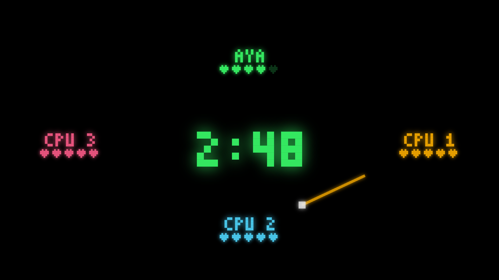
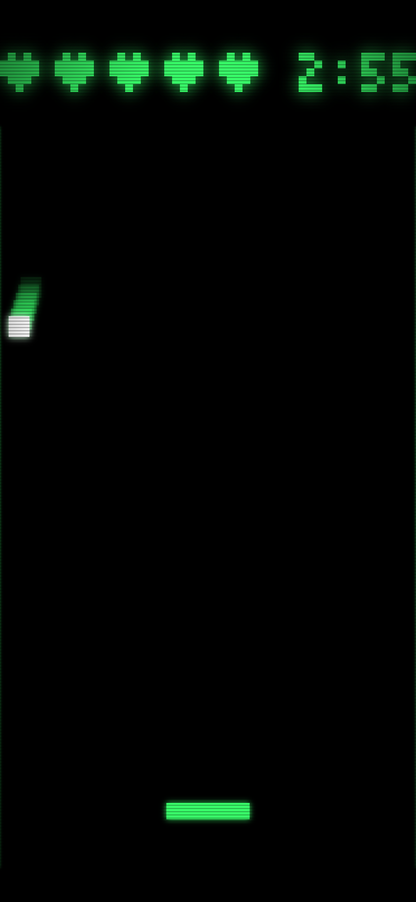

# AI時代こそ、抽象化が重要になる

*コーディングエージェントとohraでマルチプレイヤーゲームを開発して分かったこと*

[English](abstractions-for-ai.md)

## AIがコードを書くなら、ライブラリは必要なくなるのか？

ライブラリやフレームワークは、開発者が複雑な処理を毎回実装しなくて済むように作られてきました。

例えば並行処理です。複数の処理が同じ状態を変更する場合、競合状態やデッドロック、タスクのキャンセル、リソースの解放など、注意しなければならないことが数多くあります。

Actorモデルは、こうした問題を扱うための抽象化の一つです。

では、AIがコードを書くようになった今、こうした抽象化にはどれほどの価値があるのでしょうか。

AIが必要なコードをすべて生成できるなら、ライブラリを使う必要はないのでしょうか。

今回、Python向けActorライブラリの **ohra** を使い、Claude Codeにマルチプレイヤーゲームを開発させてみました。

設計から実装、テスト、別のエージェントによるレビュー、修正、`main`へのマージまでを1セッションで行っています。

その結果、興味深いことが分かりました。

**ゲームのルールやブラウザ側にはいくつものバグが見つかりましたが、Actorモデルが扱う並行処理については、レビューでバグが見つからなかったのです。**

AIが並行処理を完璧に実装したからではありません。

**ohraが並行処理の複雑さを吸収していたため、AIはその部分を自分で実装する必要がなかったのです。**

## 開発したゲーム「Relay Rally」

[Relay Rally](../../examples/fastapi_relay_rally.py) は、複数人がスマートフォンを使って遊ぶパーティーゲームです。

大きな画面に表示されたQRコードを読み取ると、各自のスマートフォンがゲームのコートになります。

画面上からパックが落ちてくるので、プレイヤーは画面下のパドルで打ち返します。打ち返されたパックは0.6秒後に別のプレイヤーのスマートフォンに現れます。

取り逃すとライフが1つ減り、3分後に最も多くのライフを残した人が勝者になります。

大画面にはスコア、残り時間、プレイヤー間を移動するパックの軌跡が表示されます。

<p align="center">
  
  
</p>

このゲームには、技術的に重要な仕組みが二つあります。

### 1. 複数端末の時計を同期する

ゲーム中、サーバーはパックの座標を連続して配信しません。

代わりに、「サーバー時刻の何秒に、どの位置から、どの速度でパックが入ってくるか」という情報を一度だけ送ります。

各端末はサーバーとの時刻のずれを補正し、自分でパックを描画します。

これにより、端末ごとに異なるタイミングでメッセージを受け取っても、共通の時間軸でゲームを進められます。

この仕組みには、ohraのFastAPI拡張に追加した `synced()` と `clock.js` を使っています。

詳しくは[第9章](../book/09-fastapi.md#devices-on-one-clock)で説明しています。

### 2. ゲーム全体の状態を一つのActorで管理する

ゲームの中心となるのは、`rally` というActorです。

このActorが、プレイヤー、ライフ、パックの移動、ゲームの制限時間、応答が途絶えたプレイヤーの監視を管理します。

スマートフォンと大画面には、それぞれ専用のActorが割り当てられます。

WebSocketから届いたフレームはメッセージとして `rally` に送られ、`rally` からのメッセージはWebSocketのフレームに変換されます。

さらに、コンピュータープレイヤーもActorとして実装しました。

CPUプレイヤーはWebSocketを持ちませんが、人間のプレイヤーと同じメッセージを受け取り、同じ形式で応答します。

そのため、ゲーム本体は相手が人間なのかCPUなのかを区別する必要がありません。

一人でも、CPUだけでもゲームを進められます。

ゲーム本体のActorは約200行。HTML、JavaScript、テストを含むサンプル全体でも約1,800行です。

## バグはどこで発生したのか？

最初のエージェントが実装を終えた後、開発時の文脈を共有していない別のエージェントに、仕様とコードを照合するレビューを依頼しました。

開発中に見つかった問題も含め、バグを分類すると次のようになりました。

| 分類 | 発見された問題 |
|---|---|
| ブラウザ | HTTP環境で `crypto.randomUUID` が使えず、実機のスマートフォンが参加できない。ほかに途中参加時の表示とオフライン時の動作に問題 |
| ゲームのルール | 遅れて届いたパスの報告による不公平な失点、終了時刻のずれ、プレイヤー名や色の重複 |
| ohraの拡張 | 新しい `synced()` が既存のWebSocketの動作保証を破っていた |
| Actorの並行処理 | **レビューでは問題が見つからなかった** |

特に注目したいのは最後の項目です。

このゲームでは、さまざまなイベントが予測できないタイミングで発生します。

スマートフォンからの操作、タイマーの発火、通信の切断、再接続、応答が途絶えたプレイヤーの検出などです。

これらはすべてゲームの状態に影響します。

通常の `asyncio` で実装する場合、複数のコルーチンが `await` を挟んで実行されるため、状態の整合性を慎重に管理する必要があります。

例えば、ゲームが終了した後に古いタイマーが発火したり、キャンセルしたタスクが処理を続けたりする可能性があります。

今回のレビューでは、こうした問題を具体的に検証しました。

すでに次のプレイヤーへ移動したパックに対する古い操作、同じプレイヤーによる複数タブでの接続、STARTボタンの二重操作、プレイヤーが一人を残して全員退出するケースなどです。

これらについて、並行処理に起因する問題は確認されませんでした。

### なぜ並行処理のバグが見つからなかったのか？

理由はActorモデルにあります。

`rally` は受け取ったメッセージを一つずつ処理します。そのため、通常のメッセージ処理では、複数のイベントが同時にActorの内部状態を書き換えることはありません。

状態を保護するためのロックも必要ありません。

タイマーもActorへのメッセージとして扱われます。同じキーでタイマーを再設定すると古いタイマーはキャンセルされ、キャンセル済みのタイマーメッセージも適切に処理されます。

WebSocketの切断もメッセージとして通知されます。

さらに、ゲーム本体はWebSocketへの送信完了を直接待ちません。通信の遅い端末があっても、ゲーム全体の進行を止めず、必要に応じてその接続を切断できます。

つまり、**AIが実装したのはゲームのルールであり、並行処理に関する保証を提供したのはohraだった**ということです。

もちろん、今回バグが見つからなかったからといって、バグが存在しないと証明されたわけではありません。

それでも、発見された問題がブラウザの制約やゲームの仕様に集中していたことは、注目に値します。

## 最も重要なバグは、ohra自体を変更したときに発生した

今回の開発で、最も興味深かったのは `synced()` の実装で発生した問題です。

最初の実装では、WebSocketとアプリケーションのActorの間に、時計同期を担当する中間Actorを置いていました。

一見すると問題のない設計です。実際に動作し、当初のテストも通っていました。

しかし、ohraのWebSocket拡張には、明文化された重要な保証があります。

**WebSocketが閉じられても、Actorはすでに受信したフレームを処理してから終了する。**

中間Actorを挟んだことで、この保証が破られていました。

WebSocketが閉じられると、中間Actorの終了に伴ってアプリケーション側のActorも停止されます。その際、メールボックスに残っていたフレームが処理されずに失われる可能性がありました。

レビュアーは、この問題を再現しました。

処理の遅いActorに20個のフレームを送信したところ、通常の `websocket()` では20個すべてが処理されたのに対し、最初の `synced()` では1個しか処理されませんでした。

AIは、この動作保証を理解しないまま実装を変更していたのです。

しかし、ohraにはその保証がドキュメントとして記載され、`test_frames_the_actor_already_has_are_handled_when_the_client_closes` というテストでも検証されていました。

そのため、問題を明確に特定できました。

修正では、中間Actorを廃止し、WebSocketのラッパー自身が時計同期のpingに応答する構造へ変更しました。

そして、問題を再現するテストが修正前には失敗し、修正後には成功することを確認しました。

ここには重要な違いがあります。

**AIが抽象化を利用する場合と、抽象化そのものを変更する場合では、求められる理解の深さが異なります。**

既存のライブラリを利用している間は、その保証に従ってコードを書けばよいのですが、ライブラリ自体を変更する場合は、既存の保証を壊さないようにする必要があります。

そのためには、仕様が明文化され、テストで検証できることが重要になります。

## AIによる開発では、テストキットの価値も大きい

今回、もう一つ効果的だったのが、ohraのテストキットです。

Relay Rallyは3分間のゲームですが、テストのたびに実際の3分間を待つ必要はありません。

ohraには、テスト側から時間を進められるManualTimeがあります。

```python
async with ActorTestKit(manual_time=True) as kit:
    manual = ManualTime(kit.system)
    rally = kit.spawn(rr.rally(clock=lambda: manual.scheduler.current_time))
    ...
    await manual.time_passes(180.0)
```

このように、仮想的な時間を180秒進めるだけで、ゲーム終了までの動作を検証できます。

今回作成した43個のテストでは、次のようなケースを検証しています。

- パックを取り逃したときのライフ減少
- 制限時間によるゲーム終了
- CPUプレイヤー3人だけのゲーム
- 応答しないスマートフォンに対するウォッチドッグの処理
- ゲーム中に切断したプレイヤーの再接続とライフの維持
- 参加上限を超えた9人目のプレイヤーの拒否

これらを含むテスト全体は約6秒で終了します。そのうち約2秒は、意図的に実時間を待つ処理です。

特に役立ったのが、ゲーム終了時刻に関するバグの修正でした。

時計にわずかなずれがあると、表示が0:00になってもゲームが終了しない場合があるとレビュアーが指摘しました。

そこでAIは、その条件を再現するテストを追加しました。

修正前に失敗することを確認し、コードを修正した後に成功することを検証しています。

時間に依存するバグは、コードを読むだけでは見逃しやすいものです。

しかし、時間そのものを制御できれば、再現可能なテストになります。

これは人間の開発者にとっても便利ですが、AIのコーディングエージェントにとっては特に重要です。

AIが実際にゲームを遊んで問題を確認するよりも、テストを実行して結果を評価する方がはるかに容易だからです。

**抽象化は実装を簡単にするだけでなく、検証そのものを簡単にすることもできます。**

## Actorモデルだけですべてが解決するわけではない

今回の結果は、ohraを使えばAIがバグのないアプリケーションを作れるという意味ではありません。

実際、ブラウザ側の実装やゲームのルールには、いくつもの問題が見つかりました。

HTTP環境で利用できないAPIを使ってしまう問題も、ゲームの公平性に関する問題も、Actorモデルでは防げません。

時計同期の仕組みも、Actorモデルそのものとは独立しています。pingとpong、約60行のJavaScriptがあれば、ほかのサーバーでも利用できます。

また、ohraは新しいライブラリなので、AIが事前にそのAPIや動作を十分知っていたわけではありません。

タイマー、切断の通知、テストキットなどについては、エージェントが実際にソースコードを読んで理解する必要がありました。

さらに、今回の結果は比較実験ではありません。

同じゲームをohraを使わずに `asyncio` だけで実装した場合、ロックやタスクのキャンセル、切断処理などによってコード量が30〜50%増え、タイミングに関するバグも増えるのではないかと見積もっています。

ただし、これは実測値ではありません。

厳密に比較するには、同じ仕様のゲームをohraなしで実装し、コード量、実装時間、発生したバグを比較する必要があります。

## AI時代のライブラリ設計で重要になること

今回の経験から、AIがコードを書く時代には、ライブラリの設計で次の点がますます重要になると感じました。

**動作保証を明文化すること。**

単にAPIの使い方を説明するだけでなく、何が保証され、何が保証されないのかを明確にする必要があります。

今回のWebSocketの問題も、終了時のフレーム処理について保証が書かれていたからこそ発見できました。

**保証をテストで検証できること。**

仕様を文章で説明するだけでは不十分です。その仕様が守られているかを、自動テストで確認できることが重要です。

テストには、何を保証しているのかが分かる名前を付けるべきでしょう。

**時間や非同期処理を制御できるテスト環境を用意すること。**

非同期処理の不具合は再現が難しくなりがちです。時間を制御できるテストキットがあれば、複雑なタイミングの問題も繰り返し検証できます。

**APIを小さく、振る舞いを明確にすること。**

AIがライブラリを正しく利用するために、必ずしも大量のドキュメントが必要なわけではありません。

今回、`websocket()` の動作を理解するために必要だったのは、明確なdocstringと関連するテストでした。

むしろ、実際には保証できないことまでAPIの仕様として書いてしまう方が危険です。AIはその説明を前提としてコードを生成するからです。

## 結論：AIに何を書かせないかが重要になる

AIのコーディング能力が向上すれば、これまで人間が時間をかけて書いていたコードの多くを生成できるようになります。

しかし、それは複雑な問題がなくなることを意味しません。

並行処理、状態管理、タイマー、障害処理など、システムが正しく動作するために必要な仕組みは依然として存在します。

AIにそのすべてを毎回実装させることもできますが、十分にテストされたライブラリに任せる方が合理的な場合もあります。

今回のRelay Rallyでは、AIはゲームのルールや画面の実装に集中できました。

並行処理に関する多くの問題は、ohraがすでに解決していたからです。

そして、AIがその抽象化自体を変更したときには、明文化された仕様とテストが問題の発見に役立ちました。

抽象化はもともと、複雑な処理を何度も実装しなくて済むようにするためのものです。

**コードを書く主体が人間からAIに変わっても、その価値は失われません。むしろ、AIが生成するコードの量が増えるほど、信頼できる抽象化の重要性は高まるのではないでしょうか。**

---

ゲームの実装：[examples/fastapi_relay_rally.py](../../examples/fastapi_relay_rally.py)

時計同期の仕組み：[第9章](../book/09-fastapi.md#devices-on-one-clock)

テストキット：[第12章](../book/12-testing.md)
