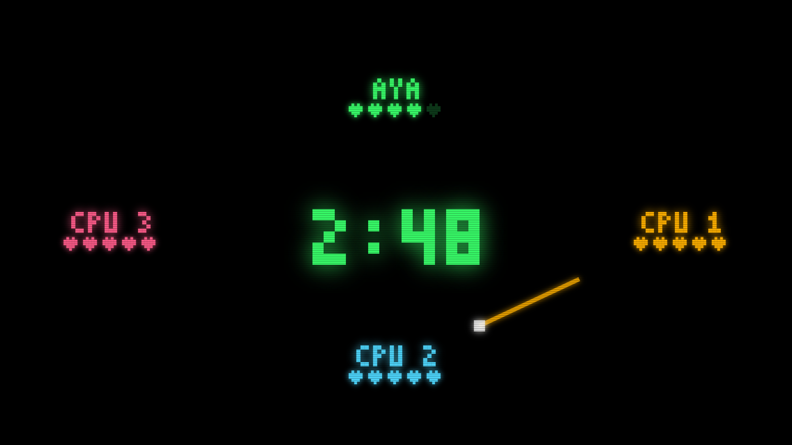
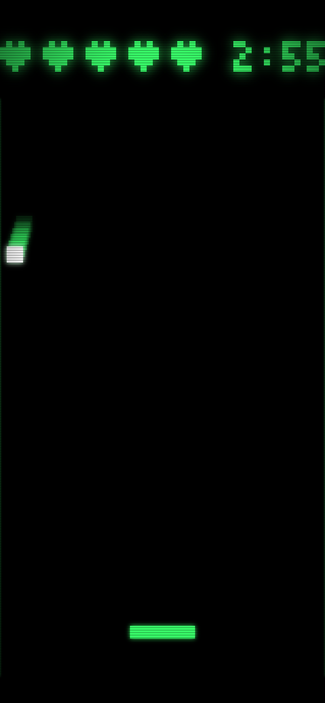

# Abstractions Matter Even More When AI Writes the Code

*What building a multiplayer game with Claude Code and ohra taught us about library design*

[日本語](abstractions-for-ai.ja.md)

## If AI writes the code, do we still need libraries?

Libraries and frameworks have traditionally been justified by the work they save developers. They reduce repetitive code, provide useful programming models, and help prevent common mistakes.

But increasingly, the code using these libraries is written by AI coding agents.

If an AI can generate the implementation, does it still make sense to rely on an abstraction?

To explore this question, we used Claude Code to build a multiplayer game with **ohra**, a Python actor library.

In a single session, the agent completed the design, specification, planning, implementation, and testing. A second agent independently reviewed the code, after which the issues were fixed and the changes merged into `main`.

We recorded the bugs found during development and review.

The result was interesting: **several bugs appeared in the browser code and game rules, but the review found no concurrency bugs in the actor code.**

Not because the agent had written flawless concurrency code.

**It was because ohra had already handled much of the concurrency complexity. The agent did not need to implement those mechanisms itself.**

## The game: Relay Rally

[Relay Rally](../../examples/fastapi_relay_rally.py) is a multiplayer party game played using smartphones and a shared display.

Players scan a QR code on the large screen. Each phone becomes a small court with a paddle at the bottom.

A puck drops into one player's court. When the player hits it, the puck leaves the top of the screen and appears on another randomly selected player's phone 0.6 seconds later.

Missing the puck costs one of five lives. After three minutes, the player with the most remaining lives wins.

The shared display shows the scoreboard, remaining time, player lives, and animated streaks representing passes between players.

<p align="center">
  
  
</p>

Two mechanisms are central to the implementation.

### Synchronizing multiple devices

The server does not continuously stream the puck's position.

Instead, it sends a single message describing when and where the puck enters a court, along with its velocity.

Each device translates the server timestamp into its local clock and renders the movement independently.

This uses `synced()` and `clock.js`, newly added to `ohra.ext.fastapi`.

The implementation is described in [chapter 9](../book/09-fastapi.md#devices-on-one-clock).

### One actor owns the game state

The game is managed by a single actor named `rally`.

It owns the players, remaining lives, puck state, three-minute timer, and watchdog.

Each phone and the shared display gets its own actor. These actors translate incoming WebSocket frames into messages for `rally`, and outgoing actor messages into WebSocket frames.

Computer-controlled players use the same messaging interface.

A CPU player has no WebSocket connection, but receives the same messages as a phone and responds in the same way, at the appropriate time.

As a result, `rally` does not need separate game logic for human and computer players. It only needs to manage their participation.

The game actor itself is approximately 200 lines of code. The complete example, including browser pages and tests, is approximately 1,800 lines.

## Where the bugs appeared

After implementation, a second coding agent reviewed the entire branch against the specification, without sharing the original agent's development context.

We combined its findings with the problems discovered during implementation.

| Area | Problems found |
|---|---|
| Browser code | `crypto.randomUUID` was unavailable over plain HTTP on the LAN, preventing real phones from joining. Two smaller problems affected what late joiners saw and whether the shared display worked offline. |
| Game rules | Delayed pass reports could unfairly cost another player a life. Small clock discrepancies could prevent the game from ending at 0:00. Player names and colors could be assigned more than once. |
| ohra extension | The first implementation of `synced()` violated an existing WebSocket guarantee. |
| Concurrency in the actor code | **No bugs found.** |

The final row is the important one.

This game receives events at unpredictable times: player actions, timer expirations, watchdog notifications, disconnections, and reconnections.

All of them can affect the same game state.

In a conventional `asyncio` implementation, these interactions require careful handling.

Two coroutines might interleave at an `await`. A timer might fire after its game has ended. A cancelled task might continue running. A slow WebSocket connection might delay the entire game if the game logic directly awaits network I/O.

The reviewer specifically examined scenarios such as delayed reports for a puck that had already been served again, a player opening two tabs, pressing START twice, and all but one player leaving.

No concurrency defects were found in those cases.

### Why?

Because the actor model already provides the relevant guarantees.

The `rally` actor processes messages sequentially. Its internal state is therefore not modified concurrently by multiple message handlers, and the game does not need locks to protect that state.

Timers also deliver messages. Starting a new timer with an existing key cancels the previous timer, and messages from cancelled timers are discarded even if they were already waiting in the mailbox.

A closed WebSocket also arrives as a message.

The game actor never directly awaits a WebSocket send. A slow client is disconnected without blocking the game for everyone else.

**The agent implemented the game rules. ohra provided the concurrency guarantees.**

This does not prove that the implementation contains no concurrency bugs. It is one project, and a review can only establish what it found.

Nevertheless, the distinction is meaningful.

The bugs that appeared were primarily about browser behavior, game fairness, and user experience—problems that an actor library cannot solve.

## The most revealing failure happened when the agent modified ohra

The most instructive bug appeared not when the agent used ohra, but when it extended the library.

The initial implementation of `synced()` introduced an intermediate actor between `websocket()` and the application's actor.

This intermediate actor handled clock synchronization messages.

The design worked, and its initial tests passed.

However, ohra's WebSocket integration documents an important guarantee:

**When a WebSocket closes, its actor processes frames it has already received before stopping.**

The intermediate actor broke that guarantee.

When the socket closed, the intermediate actor stopped. Stopping the parent also stopped its child actor, potentially before the child had processed all messages in its mailbox.

As a result, frames that had already been received could be lost.

The reviewer reproduced the problem using a deliberately slow handler and 20 incoming frames.

With the original `websocket()`, all 20 frames were processed.

With the first version of `synced()`, only one was processed.

The agent had introduced a regression because it did not know that this guarantee existed.

Fortunately, the guarantee was explicitly documented and covered by tests, including:

`test_frames_the_actor_already_has_are_handled_when_the_client_closes`

That gave the reviewer a concrete contract to verify and the implementing agent a precise target for the fix.

A regression test reproduced the failure in the old implementation.

The implementation was then changed so that the WebSocket wrapper itself handled clock synchronization pings, removing the intermediate actor.

The same test passed after the change.

This illustrates an important distinction.

**Using a well-defined abstraction requires understanding its interface. Modifying the abstraction requires preserving every guarantee that interface provides.**

The agent could use ohra successfully without understanding all its internals.

But when it changed those internals, the documented contract and regression tests became essential.

## A test kit makes the difference between reasoning and verification

Another important part of the experiment was ohra's testing infrastructure.

Relay Rally is a three-minute game. Testing its behavior should not require waiting three minutes or asking someone to play after every code change.

ohra provides manual time through `ActorTestKit`.

```python
async with ActorTestKit(manual_time=True) as kit:
    manual = ManualTime(kit.system)
    rally = kit.spawn(rr.rally(clock=lambda: manual.scheduler.current_time))
    ...
    await manual.time_passes(180.0)
```

The test controls the clock, and scheduled timers fire as virtual time advances.

This allows the entire game to be simulated without waiting for three real minutes.

The example contains 43 tests covering scenarios such as missed pucks, time expiration, games with only CPU players, watchdog recovery after a silent client, reconnection with lives preserved, and rejection of a ninth player.

The tests complete in approximately six seconds, including two seconds of intentional real-time waiting.

This capability proved particularly useful when the reviewer identified a possible clock discrepancy.

Under certain conditions, the displayed timer could reach 0:00 without the game actually ending.

The agent reproduced the discrepancy with a test, confirmed the failure, corrected the implementation, and verified that the test passed.

That is the difference between reasoning that a timing problem might exist and demonstrating it.

Human developers benefit from deterministic tests, too. But for coding agents, the value is especially significant.

An agent can run a test and inspect its result far more easily than it can observe and evaluate an interactive game in real time.

**A good abstraction does more than simplify implementation. It can also make behavior easier to verify.**

## What the abstraction does not solve

This experiment does not mean that using an actor library makes AI-generated applications automatically correct.

There are important limitations.

### Problems outside the actor model

Browser compatibility, game physics, user interface behavior, and the rules of fair play still require application-specific implementation and testing.

The actor model cannot prevent an agent from using a browser API unavailable in the target environment.

Nor can it determine whether a delayed pass should count against another player.

Clock synchronization is also independent of the actor model. Its ping-pong mechanism and approximately 60 lines of JavaScript could work with another server implementation.

### Familiarity with the library

ohra is a relatively new library and is unlikely to be well represented in a coding agent's training data.

The agent therefore had to inspect the source code to understand its timers, termination, and the test kit.

With a widely used framework, some of that knowledge might already have been available.

However, the fact that the agent could learn these behaviors from the source, documentation, and tests is itself relevant to library design.

### No controlled comparison yet

We estimate that implementing the same server using plain `asyncio` could require 30–50% more code, largely for task management, cancellation, connection handling, and state coordination.

We also expect that some timing-related defects would become harder to detect.

But these are estimates, not experimental results.

A meaningful comparison would require implementing the same specification without ohra and measuring code size, development effort, and defects.

That would be a useful follow-up experiment.

## What this means for library authors

This experience does not suggest that libraries need an entirely new design philosophy for AI.

Instead, it reinforces several established engineering practices.

### Document behavioral guarantees

Documentation should explain not only how to call an API, but what behavior the API guarantees.

The WebSocket regression was discovered because frame processing during shutdown was part of an explicit contract.

Without that contract, the loss of messages might have gone unnoticed.

### Turn guarantees into named tests

A documented promise becomes much more useful when a test verifies it.

Tests with descriptive names make the intended behavior discoverable and provide a concrete safeguard against regressions.

This matters whether the next change is made by a human developer or a coding agent.

### Provide tools for deterministic testing

Concurrency and time-dependent behavior are difficult to verify through observation alone.

A test kit that controls time, scheduling, and message delivery allows developers and agents to reproduce scenarios that would otherwise be difficult or expensive to test.

### Keep interfaces small and their contracts precise

A coding agent does not necessarily need extensive documentation to use a library correctly.

For `websocket()`, a clear docstring and a relevant test file provided the essential information.

But the documentation must be accurate.

An abstraction that promises behavior it cannot guarantee is dangerous, especially when an agent confidently generates code based on that promise.

## Conclusion: What matters is what the AI does not have to implement

As coding agents improve, more application code will be generated automatically.

But generating code does not eliminate the underlying complexity of software systems.

Concurrency, state management, cancellation, failure handling, and resource lifecycles remain difficult problems.

An agent could attempt to implement these mechanisms from scratch for every application.

Or it could rely on a well-tested abstraction that already provides the necessary guarantees.

In Relay Rally, the agent could concentrate on implementing the game itself because ohra handled much of the concurrency machinery.

When the agent modified that machinery, the library's documented contracts and tests helped detect a regression.

That is the central lesson of this experiment.

**The value of an abstraction is not just the code it saves someone from writing. It is also the complexity that no longer needs to be implemented, reviewed, and debugged in every application.**

That remains true whether the developer writing the application is a person or an AI coding agent.

And as the amount of AI-generated code grows, reliable abstractions may become more valuable, not less.

---

The game: [examples/fastapi_relay_rally.py](../../examples/fastapi_relay_rally.py)

Clock synchronization: [chapter 9](../book/09-fastapi.md#devices-on-one-clock)

Testing with manual time: [chapter 12](../book/12-testing.md)
