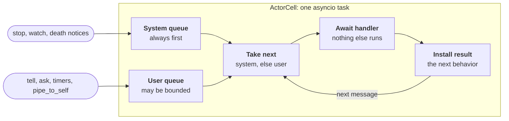

# 1. Actors

An actor is an `ActorCell` running one asyncio task. The task loops forever: take the next message, hand it to the current behavior, install the behavior the handler returns. It waits on a future when both of its queues are empty, and a send wakes it.



- **Two queues.** The system queue holds stop, watch and death notifications, and always goes first. The user queue holds ordinary messages and may be bounded, dropping new or old messages or raising when full.
- **Serialized across awaits.** The loop awaits the handler before it takes the next message. A handler can await I/O and no other message runs in between. That is why actors are useful on a single event loop.
- **Behaviors are values.** A handler returns the next behavior: itself with new state, `Behaviors.same`, or `Behaviors.stopped()`. State lives in a closure or a factory parameter, so `counter(n + 1)` is the whole state change. `setup`, `with_timers` and `with_stash` run once when the behavior is started.
- **The ref is the only handle.** `ctx.self` is a `LocalRef` whose `tell` appends to the cell's queue. A message adapter or `pipe_to_self` also lands in the user queue, so their results are serialized with everything else.

## Messages and behaviors

Messages are frozen dataclasses, a command protocol is a union, and a handler dispatches with `match`. A handler returns the next behavior: a new one carrying new state, `Behaviors.same`, `Behaviors.stopped()`, or `Behaviors.unhandled`. Handlers may be `async def`; an awaiting handler keeps the actor busy, and the next message waits.

`Behaviors.setup`, `receive`, `receive_message` and `receive_signal` each take one function and return a behavior, so they work as decorators. The decorator form and the call form are the same thing and can be mixed freely: `@Behaviors.receive_message` above `def on_message` is `Behaviors.receive_message(on_message)`. The decorator form is new in ohra, since Apache Pekko has no equivalent; the snippets below and the examples use it. `setup` runs once per actor and is where per-actor state and children are created. `receive` is `receive_message` with the context.

## Ask and reply

A request carries its own `reply_to`. From outside the system, `ask` returns the reply or raises `AskTimeoutError`. From inside an actor, `ctx.ask` delivers the reply to the asking actor as a message, wrapped in `Success` or `Failure`.

```python
from ohra import ActorContext, Failure, Success, Try


@dataclass(frozen=True)
class Fetch:
    url: str
    reply_to: ActorRef[str]


@dataclass(frozen=True)
class Fetched:
    result: Try[str]


def client(fetcher: ActorRef[Fetch]) -> Behavior[Fetched | str]:
    @Behaviors.receive
    def on_message(
        ctx: ActorContext[Fetched | str], msg: Fetched | str
    ) -> Behavior[Fetched | str]:
        match msg:
            case str(url):
                ctx.ask(fetcher, lambda r: Fetch(url, r), Fetched, timeout=2)
            case Fetched(result):
                match result:
                    case Success(body):
                        ctx.log.info("got %d bytes", len(body))
                    case Failure(e):
                        ctx.log.warning("fetch failed: %r", e)
        return Behaviors.same

    return on_message
```

The `make` argument is anything that turns a reply ref into the request: a lambda, or the message class itself when `reply_to` is its only field. Pyright infers the reply type from the request's `reply_to` field.

`ctx.pipe_to_self(awaitable, adapt)` does the same for any awaitable, and `ctx.message_adapter(f)` gives you a ref of another type that translates into your own protocol.

## Children, stopping, and DeathWatch

`ctx.spawn(behavior, name)` and `ctx.spawn_anonymous(behavior)` create children. `ctx.stop(child)` stops one. Stopping a parent stops its subtree first, then delivers `PostStop`. `ctx.watch(ref)` delivers a `Terminated` signal when that actor stops, or `ChildFailed` if it was a child that failed. Leaving `Terminated` unhandled fails the watcher with `DeathPactError`, as in Pekko.

```python
from ohra import Signal, Terminated


@Behaviors.setup
def parent(ctx: ActorContext[str]) -> Behavior[str]:
    worker = ctx.spawn(counter(), "worker")
    ctx.watch(worker)

    @Behaviors.receive_signal
    def on_signal(ctx: ActorContext[str], sig: Signal) -> Behavior[str]:
        if isinstance(sig, Terminated):
            ctx.log.info("%s stopped", sig.ref.path)
            return Behaviors.stopped()
        return Behaviors.unhandled

    return on_signal
```

To create actors from plain async code, run `SpawnProtocol.apply()` as the guardian and ask it: `await system.ask(lambda r: SpawnProtocol.Spawn(behavior, "name", r), timeout=1)`.

The stop order is fixed, and nothing awaits after the third step:

1. Stop the children and wait for every one to finish.
2. Signal `PostStop` to the last running behavior, then run the `stopped()` callback.
3. Mark the cell terminated.
4. Turn the pending user messages into dead letters.
5. Notify every watcher and the parent with `Terminated`, or `ChildFailed` if it failed.

Timers and background tasks are cancelled at the start of the stop, so nothing outlives the actor. The test suite fails any test that leaves an asyncio task behind.

## Supervision

A failing handler stops the actor unless a supervisor says otherwise. `resume` keeps the state and drops the message. `restart` reruns the supervised behavior from its `setup`, stopping children first. `restart_with_backoff` waits with exponential delay and stashes messages meanwhile, which is the right choice for a `setup` that can fail.

```python
from ohra import SupervisorStrategy

resilient = Behaviors.supervise(counter()).on_failure(
    SupervisorStrategy.restart().with_limit(3, within=10.0), exc_type=ValueError
)
```

`PreRestart` is signalled before a restart. Both restart strategies cancel the actor's timers first, so timers started in the supervised `setup` come back and timers started from a handler do not.

## Timers and stash

`ctx.timers` is the actor's `TimerScheduler`. Starting a timer with a key already in use cancels the old one, and a message from a cancelled timer that already reached the mailbox is dropped. A `StashBuffer` holds messages for later; `buffer.unstash_all(behavior)` replays them before any new one. One `setup` is enough to wire timers, a stash and state:

```python
from ohra import ActorContext, StashBuffer


@dataclass(frozen=True)
class Tick:
    pass


@dataclass(frozen=True)
class Ready:
    pass


type Cmd = Tick | Ready | str


@Behaviors.setup
def gated(ctx: ActorContext[Cmd]) -> Behavior[Cmd]:
    ctx.timers.start_timer_with_fixed_delay("tick", Tick(), 1.0)
    buffer = StashBuffer[Cmd](1000)

    @Behaviors.receive_message
    def active(msg: Cmd) -> Behavior[Cmd]:
        print(msg)
        return Behaviors.same

    @Behaviors.receive_message
    def waiting(msg: Cmd) -> Behavior[Cmd]:
        match msg:
            case Ready():
                return buffer.unstash_all(active)
            case Tick():
                return Behaviors.same
            case _:
                buffer.stash(msg)
                return Behaviors.same

    return waiting
```

The Apache Pekko spelling, `Behaviors.with_timers(factory)` and `Behaviors.with_stash(capacity, factory)`, works too and is what the ported examples use.

## Routers, batching, and bounded mailboxes

`Routers.pool(n, behavior)` spawns `n` routees and forwards each message by round robin, at random, or by `with_consistent_hashing_routing(key)` so that equal keys reach the same routee. `batching(max_n, max_wait, handle)` is a behavior that collects messages and hands them to `handle` in batches, which is where `np.add.at` earns its keep. `MailboxSelector.bounded(capacity, overflow=...)` passed to `spawn` bounds a mailbox and drops the new message, drops the oldest, or raises in the sender. A producer that can await should use `await ref.offer(msg)` instead of `tell`: on a full mailbox it waits for room, so a slow consumer slows the producer and nothing is lost. `tell` never waits, so it stays usable from callbacks and timers.

## Runtime model

- One asyncio task per actor. System messages (stop, watch, death notifications, backoff timers) are processed before user messages.
- A behavior is a value, and one value can start many actors (`Routers.pool`, or spawning it twice). Anything captured in its closure is then shared by all of them. Create per-actor state inside `Behaviors.setup`, `with_timers` or `with_stash`, which run once per actor.
- A handler that awaits keeps the actor busy. Messages are serialized across awaits, which is the main reason to use actors on a single event loop. `test_async_handler_keeps_messages_serialized` pins this down.
- Stopping an actor stops its children first (depth-first), then delivers `PostStop` to the last running behavior, then runs the `Behaviors.stopped(callback)` callback, then notifies watchers and the parent. Pending user messages become dead letters (logger `ohra.dead_letters`).
- There is one `TimerScheduler` per actor, and a `restart` or `restart_with_backoff` cancels all of its timers before `PreRestart`, as Pekko's `RestartSupervisor` does. `resume` leaves them running.
- Background work started with `pipe_to_self` is cancelled when the actor stops. Every test asserts that no asyncio task outlives the system.
- Timer messages are validated when dequeued, so a message from a timer that was cancelled or restarted while it sat in the mailbox is dropped. `unstash_all` replays the stashed messages inside the current message's turn, before any new message.
- An idle actor costs about 3.5KB and 40µs to spawn. A busy actor handles over a million trivial messages a second; waking an idle one costs an asyncio task switch, about 16µs, which is what `batching` amortizes. 100k actors fit, but `examples/population.py` shows why 16 shard actors holding struct-of-arrays beat 100k single-arm actors by hundreds of times on memory and query time.

---

[Contents](README.md) · [The actor system →](02-actor-system.md)
