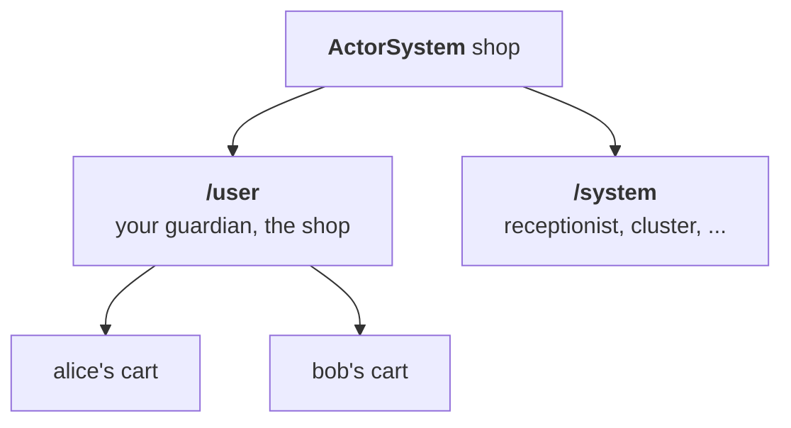

# 2. The actor system

## The problem

Chapter 1 had one cart. A shop has one per customer, created as customers arrive. Something has to start those actors, keep track of them, and, when the program stops, wind them down in an order that loses nothing: stop taking new requests, let the ones in progress finish, then stop. In plain asyncio, tasks are started wherever it is convenient, found through globals, and cancelled all at once on the way out.

## The idea

The **actor system** is the building the actors live in. The first actor is the one you hand to `ActorSystem(...)`, the **guardian**. Every other actor is started by an actor that is already running, as its **child**, so actors form a family tree, and each has a **path** in it, such as `ohra://shop/user/alice`. A parent is responsible for its children: stopping it stops them first.



The building comes with two services. The **receptionist** is the front desk: an actor registers under a name, a `ServiceKey`, and anyone can ask the desk who is registered under it. It matters most once actors live on several machines, in [chapter 5](05-cluster.md). **Coordinated shutdown** is closing time: a fixed checklist of phases, from "stop taking new customers" to "turn off the lights", and each part of the program adds its tasks to the phase where they belong.

## A first example

The shop is the guardian. Asked for a customer's cart, it starts one the first time and hands back the same one after that. It uses chapter 1's `cart.py`:

```python
import asyncio
from dataclasses import dataclass

from cart import AddItem, CartCmd, GetCart, cart
from ohra import ActorContext, ActorRef, ActorSystem, Behavior, Behaviors, CoordinatedShutdown, ask


@dataclass(frozen=True)
class CartFor:
    customer: str
    reply_to: ActorRef[ActorRef[CartCmd]]


def shop(carts: dict[str, ActorRef[CartCmd]]) -> Behavior[CartFor]:
    @Behaviors.receive
    def on_message(ctx: ActorContext[CartFor], msg: CartFor) -> Behavior[CartFor]:
        if msg.customer in carts:
            msg.reply_to.tell(carts[msg.customer])
            return Behaviors.same
        new_cart = ctx.spawn(cart({}), msg.customer)  # a child, named after the customer
        msg.reply_to.tell(new_cart)
        return shop({**carts, msg.customer: new_cart})

    return on_message


async def close_the_till() -> None:
    print("till closed")


async def main() -> None:
    async with ActorSystem(shop({}), "shop") as system:
        CoordinatedShutdown(system).add_task("service-unbind", "close-the-till", close_the_till)
        alice = await system.ask(lambda r: CartFor("alice", r), timeout=1)
        bob = await system.ask(lambda r: CartFor("bob", r), timeout=1)
        await ask(alice, lambda r: AddItem("book", 1, r), timeout=1)
        await ask(bob, lambda r: AddItem("pen", 2, r), timeout=1)
        print(alice.path, await ask(alice, GetCart, timeout=1))
        print(bob.path, await ask(bob, GetCart, timeout=1))
    print("shop closed")


if __name__ == "__main__":
    asyncio.run(main())
```

It prints:

```
ohra://shop/user/alice {'book': 1}
ohra://shop/user/bob {'pen': 2}
till closed
shop closed
```

- **`CartFor`** asks the shop for a customer's cart, and the answer is itself a ref, an `ActorRef[CartCmd]`. An address can travel in a message like any other value.
- **`shop(carts)`** keeps the carts it has started in its parameter, the same way the cart keeps its items. A known customer gets their cart back. A new one gets a new child, started with `ctx.spawn` and named after them.
- **After that, you talk to the cart directly.** The shop only hands out addresses; it is not in the path of every request.
- **The paths show the tree.** Both carts are children of the guardian, under `/user`.
- **`add_task("service-unbind", ...)`** puts a task on the closing checklist. Leaving the `async with` runs the checklist, which is why `till closed` prints before `shop closed`.

A parent handing out one actor per id is also what [sharding](07-sharding.md) does, spread over many machines.

> **Coming from Apache Pekko**
>
> - `ActorSystem(guardian, name)`, the `/user` and `/system` roots, and the system being a ref to the guardian are as in Pekko Typed.
> - `ctx.spawn(behavior, name)` is `context.spawn`. There are no `Props`: a mailbox is the third argument, `ctx.spawn(behavior, name, MailboxSelector.bounded(100))`.
> - Configuration is constructor arguments and settings dataclasses (`address=`, `cluster=`, `shutdown=`, `management=`) instead of HOCON. Extensions are reached as in Pekko: `Cluster(system)`, `Receptionist(system)`.
> - The receptionist has Pekko's `Register`, `Find`, `Subscribe` and `Listing`, but `Listing[T]` is a generic dataclass whose `service_instances` field replaces `serviceInstances(key)`.
> - CoordinatedShutdown has Pekko's twelve phases as a fixed list, without custom phases. The signal hook is opt-in (`run_on_signals`) where the JVM hook is on by default, and a task that outlives its phase is cancelled. [Appendix B](appendix-deviations.md) has the details.

## How it works

`ActorSystem(guardian, name)` creates two root cells. `/user` runs your guardian behavior, and the system itself is a ref to it. `/system` hosts the infrastructure: the receptionist, the cluster daemon, the split-brain resolver, singleton managers and sharding regions. Your actors and the machinery never share a parent, so stopping one tree does not tear the other mid-step.

**Extensions.** `Cluster(system)`, `ClusterSharding(system)`, `ClusterSingleton(system)`, `Receptionist(system)` and `Management(system)` each return the one instance for that system, as Pekko's extensions do. The constructor's arguments decide which exist: `address=` turns on remoting, `cluster=` the cluster, `management=` the management endpoint.

### Receptionist

Actors find each other through the Receptionist, Apache Pekko's service registry: a service registers under a `ServiceKey`, and anyone asks `Find` for the current refs under that key or `Subscribe`s to be sent a `Listing` now and after every change. Every system starts one; on a cluster node the registry is replicated, so a service registered on one node is found on the others as a `RemoteRef`. Entries follow their node: they vanish when the service stops or the member is removed, and while a node is unreachable its services drop from `service_instances` but stay in `all_service_instances`.

```python
import asyncio

from ohra import Find, Listing, Receptionist, Register, ServiceKey
from ohra.receptionist import Subscribe  # the cluster's Subscribe is the top-level one

GREETER = ServiceKey[Greet]("greeter")


@Behaviors.setup
def greeter_node(ctx: ActorContext[Listing[Greet]]) -> Behavior[Listing[Greet]]:
    Receptionist(ctx.system).ref.tell(Register(GREETER, ctx.spawn(greeter, "greeter")))
    # a Listing now, then one per change
    Receptionist(ctx.system).ref.tell(Subscribe(GREETER, ctx.self))

    @Behaviors.receive_message
    def on_listing(listing: Listing[Greet]) -> Behavior[Listing[Greet]]:
        print(sorted(r.path for r in listing.service_instances))
        return Behaviors.same

    return on_listing


def greeter_system(port: int) -> ActorSystem[Listing[Greet]]:
    seeds = (Address("app", "127.0.0.1", 2551),)
    return ActorSystem(
        greeter_node,
        "app",
        address=("127.0.0.1", port),
        cluster=ClusterSettings(seed_nodes=seeds),
    )


async def main() -> None:
    async with greeter_system(2551), greeter_system(2552) as second:
        while len(Cluster(second).state.members) < 2:  # wait until both nodes have joined
            await asyncio.sleep(0.1)
        listing = await ask(Receptionist(second).ref, lambda r: Find(GREETER, r), timeout=1)
        # one local ref, one RemoteRef to the greeter on the first node
        for ref in listing.service_instances:
            print(await ask(ref, lambda r: Greet("pekko", r), timeout=1))
```

Only local actors can register or subscribe, as in Pekko; the receptionist watches them, message adapters included. A `Find` may come from another node: `Listing` and the replies are `@remotable`. Replication is one versioned row per node, pushed to the other members on every change and re-sent every `receptionist_resend_interval`, instead of Pekko's distributed data; see the deviations.

### Coordinated shutdown

`terminate()` does not just stop the guardian. It runs Pekko's twelve phases in order, each with a timeout, and each layer adds its tasks to the phase where it belongs:

| Phase | Who adds work there |
| --- | --- |
| `before-service-unbind` to `service-stop` | your application, for example stop taking HTTP requests |
| `cluster-sharding-shutdown-region` | every sharding region hands off its shards |
| `cluster-leave` | the cluster sends Leave for this node |
| `cluster-exiting` | the cluster waits for Exiting; singletons hand over |
| `cluster-exiting-done`, `cluster-shutdown` | the cluster waits for removal and stops its daemon |
| `actor-system-terminate` | stops `/user`, then `/system`, then closes remoting |

The same sequence runs when a node is downed, when the guardian stops on its own, and, if you opt in with `run_on_signals`, on SIGTERM. A task that outlives its phase is cancelled and the run moves on, so a stuck hand-off cannot hold the process forever.

#### Using it

`ActorSystem.terminate()` runs Apache Pekko's CoordinatedShutdown: a fixed sequence of phases, each bounded by a timeout, to which you add tasks. On a cluster node the cluster adds its own: `cluster-sharding-shutdown-region` hands the node's shards off, `cluster-leave` sends `Leave`, `cluster-exiting` waits for the leader to move the node to Exiting and is where singletons hand over, `cluster-exiting-done` confirms the exit, `cluster-shutdown` waits for the cluster daemon, and `actor-system-terminate` stops the actors. The same run happens when another node sends `Leave` for this one, when this node is downed, and, if you opt in, on a signal.

```python
import signal

from ohra import CoordinatedShutdown, CoordinatedShutdownSettings


async def drain() -> None:
    await server.close()  # stop taking requests before the node leaves the cluster


async def main() -> None:
    system = ActorSystem(
        guardian,
        "app",
        shutdown=CoordinatedShutdownSettings(run_on_signals=(signal.SIGINT, signal.SIGTERM)),
    )
    CoordinatedShutdown(system).add_task("service-unbind", "stop-http", drain)
    # ctrl-c or SIGTERM runs the phases: user tasks, hand-offs, leave, stop
    await system.when_terminated()
```

The phases, in order: `before-service-unbind`, `service-unbind`, `service-requests-done`, `service-stop`, `before-cluster-shutdown`, `cluster-sharding-shutdown-region`, `cluster-leave`, `cluster-exiting`, `cluster-exiting-done`, `cluster-shutdown`, `before-actor-system-terminate`, `actor-system-terminate`. Tasks in one phase run concurrently; a task that fails is logged and the run continues, as Pekko's `recover = on`. A phase that outlives its timeout (`default_phase_timeout` 5 s; 10 s for the region, exiting and terminate phases; `phase_timeouts` overrides) is logged and its still-running tasks are cancelled, so a task must tolerate `CancelledError` at any await; Pekko lets such a task run on. `terminate()` returns at once, as Pekko's does: messages told after it may still be processed, so await `when_terminated()`. A guardian that stops on its own also runs the phases, after its actors are gone. `run(reason)` starts the run by hand; `shutdown_reason` says who did. A node that terminates while another member is unreachable and not downed waits out `cluster-exiting`, since the leader cannot move it to Exiting; the split-brain resolver below removes that wait.

---

[← Actors](01-actors.md) · [Contents](README.md) · [Persistence →](03-persistence.md)
