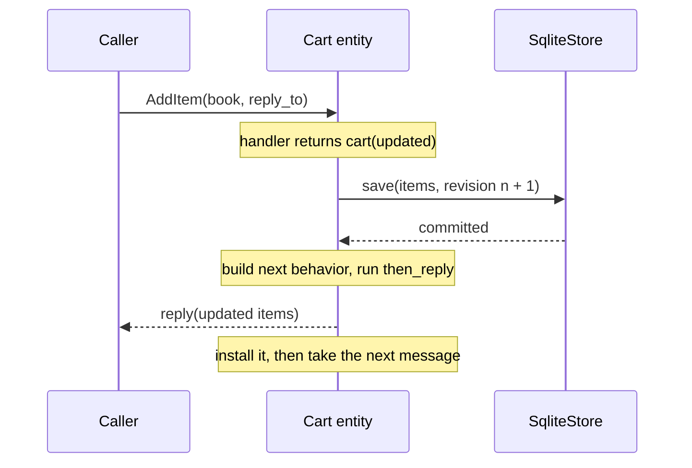

# 3. Persistence

## The problem

The cart lives in memory. Restart the program, for a deploy or after a crash, and every cart is empty. Saving to a database from the handler is the obvious fix, but the order matters. If the actor replies "added" and the save then fails, the customer has been told something that is not true. And if two copies of the same cart ever ran at once, say for a moment during a deploy, each would overwrite the other's saves without anyone noticing.

## The idea

Think of a shop assistant with a ledger. Each time a cart changes, they write its new contents on a fresh line before telling the customer "done". If the writing fails, they tell the customer nothing, and the customer can try again. When the shop reopens, they read the last line and carry on: one read, however long the ledger has grown. Every line is numbered, its **revision**, and the ledger takes only the next number, so if two assistants ever try to write line 8 for the same cart, the second is refused instead of quietly overwriting the first.

In ohra the ledger is a **store**, and `Behaviors.persisted(store)` makes a behavior keep one. It stores the latest state only, not the history of how the state came about.

## A first example

Chapter 1's cart, made durable. It uses the messages from `cart.py`:

```python
import asyncio

from cart import AddItem, CartCmd, GetCart
from ohra import ActorSystem, Behavior, Behaviors, SqliteStore

store = SqliteStore[dict[str, int]]("carts.db")


@Behaviors.persisted(store)
def cart(items: dict[str, int]) -> Behavior[CartCmd]:
    @Behaviors.receive_message
    def on_message(msg: CartCmd) -> Behavior[CartCmd]:
        match msg:
            case AddItem(sku, qty, reply_to):
                updated = {**items, sku: items.get(sku, 0) + qty}
                return cart(updated).then_reply(reply_to, updated)  # saved, then replied
            case GetCart(reply_to):
                reply_to.tell(items)  # a read: nothing is saved
                return Behaviors.same

    return on_message


async def main() -> None:
    async with ActorSystem(cart.recover("alice", empty={}), "shop") as system:
        print(await system.ask(lambda r: AddItem("book", 1, r), timeout=1))


if __name__ == "__main__":
    asyncio.run(main())
```

Run it twice and the cart remembers:

```
$ python durable_cart.py
{'book': 1}
$ python durable_cart.py
{'book': 2}
```

- **`SqliteStore`** keeps the states in a SQLite file, `carts.db`, using only the standard library. [`PostgresStore`](#a-cluster-postgresstore) does the same for a cluster.
- **`@Behaviors.persisted(store)`** makes the `cart` factory durable. The handler is chapter 1's: it returns `cart(updated)` with the new contents, and now returning it also saves them.
- **`.then_reply(reply_to, updated)`** sends the reply only once the save has succeeded. Chapter 1 called `reply_to.tell(...)` inside the handler; here that would reply before the save.
- **A read saves nothing.** `GetCart` returns `Behaviors.same`, so nothing changed and nothing is written.
- **`cart.recover("alice", empty={})`** starts the actor by loading alice's saved cart, or an empty one the first time. With [sharding](07-sharding.md), every customer's cart recovers this way under its own id.

> **Coming from Apache Pekko**
>
> - `Behaviors.persisted` is Pekko's `DurableStateBehavior`: the latest state, with the same revision check. There is no `EventSourcedBehavior`.
> - There is no command handler and no `Effect`: the handler returns the next behavior, as everywhere else. `Effect.persist(state).thenReply(replyTo)(_ => reply)` is `cart(state).then_reply(reply_to, reply)`, and `Effect.none` is `Behaviors.same`.
> - `persistenceId` and `emptyState` are the arguments of `recover(id, empty=...)`.
> - Stores replace plugins: `SqliteStore` for one host, and `PostgresStore`, with the JDBC plugin's `durable_state` table, for a cluster. States are pickled by default, where Pekko uses its serialization extension. The full comparison is [below](#how-this-differs-from-apache-pekko-persistence).

## How it works

Persistence stores the latest state, like Pekko's `DurableStateBehavior`, and has no event sourcing. It adds no new concept to the runtime: a persisted behavior is still a factory from state to behavior, decorated with a store.

### The state is written before anyone hears about it

**Recovery is one read.** `recover(id, empty)` is a `setup` that loads the stored state and revision, or starts from `empty` at revision 0, records the incarnation for this actor's task, and calls the factory once. There is no replay, so recovery time does not grow with history.

**A write is a setup too.** Calling `cart(updated)` inside a handler does not build a behavior directly. It returns a `Persist` value, which is a `Setup`. The runtime starts any returned setup before it takes the next message, so the write happens inside the same turn:

1. Save the state with the next revision, awaiting the store.
2. Build the next behavior from the saved state.
3. Run the deferred effects, `then_reply` and `then_run`, in order.
4. Install the behavior, then take the next message.



A failed write raises before step 2. The actor fails with its old behavior and no reply has left, so the caller never hears of a state that was not stored. A supervisor that restarts it runs `recover` again and reloads what was committed.

**Revisions keep two writers apart.** Every save carries `revision + 1` and the store accepts it only if it holds exactly `revision`. If two incarnations of one id ever ran at once, the second writer's save is refused with `RevisionConflictError` and that actor fails, instead of silently overwriting the first.

**With sharding.** The entity factory is `lambda e: cart.recover(e.entity_id, empty={})`. Sharding keeps at most one entity per id while membership is agreed, the revision check catches anything else, and the store is what lets an entity move: when its shard is handed off or its node dies, the entity starts on another node and recovers the same state from the shared store. `SqliteStore` writes in a thread so the event loop never blocks; it suits one host. A cluster with several nodes uses [`PostgresStore`](#a-cluster-postgresstore).

### Using it

`Behaviors.persisted(store)` makes a state-to-behavior factory durable: calling it with a new state returns a behavior that writes the state before it is installed and before any deferred reply leaves. `factory.recover(id, empty)` starts the actor by loading the state for that id in one read. There are no events and no replay. The latest state is the truth, which is what carts, sessions and rooms want.

```python
from ohra import SqliteStore

store = SqliteStore[int]("counters.db")


@Behaviors.persisted(store)
def durable_counter(total: int) -> Behavior[Command]:
    @Behaviors.receive_message
    def on_message(msg: Command) -> Behavior[Command]:
        match msg:
            case Increment(by):
                return durable_counter(total + by)  # written, then installed
            case GetTotal(reply_to):
                reply_to.tell(total)  # a read: nothing written
                return Behaviors.same

    return on_message


recovered = durable_counter.recover("counter-1", empty=0)
```

`then_reply(ref, msg)` and `then_run(callback)` on the returned behavior defer effects until the write has completed; anything done inside the handler before returning happens whether or not the write succeeds. Every write carries a revision, and a store rejects a stale one, so two incarnations of one id cannot overwrite each other silently. A failed write fails the actor with the old behavior still current, and a `restart` reloads the committed state when `supervise` wraps the `recover(...)` behavior. Recovery always calls the one factory it was given, so an actor with several phases keeps the phase inside the persisted state rather than switching to another persisted factory. `InMemoryStore` is for tests; `SqliteStore` is stdlib SQLite with writes in a thread, pickle by default (trusted local storage only) and a codec argument for anything else. With sharding, the entity factory is `lambda e: cart.recover(e.entity_id, empty={})`, and a passivated entity recovers on its next message.

#### A cluster: PostgresStore

SQLite is a file on one disk. When sharding moves an entity to a pod on another node, the entity recovers from that node's file. Either its state is missing, or the file holds an older copy from a time the entity lived there, which no revision check can catch because each file only knows its own revisions. A network file system does not help: SQLite's locking is unreliable on one, and WAL mode needs memory shared between processes on a single machine. A cluster with several nodes needs a store that every node reaches.

`PostgresStore` in `ohra.ext.postgres` is that store, with the same contract. It needs the `postgres` extra, which installs psycopg 3 and its connection pool. The store owns the pool for the life of an `async with` block, so the factory is wrapped inside it rather than with the decorator at import time:

```python
from ohra.ext.postgres import PostgresStore

async with PostgresStore[dict[str, int]]("postgresql://app:secret@db/app") as store:
    cart = Behaviors.persisted(store)(cart_state)
    async with ActorSystem(guardian(cart), "shop", address=..., cluster=...) as system:
        await system.when_terminated()
```

The table follows the names of Pekko's JDBC durable state: `durable_state`, with `persistence_id`, `revision` and `state_payload`. The serializer columns the JVM needs are left out. `table=` names another table, schema-qualified if needed. The table is created when the store opens, under an advisory lock, because concurrent `CREATE TABLE IF NOT EXISTS` from pods starting together fails in Postgres. Saving revision 1 inserts only when the id is new, and every later revision updates only the row that holds the revision before it, so two incarnations on two nodes cannot both commit. When the database restarts, the pool still holds the closed connections. The first statement to fail with a connection error makes the pool drop every broken idle connection at once, and the statement runs once more. A retried save that had in fact committed fails the revision check, like any other failed write. The codec defaults to pickle, as in `SqliteStore`.

The tests in `tests/test_postgres_store.py` run against the server named by `OHRA_POSTGRES_DSN` and are skipped without it:

```
docker run -d --rm -p 55432:5432 -e POSTGRES_PASSWORD=pg postgres:17
OHRA_POSTGRES_DSN=postgresql://postgres:pg@localhost:55432/postgres pytest tests/test_postgres_store.py
```

#### How this differs from Apache Pekko persistence

Apache Pekko offers two persistence styles. `EventSourcedBehavior` stores the events a command produced and rebuilds state by replaying them. `DurableStateBehavior` stores the latest state. Both share one API: a command handler that receives the state and the command and returns an `Effect` such as `Effect.persist(...)` or `Effect.none`, chained with `thenReply`. That shared shape exists so the two styles are interchangeable. ohra has no event sourcing, so it does not carry the shape either, and the design differs in five ways.

- **State stays where every other behavior keeps it.** In ohra, state is the parameter of a behavior factory, `counter(total)`, and a handler returns the next behavior. Persistence keeps that: `Behaviors.persisted(store)` wraps the factory, and a handler that returns `counter(total + by)` has, by construction, named the next state. There is no command handler, no event handler and no `Effect` type. A read returns `Behaviors.same` and writes nothing.
- **Recovery is one read, always.** `factory.recover(id, empty)` loads the stored state and calls the factory once. There is no replay, so recovery time does not grow with the number of commands handled, and there are no snapshots to tune or event schemas to keep decodable as the code evolves. What is given up is history: there are no events to project into other read models or to audit. If an entity's history is the product, as in a ledger, event sourcing is the right tool and this is not it.
- **Write, then install, then effects.** The returned behavior is a `setup` whose async factory writes the state, builds the next behavior, runs the deferred `then_reply` and `then_run` effects, and installs. A failed write raises before anything is installed or replied, so the actor fails with its old behavior and supervision decides; a `restart` around `recover` reloads the committed state. A failing effect after the commit is logged and does not roll memory back behind the store. Pekko reaches the same ordering through its stash-while-persisting machinery; here the runtime's existing rule, that a returned `setup` runs before the next message, is enough, and `cell.py` has no persistence code.
- **Every write carries a revision.** The store rejects a write that is not exactly one past what it holds, so two incarnations of one id, for example in two processes, cannot overwrite each other silently; the second writer's actor fails. Pekko's durable state has the same optimistic check and surfaces it the same way, as a failure of the actor.
- **The incarnation is implicit.** Pekko threads the persistence id through the behavior. Here `recover` records the id, store and revision for the actor's asyncio task, and every state the actor later returns finds it there. The record is bound to the task that recovered it, so a child actor cannot inherit its parent's incarnation, and bound to the factory, so a state from a different persisted factory fails the actor instead of writing into the wrong store.

The stores are small by design: a `Store` protocol with `load`, `save` and `delete`, an in-memory store for tests, a SQLite store over the stdlib with writes in a thread and a pluggable codec, and a Postgres store for clusters in `ohra.ext.postgres`. Pekko's durable state plugs into JDBC or R2DBC through its serialization extension; the Postgres store keeps the JDBC plugin's table names.

---

[← The actor system](02-actor-system.md) · [Contents](README.md) · [Remoting →](04-remoting.md)
