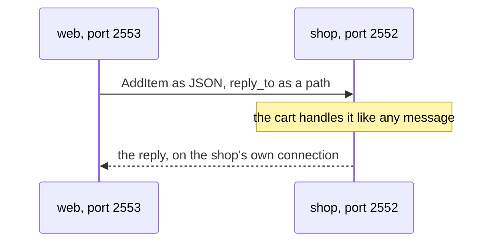

# 4. Remoting

## The problem

The shop has outgrown one machine: the web server runs on one and the carts on another. In plain Python, talking to the other machine means choosing a protocol, writing a client and a server, turning objects into bytes and back, and deciding what happens when the network fails halfway. And code that talks to a remote cart ends up looking nothing like code that talks to a local one.

## The idea

A ref is an address, and an address can name a machine. Give a system a network address and the paths of its actors gain a host and a port: `ohra://shop@127.0.0.1:2552/user`. Another system turns that path into a ref, and `tell` and `ask` on it work as before. The message is packed into JSON, sent over a TCP connection that opens on first use, and unpacked on the other side, where the actor handles it like any other message. The one thing you add is a mark on each message type that may travel, `@remotable`, so that ohra knows how to pack it.



## A first example

Chapter 1's cart, reached from another system. The two systems run in one process so that one command starts both. On two machines each would run one of them, with real host names in place of `127.0.0.1`, and nothing else would change.

```python
import asyncio

from cart import AddItem, CartCmd, GetCart, cart
from ohra import ActorRef, ActorSystem, Behaviors, ask, remotable

remotable(AddItem)  # these two may now cross the network
remotable(GetCart)


async def main() -> None:
    shop = ActorSystem(cart({}), "shop", address=("127.0.0.1", 2552))
    web = ActorSystem(Behaviors.ignore, "web", address=("127.0.0.1", 2553))
    async with shop, web:
        the_cart: ActorRef[CartCmd] = web.resolve("ohra://shop@127.0.0.1:2552/user")
        print(type(the_cart).__name__)
        print(await ask(the_cart, lambda r: AddItem("book", 1, r), timeout=3))
        print(await ask(the_cart, GetCart, timeout=3))


if __name__ == "__main__":
    asyncio.run(main())
```

It prints:

```
RemoteRef
{'book': 1}
{'book': 1}
```

- **`remotable(AddItem)`** registers chapter 1's messages for the network. It is the `@remotable` decorator called as a function, because these classes are already defined in `cart.py`; a new message type carries `@remotable` on its definition, as in [chapter 6](06-singleton.md).
- **`address=`** puts a system on the network. It is both where the system listens and the address others use to reach it.
- **`web.resolve(path)`** turns a path into a ref. This path names the system `shop` at `127.0.0.1:2552` and its guardian, `/user`, which is the cart. The path is on another node, so the ref is a `RemoteRef`.
- **`ask` works unchanged.** The temporary reply ref travels as a path, and the answer comes back on a connection from the shop to the web system, which is why `web` needs an address too.
- **The cart did not change.** It cannot tell whether a message came from its own process or from another machine.

Remoting only connects processes. Knowing which processes are there, and noticing when one dies, is the cluster's job, in the [next chapter](05-cluster.md).

> **Coming from Apache Pekko**
>
> - `ActorSystem(..., address=(host, port))` replaces `pekko.remote.artery.canonical.hostname` and `port`, and `system.resolve(path)` is `ActorRefResolver.resolveActorRef`.
> - `@remotable` on a frozen dataclass replaces serializer bindings: the encoding is JSON, and the manifest is the class name.
> - The transport is Artery narrowed to TCP with JSON frames, so ohra nodes talk only to ohra nodes. A message that cannot be serialized raises at `tell`, where Pekko logs and drops it.
> - There is no quarantine and no remote `watch` at this layer. [Appendix B](appendix-deviations.md) has the details.

## How it works

Give a system `address=(host, port)` and its actor paths become `ohra://name@host:port/user/...`. `system.resolve(path)` returns a `LocalRef` when the path is on this node and a `RemoteRef` otherwise. Code that tells a ref cannot see the difference, which is the whole point.

- **Identity.** A node is a `UniqueAddress`: host, port and a random uid minted per incarnation. A restarted node on the same port has a new uid, which is how the cluster tells a new process from the old one.
- **Messages.** A type crosses the wire once it carries `@remotable`, on a frozen dataclass. It is encoded as JSON with a `$type` manifest. A ref inside a message is encoded as its path and resolved on arrival. The keys `$ref`, `$type`, `$entity` and `$region` are reserved for these, so a plain `dict` in a message that uses one raises at the sender. A function ref, such as an `ask` reply address, is registered under `/temp/` so the other side can answer it.
- **Connections.** The first send to a peer opens one outbound TCP connection, the association, and queues up to 1000 frames until it is up. Each frame is a length-prefixed JSON object. The receiving side resolves the `to` path and tells the local actor. A path nobody owns becomes a dead letter on the receiver.
- **Failure.** `tell` never blocks and never raises for network reasons. A connection that fails turns its queued messages into dead letters, and the next send opens a fresh one. A message that cannot be serialized raises at the sender, before anything touches the network.

Remoting alone has no membership, no remote death watch and no quarantine. Those belong to the cluster, which builds them out of heartbeats over these same connections.

### Using it

Give a system an address and its actors are reachable from other ohra processes by path. `system.resolve(path)` returns a `RemoteRef`, an `ActorRef` whose `tell` serializes the message and sends it over a TCP connection opened on first use. `ask` works unchanged, because the reply ref crosses the wire as a path too. A message type is sendable once it is marked `@remotable`, which derives a JSON codec from the frozen dataclass; an `ActorRef` field becomes a path, and nested or union-typed fields work because the encoding is self-describing.

```python
from ohra import remotable


@remotable
@dataclass(frozen=True)
class Greeted:
    text: str


@remotable
@dataclass(frozen=True)
class Greet:
    name: str
    reply_to: ActorRef[Greeted]


async def client() -> None:
    async with ActorSystem(Behaviors.ignore, "client", address=("127.0.0.1", 2553)) as system:
        greeter: ActorRef[Greet] = system.resolve("ohra://greeter@127.0.0.1:2552/user")
        print(await ask(greeter, lambda r: Greet("pekko", r), timeout=3))
```

A `tell` to a node that is down never blocks or raises; once the connection attempt fails the message is a dead letter, as in Pekko. Sending an unregistered type, or a message over 16 MiB, raises `SerializationError` at `tell`. A message for a path nobody owns, or one that fails to decode, is a dead letter on the receiving node and the connection stays up. Replies travel on the replying node's own connection back, so the asking side must be listening too (`async with` does that) and `address=` must be a host its peers can reach: it is both the bind and the advertised address, and `127.0.0.1` and `localhost` are different authorities. Message adapters are kept for the actor's lifetime, so create them in `setup` rather than per message. Remoting alone has no membership and no remote `watch`, and a peer that restarts is served rather than quarantined; membership is the [next chapter](05-cluster.md). Without TLS the listener accepts any peer, so run it on a private network or turn on TLS, below.

### TLS

Plain remoting trusts the network: any host that reaches the port can send any `@remotable` message to any actor, join a cluster, or send gossip in a member's name. `ssl=RotatingKeysSSLEngineProvider()` closes that. It is Apache Pekko's `RotatingKeysSSLEngineProvider`: both sides of every connection present a certificate, both certificates must chain to the cluster's CA, and the peer's certificate must share a subject name (its common name or a DNS alternative name) with this node's own. The connection runs TLS 1.3.

```python
from ohra import ActorSystem, Behaviors, RotatingKeysSSLEngineProvider


async def node() -> None:
    tls = RotatingKeysSSLEngineProvider()  # /var/run/secrets/ohra-tls/rotating-keys-engine
    async with ActorSystem(Behaviors.ignore, "a", address=("10.0.0.1", 2552), ssl=tls):
        ...
```

The provider reads three PEM files under `secret_mount_point`: `tls.key`, `tls.crt` and `ca.crt`, the names a Kubernetes TLS secret mounts (`key_file`, `cert_file` and `ca_cert_file` override them one by one). Give every node a certificate from one CA carrying one shared name, such as the service's DNS name. The files are read again for new connections once `ssl_context_cache_ttl` (five minutes) has passed, so rotated certificates take effect without a restart; open connections keep the context they started with. A key, certificate or CA that does not load fails `async with ActorSystem(...)` at startup.

A peer that fails the handshake or the name check is closed before it receives anything, and the node logs a warning naming it. When the sender is the one that refuses, or the handshake fails, the sender's connection fails like any other: its messages become dead letters, with a warning. When only the receiver refuses, as can happen while a new CA reaches the nodes one by one, TLS 1.3 lets the sender finish its side of the handshake first, so what it sent is lost without a dead letter, and the receiver's warning is the one to watch. TLS covers remoting and so the cluster, sharding and singletons on top of it; the management endpoint of [chapter 8](08-management-and-kubernetes.md) stays plain HTTP.

---

[← Persistence](03-persistence.md) · [Contents](README.md) · [Cluster membership →](05-cluster.md)
