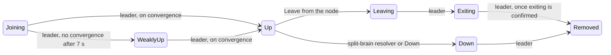

# 5. Cluster membership

Every node runs one daemon actor at `/system/cluster`, a port of Pekko's `ClusterCoreDaemon` function for function. The daemon holds the membership as a `Gossip` value: the members and their statuses, a reachability table, the set of nodes that have seen this version, and a vector clock. Nothing is ever told "the cluster is now X". Each node merges what it hears and acts on what it sees.

## Gossip, a leader, and agreement

- **Joining.** A new node sends `InitJoin` to its seed nodes, or is told whom to join by the bootstrap, then sends `Join` to the first that answers. The contact adds it as Joining and replies `Welcome` with the current gossip.
- **Gossip.** Every second the daemon sends its gossip to one member, preferring those that have not seen it. The receiver compares vector clocks. A newer version wins, an older one is answered with ours, and concurrent versions are merged. Then the receiver marks the result as seen by itself.
- **Convergence and the leader.** When every reachable member has seen the same version, the cluster has converged. The leader is the first reachable member in address order; no election takes place, every node computes the same answer. Only the leader moves statuses, and only on convergence, so two nodes never make conflicting decisions.



A node asks to leave and the split-brain resolver downs, but every other move is the leader's. Any status can be downed; the diagram shows it from Up only.

**Failure detection.** Each node heartbeats a few neighbours on a hash ring, up to nine. A phi-accrual detector turns the gaps between heartbeat replies into a suspicion level. Past the threshold the observer records the peer as unreachable in its reachability row, and the gossip spreads that observation. Unreachable is not removed: a member stays in until it is downed, and the leader cannot converge while anyone is unreachable.

**Split-brain resolver.** Someone has to decide to down an unreachable member, and the resolver at `/system/cluster/downingProvider` does it on the leader. It waits until membership and reachability have been stable for `stable_after`, then applies a strategy: keep-majority, static-quorum, keep-oldest or down-all. The losing side downs itself, which runs coordinated shutdown, so a partition cannot leave two clusters each believing it is the cluster.

Applications watch all of this through `Cluster(system).subscriptions`, which publishes `MemberUp`, `UnreachableMember`, `LeaderChanged` and the rest as diffs between gossip versions.

## Using it

Give a system `cluster=ClusterSettings(seed_nodes=...)` and it runs Apache Pekko's membership protocol under `/system/cluster`: it joins through the seed nodes, gossips the member list with a vector clock, elects the lowest address among reachable Up members as leader, and lets only that leader, on convergence, move members `joining → up` and `leaving → exiting → removed`. Phi-accrual failure detection over heartbeats marks a silent node `unreachable`; `Down` it and the leader removes it. A node that is downed, or that leaves, terminates its own system. `Cluster(system)` is the extension: `manager` takes the commands, `subscriptions` the subscriptions, and `state` / `self_member` are the current view.

```python
from pekko_py import Address, Cluster, ClusterSettings, Leave, MemberEvent, Subscribe


def cluster_node(port: int, seed_port: int) -> ActorSystem[MemberEvent]:
    seeds = (Address("app", "127.0.0.1", seed_port),)
    system = ActorSystem(listener, "app", address=("127.0.0.1", port), cluster=ClusterSettings(seed_nodes=seeds))
    Cluster(system).subscriptions.tell(Subscribe(system, MemberEvent))  # current state first, then every change
    return system


async def main() -> None:
    async with cluster_node(2551, 2551) as first, cluster_node(2552, 2551) as second:
        await until(lambda: all(m.status == "up" for m in Cluster(first).state.members) and len(Cluster(first).state.members) == 2)
        print(Cluster(first).state.leader)                        # Address(name='app', host='127.0.0.1', port=2551)
        Cluster(first).manager.tell(Leave(Cluster(second).self_address))
        await second.when_terminated()                            # exiting nodes shut themselves down
```

`listener` is any `Behavior[MemberEvent]`; it receives `MemberJoined`, `MemberUp`, `MemberLeft`, `MemberExited`, `MemberRemoved(member, previous_status)` and, under `ReachabilityEvent`, `UnreachableMember` / `ReachableMember`; `LeaderChanged`, `SelfUp` and `SelfRemoved` arrive when subscribing to `ClusterDomainEvent`, as do the internal `SeenChanged` and `ReachabilityChanged`, which fire on most gossip rounds, so a listener for every event should match what it wants and ignore the rest. The first seed node forms the cluster alone once the other seeds have not answered within `seed_node_timeout`; any other node asks every seed and joins the first to answer, and a node with no seed nodes waits for a `Join(address)` or `JoinSeedNodes(...)` command. All settings are `ClusterSettings` fields with Pekko's defaults in seconds (`gossip_interval`, `heartbeat_interval`, `acceptable_heartbeat_pause`, `failure_detector_threshold`, `monitored_by_nr_of_members`, `allow_weakly_up_members`, ...). A member that rejoins from a restarted process is a new incarnation: the old one is marked terminated and removed before the new one is let in. `terminate()`, or leaving the `async with`, stops a node gracefully through the coordinated shutdown below: it leaves, hands over, and only then stops. Actors on different nodes find each other through the Receptionist, next.

## Split-brain resolver

Without a downing provider an unreachable member stays unreachable until someone sends `Down`, and until then the leader cannot move any member, so a crashed oldest node blocks singleton hand-over and shard reallocation. Apache Pekko's split-brain resolver is the provider: a child of the core daemon, active on the leader, that waits until membership and reachability have been stable for `stable_after` and then downs one side by a strategy, so the leader can remove it. Turn it on with `downing=`:

```python
from pekko_py import ClusterSettings, KeepMajority, SplitBrainResolverSettings

settings = ClusterSettings(
    seed_nodes=seeds,
    downing=SplitBrainResolverSettings(strategy=KeepMajority(), stable_after=20.0, down_all_when_unstable=None),
    down_removal_margin=0.0,  # 0: use stable_after
)
```

- `KeepMajority()`, the default: down the unreachable side when this side holds the majority of the last known membership, else down this side; equal sides keep the one with the lowest address. Three or more parts with no majority all shut down.
- `StaticQuorum(quorum_size)`: keep this side when it has at least `quorum_size` members, else down it. Never grow the cluster past `2 * quorum_size - 1`; past that it downs all.
- `KeepOldest(down_if_alone=True)`: keep the side with the oldest member, except that an oldest partitioned from two or more others downs itself.
- `DownAll()`: down every node, the conservative choice.

All four detect indirectly connected nodes, which are marked unreachable over some links but still talk over others, and down those first, as Pekko. `down_all_when_unstable` (`None` is Pekko's `on`: three quarters of `stable_after`, at least four seconds; `0` is off) downs everything on every node when reachability keeps flapping for `stable_after + down_all_when_unstable`. `down_removal_margin` is how long the surviving side waits after a removal before starting that node's singletons and shards, so the downed side has time to stop them; it defaults to `stable_after`.

---

[← Remoting](04-remoting.md) · [Contents](README.md) · [Cluster singleton →](06-singleton.md)
