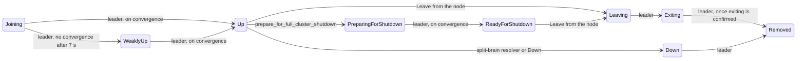

# 5. Cluster membership

## The problem

With carts on several machines, each machine needs to know which others are there. Machines start, stop for a deploy, and crash, and the network between them can drop for a few seconds and come back. If each machine kept its own list, the lists would soon disagree, and two machines could each decide they were in charge of the same cart.

## The idea

The machines, the **nodes**, keep one membership list between them by **gossip**. Every second each node tells another node what it knows, so news reaches every node within a few rounds, and each version of the list carries a clock that says which version is newer. One node is the **leader**: the reachable node with the lowest address. Every node can work that out from the list, so there is no vote. Only the leader changes a member's status, from joining to **up**, or from leaving to **removed**, and only once every node has seen the same list, so no two nodes ever make conflicting changes.

Nodes also send each other heartbeats. A node that stops answering is marked **unreachable**, which is a suspicion, not a verdict: it might be slow or cut off rather than dead. Deciding that it is gone, so that it can be removed, is the job of the **split-brain resolver**, at the [end of this chapter](#split-brain-resolver).

## A first example

Three nodes in one process, again so that one command runs them all. The first one prints what it hears:

```python
import asyncio

from ohra import (
    ActorSystem,
    Address,
    Behavior,
    Behaviors,
    Cluster,
    ClusterSettings,
    MemberEvent,
    MemberRemoved,
    MemberUp,
    Subscribe,
)

SEEDS = (Address("shop", "127.0.0.1", 2551),)


def watcher() -> Behavior[MemberEvent]:
    @Behaviors.receive_message
    def on_event(event: MemberEvent) -> Behavior[MemberEvent]:
        match event:
            case MemberUp(member=m):
                print("up:", m.address.port)
            case MemberRemoved(member=m):
                print("removed:", m.address.port)
            case _:
                pass  # joining, leaving, exiting: steps on the way
        return Behaviors.same

    return on_event


def node(port: int) -> ActorSystem[MemberEvent]:
    settings = ClusterSettings(seed_nodes=SEEDS)
    return ActorSystem(watcher(), "shop", address=("127.0.0.1", port), cluster=settings)


async def members_up(system: ActorSystem[MemberEvent], n: int) -> None:
    while sum(m.status == "up" for m in Cluster(system).state.members) != n:
        await asyncio.sleep(0.1)


async def main() -> None:
    async with node(2551) as first, node(2552), node(2553) as third:
        Cluster(first).subscriptions.tell(Subscribe(first, MemberEvent))
        await members_up(first, 3)
        print("leader:", Cluster(first).state.leader)
        third.terminate()  # leaves the cluster, then stops
        await members_up(first, 2)


if __name__ == "__main__":
    asyncio.run(main())
```

It prints:

```
up: 2551
up: 2552
up: 2553
leader: Address(name='shop', host='127.0.0.1', port=2551)
removed: 2553
removed: 2552
removed: 2551
```

- **`ClusterSettings(seed_nodes=SEEDS)`** makes a system a cluster node. The seed nodes are the ones a new node contacts to join. Every node here lists 2551, and 2551, as the first seed, forms the cluster on its own.
- **Every node has the same system name**, `shop`. A cluster is one actor system spread over several processes.
- **`Subscribe(first, MemberEvent)`** sends membership changes to the first node's guardian, the `watcher`: first the current state, as events, then every change. Joining, leaving and exiting are steps on the way, and the watcher ignores them.
- **`Cluster(first).state`** is this node's current view of the cluster: the members with their statuses, and the leader, 2551, the lowest address. `members_up` reads it until enough members are Up; an application would react to the events instead.
- **`third.terminate()`** stops a node gracefully. It leaves the cluster first, so the others see it removed rather than unreachable. Leaving the `async with` does the same for the other two.

> **Coming from Apache Pekko**
>
> - The membership protocol is a port of Pekko's `ClusterCoreDaemon`: the same gossip, vector clocks, convergence rule, leader, member lifecycle and phi-accrual failure detector.
> - `ClusterSettings(seed_nodes=...)` replaces `pekko.cluster.seed-nodes` and the other `pekko.cluster` settings, as fields in snake_case with durations in seconds.
> - `Cluster(system).manager`, `subscriptions`, `state` and `self_member` are the extension's members. `Subscribe` always sends the current state as events first, and `member.status` is a string such as `"up"` or `"weakly_up"`.
> - The cluster has one data center, named `default`, and roles as in Pekko, and the split-brain resolver is off until `downing=` is set, as in Pekko with no downing provider. [Appendix B](appendix-deviations.md) lists what else is left out.

## How it works

Every node runs one daemon actor at `/system/cluster`, a port of Pekko's `ClusterCoreDaemon` function for function. The daemon holds the membership as a `Gossip` value: the members and their statuses, a reachability table, the set of nodes that have seen this version, and a vector clock. Nothing is ever told "the cluster is now X". Each node merges what it hears and acts on what it sees.

### Gossip, a leader, and agreement

- **Joining.** A new node sends `InitJoin` to its seed nodes, or is told whom to join by the bootstrap, then sends `Join` to the first that answers. The contact adds it as Joining and replies `Welcome` with the current gossip.
- **Gossip.** Every second the daemon sends its gossip to one member, preferring those that have not seen it. The receiver compares vector clocks. A newer version wins, an older one is answered with ours, and concurrent versions are merged. Then the receiver marks the result as seen by itself.
- **Convergence and the leader.** When every reachable member has seen the same version, the cluster has converged. The leader is the first reachable member in address order; no election takes place, every node computes the same answer. Only the leader moves statuses, and only on convergence, so two nodes never make conflicting decisions.



A node asks to leave, the split-brain resolver downs, and the node that runs the full cluster shutdown moves Up members to PreparingForShutdown, but every other move is the leader's. Any status can be downed; the diagram shows it from Up only.

**Failure detection.** Each node heartbeats a few neighbours on a hash ring, up to nine. A phi-accrual detector turns the gaps between heartbeat replies into a suspicion level. Past the threshold the observer records the peer as unreachable in its reachability row, and the gossip spreads that observation. Unreachable is not removed: a member stays in until it is downed, and the leader cannot converge while anyone is unreachable.

**Split-brain resolver.** Someone has to decide to down an unreachable member, and the resolver at `/system/cluster/downingProvider` does it on the leader. It waits until membership and reachability have been stable for `stable_after`, then applies a strategy: keep-majority, static-quorum, keep-oldest or down-all. The losing side downs itself, which runs coordinated shutdown, so a partition cannot leave two clusters each believing it is the cluster.

Applications watch all of this through `Cluster(system).subscriptions`, which publishes `MemberUp`, `UnreachableMember`, `LeaderChanged` and the rest as diffs between gossip versions.

### Using it

Give a system `cluster=ClusterSettings(seed_nodes=...)` and it runs Apache Pekko's membership protocol under `/system/cluster`: it joins through the seed nodes, gossips the member list with a vector clock, elects the lowest address among reachable Up members as leader, and lets only that leader, on convergence, move members `joining → up` and `leaving → exiting → removed`. Phi-accrual failure detection over heartbeats marks a silent node `unreachable`; `Down` it and the leader removes it. A node that is downed, or that leaves, terminates its own system. `Cluster(system)` is the extension: `manager` takes the commands, `subscriptions` the subscriptions, and `state` / `self_member` are the current view.

```python
from ohra import Address, Cluster, ClusterSettings, Leave, MemberEvent, Subscribe


def cluster_node(port: int, seed_port: int) -> ActorSystem[MemberEvent]:
    seeds = (Address("app", "127.0.0.1", seed_port),)
    system = ActorSystem(
        listener, "app", address=("127.0.0.1", port), cluster=ClusterSettings(seed_nodes=seeds)
    )
    # current state first, then every change
    Cluster(system).subscriptions.tell(Subscribe(system, MemberEvent))
    return system


async def main() -> None:
    async with cluster_node(2551, 2551) as first, cluster_node(2552, 2551) as second:
        await members_up(first, 2)  # from the first example
        # Address(name='app', host='127.0.0.1', port=2551)
        print(Cluster(first).state.leader)
        Cluster(first).manager.tell(Leave(Cluster(second).self_address))
        # exiting nodes shut themselves down
        await second.when_terminated()
```

`listener` is any `Behavior[MemberEvent]`; it receives `MemberJoined`, `MemberUp`, `MemberLeft`, `MemberExited`, `MemberPreparingForShutdown`, `MemberReadyForShutdown`, `MemberRemoved(member, previous_status)` and, under `ReachabilityEvent`, `UnreachableMember` / `ReachableMember`; `LeaderChanged`, `RoleLeaderChanged`, `SelfUp`, `SelfRemoved` and `ClusterShuttingDown` (published once, when the cluster extension stops, before the final removal events) arrive when subscribing to `ClusterDomainEvent`, as do the internal `SeenChanged` and `ReachabilityChanged`, which fire on most gossip rounds, so a listener for every event should match what it wants and ignore the rest. The first seed node forms the cluster alone once the other seeds have not answered within `seed_node_timeout`; any other node asks every seed and joins the first to answer, and a node with no seed nodes waits for a `Join(address)` or `JoinSeedNodes(...)` command. All settings are `ClusterSettings` fields with Pekko's defaults in seconds (`gossip_interval`, `heartbeat_interval`, `acceptable_heartbeat_pause`, `failure_detector_threshold`, `monitored_by_nr_of_members`, `allow_weakly_up_members`, ...). A member that rejoins from a restarted process is a new incarnation: the old one is marked terminated and removed before the new one is let in. `terminate()`, or leaving the `async with`, stops a node gracefully through the [coordinated shutdown](02-actor-system.md#coordinated-shutdown): it leaves, hands over, and only then stops. Actors on different nodes find each other through the [Receptionist](02-actor-system.md#receptionist).

### Roles

A role names what a node is for, such as `backend` or `frontend`, so that a feature can be confined to some of the nodes. Roles are set in `ClusterSettings(roles=frozenset({"backend"}))`, which takes a set of strings (a bare `str` raises `TypeError`). They are fixed for the life of the node and travel in the join, so every member's roles are known to every node. These are cluster roles; they are not the roles of the multi-node test kit (`RoleName`, [chapter 12](12-testing.md)), which name the nodes of a spec, as Pekko overloads the word too.

```python
import asyncio

from ohra import (
    ActorSystem,
    Address,
    Behavior,
    Behaviors,
    Cluster,
    ClusterDomainEvent,
    ClusterSettings,
    RoleLeaderChanged,
    Subscribe,
)

SEEDS = (Address("shop", "127.0.0.1", 2551),)


def watcher() -> Behavior[ClusterDomainEvent]:
    @Behaviors.receive_message
    def on_event(event: ClusterDomainEvent) -> Behavior[ClusterDomainEvent]:
        match event:
            case RoleLeaderChanged(role=role, leader=leader):
                print("leader of", role, "is", leader.port if leader else None)
            case _:
                pass
        return Behaviors.same

    return on_event


async def main() -> None:
    settings = ClusterSettings(
        seed_nodes=SEEDS,
        roles=frozenset({"backend"}),
        min_nr_of_members_of_role={"backend": 1},
    )
    async with ActorSystem(
        watcher(), "shop", address=("127.0.0.1", 2551), cluster=settings
    ) as system:
        cluster = Cluster(system)
        cluster.subscriptions.tell(Subscribe(system, ClusterDomainEvent))
        print(sorted(cluster.self_roles))
        while cluster.self_member.status != "up":
            await asyncio.sleep(0.1)
        print(cluster.self_member.has_role("backend"), cluster.state.role_leader("backend"))
        await asyncio.sleep(0.3)


if __name__ == "__main__":
    asyncio.run(main())
```

It prints, with a node that is its own backend and so its own role leader:

```
['backend', 'dc-default']
leader of backend is 2551
leader of dc-default is 2551
True Address(name='shop', host='127.0.0.1', port=2551)
leader of backend is None
leader of dc-default is None
```

- **`dc-default`** is on every member, as in Pekko, where the data center is a role named `dc-<name>`. There is one data center, `default`, so a role of your own must not start with `dc-`; `ClusterSettings` raises `ValueError` if it does. `Cluster(system).self_roles` is this node's roles with `dc-default`, and `Member.roles`, `Member.has_role(role)` and `Member.data_center` read the same for any member.
- **`min_nr_of_members_of_role={"backend": 1}`** makes the leader wait until that many members with the role have joined before it moves any member Up, as `pekko.cluster.role.<name>.min-nr-of-members` does.
- **`role_leader(role)`** is the first reachable member with the role in address order, found the way the leader is: `Cluster(system).state.role_leader("backend")`, or `state.role_leader_map` for every role, and `state.all_roles` for the roles in the cluster. Each time one changes, the subscribers of `ClusterDomainEvent` get `RoleLeaderChanged(role, leader)`, right after `LeaderChanged`. `leader` is `None` when no member has the role any more, which is what the last two lines show: the node is leaving.
- **Exiting members** are gossiped to the two oldest members and to the two oldest of each of their roles, so that the node that takes over a role's work hears of the departure first.

> **Coming from Apache Pekko**
>
> - `pekko.cluster.roles` and `pekko.cluster.role.<name>.min-nr-of-members` are the two `ClusterSettings` fields. `selfRoles`, `roles`, `hasRole`, `dataCenter`, `roleLeader`, `roleLeaderMap` and `allRoles` are snake_case. [Appendix B](appendix-deviations.md) lists the differences.

### Full cluster shutdown

Sometimes a rolling deploy is the wrong tool and the whole cluster has to stop and start again, for example when a protocol change is simpler to roll out by a restart than to make backward compatible. Tell the cluster first, and the expensive moves, such as handing the [singleton](06-singleton.md) over to another node, do not happen on the way down. If the cluster is not restarting right away there is no need to prepare it.

```python
async def full_shutdown() -> None:
    async with node(2551) as first, node(2552) as second, node(2553) as third:
        await members_up(first, 3)  # from the first example
        Cluster(first).prepare_for_full_cluster_shutdown()
        nodes = (first, second, third)
        while any(Cluster(n).self_member.status != "ready_for_shutdown" for n in nodes):
            await asyncio.sleep(0.1)
        print([(Cluster(n).self_address.port, Cluster(n).self_member.status) for n in nodes])
        third.terminate()  # one at a time, see the notes below
        await third.when_terminated()
        while any(len(Cluster(n).state.members) != 2 for n in (first, second)):
            await asyncio.sleep(0.1)
        second.terminate()
        await second.when_terminated()
        while len(Cluster(first).state.members) != 1:
            await asyncio.sleep(0.1)
```

It prints:

```
[(2551, 'ready_for_shutdown'), (2552, 'ready_for_shutdown'), (2553, 'ready_for_shutdown')]
```

- **`prepare_for_full_cluster_shutdown()`** tells the local core daemon. `Cluster(system).manager.tell(PrepareForFullClusterShutdown())` does the same. Call it on one node that is Up: a call made before the node has been welcomed into the cluster is dropped, and a Joining or WeaklyUp caller marks the others but stays Up itself, as in Pekko.
- **The node you call** moves every Up member to `preparing_for_shutdown` in its own gossip, which then spreads. Any other Up node that sees a preparing member prepares itself. Then the leader, on convergence, moves each of them to `ready_for_shutdown`. Subscribers get `MemberPreparingForShutdown` and `MemberReadyForShutdown`.
- **A node that ran the prepare** ignores new joins, and logs it, and while it is the leader it moves no Joining or WeaklyUp member to Up. That is the node you called, and any node that prepared itself on coming Up later; the others, marked preparing by gossip, behave as before. So a node that joins through another member can still come Up if the leader did not run the prepare, and it then sees the preparing members, prepares itself and ends `ready_for_shutdown` too. Members that are Leaving or Exiting leave by the normal path.
- **It does not stop the nodes.** Wait until every member that was Up sees itself `ready_for_shutdown`, then stop them and start the new version. A graceful leave from a ready node can be lost: ReadyForShutdown outranks Leaving when two views of a member merge, as in Pekko, so a leave that is concurrent with any other change to the membership, such as a move by the leader or another node's leave, is overwritten, and that node's shutdown waits out the `cluster-exiting` timeout (10 s) with a warning. The example therefore stops the nodes one at a time and waits until the others no longer list the one that left.
- Every node must run an ohra version that knows the two statuses, because an earlier version cannot merge gossip that holds them.
- **The singleton** stops handing over while any member is preparing or ready, see [chapter 6](06-singleton.md).
- **Cluster sharding** takes part, see [chapter 7](07-sharding.md#the-shard). Its coordinator stops rebalancing, its regions stop handing off, and a shard told to hand off stops at once, without waiting for its entities.

### Split-brain resolver

Without a downing provider an unreachable member stays unreachable until someone sends `Down`, and until then the leader cannot move any member, so a crashed oldest node blocks singleton hand-over and shard reallocation. Apache Pekko's split-brain resolver is the provider: a child of the core daemon, active on the leader, that waits until membership and reachability have been stable for `stable_after` and then downs one side by a strategy, so the leader can remove it. Turn it on with `downing=`:

```python
from ohra import ClusterSettings, KeepMajority, SplitBrainResolverSettings

settings = ClusterSettings(
    seed_nodes=seeds,
    downing=SplitBrainResolverSettings(
        strategy=KeepMajority(), stable_after=20.0, down_all_when_unstable=None
    ),
    down_removal_margin=0.0,  # 0: use stable_after
)
```

- `KeepMajority()`, the default: down the unreachable side when this side holds the majority of the last known membership, else down this side; equal sides keep the one with the lowest address. Three or more parts with no majority all shut down.
- `StaticQuorum(quorum_size)`: keep this side when it has at least `quorum_size` members, else down it. Never grow the cluster past `2 * quorum_size - 1`; past that it downs all.
- `KeepOldest(down_if_alone=True)`: keep the side with the oldest member, except that an oldest partitioned from two or more others downs itself.
- `DownAll()`: down every node, the conservative choice.

`KeepMajority`, `StaticQuorum` and `KeepOldest` take an optional `role`, Pekko's `keep-majority.role`, `static-quorum.role` and `keep-oldest.role`: the decision then counts only the members with that role, and downing applies to every member. When no member at all has the role, `KeepMajority` and `KeepOldest` down all; `StaticQuorum` downs this side, since it cannot reach its quorum.

```python
from ohra import ClusterSettings, KeepMajority, SplitBrainResolverSettings

settings = ClusterSettings(
    downing=SplitBrainResolverSettings(strategy=KeepMajority(role="backend")),
)
```

All four detect indirectly connected nodes, which are marked unreachable over some links but still talk over others, and down those first, as Pekko. `down_all_when_unstable` (`None` is Pekko's `on`: three quarters of `stable_after`, at least four seconds; `0` is off) downs everything on every node when reachability keeps flapping for `stable_after + down_all_when_unstable`. `down_removal_margin` is how long the surviving side waits after a removal before starting that node's singletons and shards, so the downed side has time to stop them; it defaults to `stable_after`.

### Leases

A lease lets one owner at a time hold a named resource. The owner holds it in a store outside the cluster, such as a Kubernetes custom resource or a database row, so a node on the wrong side of a partition cannot go on acting as if it still owned the resource. Apache Pekko's singleton, sharding and split-brain resolver can each take a lease for this. In ohra, sharding's shards acquire one, with `lease_settings` ([chapter 7](07-sharding.md#the-shard)); this section covers the API.

ohra ships no store-backed implementation. You subclass `Lease`, which has three methods:

- `await acquire(lease_lost_callback=None)` returns `True` when the owner holds the lease and `False` when it surely does not, for example because another owner holds it. It raises `LeaseError` when the outcome is unknown, and `LeaseTimeoutError` when the store did not answer in time. The callback is called if the lease is lost later, and never before `acquire` has completed.
- `await release()` frees the lease for another owner.
- `check_lease()` is not async. `True` means the owner certainly holds the lease; `False` means it might not.

Register the subclass with `LeaseProvider(system).register(implementation, factory, timeout_settings=..., lease_config=...)`. The `implementation` is a name you choose, `factory` takes the `LeaseSettings` and returns the lease, and `lease_config` is a mapping for your own settings. `get_lease(lease_name, implementation, owner_name)` then returns the lease, and the same three arguments return the same instance. A different owner, or a different implementation, gets another one.

```python
import asyncio
from collections.abc import Callable

from ohra import ActorSystem, Behaviors, Lease, LeaseProvider

owners: dict[str, str] = {}  # the lease store, shared by every owner


class InProcessLease(Lease):
    async def acquire(
        self, lease_lost_callback: Callable[[BaseException | None], None] | None = None
    ) -> bool:
        holder = owners.setdefault(self.settings.lease_name, self.settings.owner_name)
        return holder == self.settings.owner_name

    async def release(self) -> bool:
        if owners.get(self.settings.lease_name) == self.settings.owner_name:
            del owners[self.settings.lease_name]
        return True

    def check_lease(self) -> bool:
        return owners.get(self.settings.lease_name) == self.settings.owner_name


async def main() -> None:
    async with ActorSystem[None](Behaviors.ignore, "app") as system:
        provider = LeaseProvider(system)
        provider.register("in-process", InProcessLease)
        first = provider.get_lease("jobs", "in-process", "node-1")
        second = provider.get_lease("jobs", "in-process", "node-2")
        print(await first.acquire())  # True
        print(await second.acquire())  # False
        await first.release()
        print(await second.acquire())  # True


asyncio.run(main())
```

A real implementation does the same against its store, and answers `False` or raises `LeaseError` instead of waiting for ever.

`TimeoutSettings` holds three durations in seconds, with Pekko's defaults. `heartbeat_timeout` (120) is how long the store keeps a lease its owner has stopped refreshing. `heartbeat_interval` (12) is how often the owner refreshes it. `operation_timeout` (5) is how long one call to the store may take. `TimeoutSettings.create(...)` checks that `heartbeat_interval` is less than half of `heartbeat_timeout`, and with `heartbeat_interval=None` it takes `max(heartbeat_timeout / 10, 5)`. The constructor does not check.

`LeaseSettings` is what the factory receives: `lease_name`, `owner_name`, `timeout_settings` and `lease_config`. `LeaseUsageSettings(lease_implementation, lease_retry_interval=5.0)` is what a feature that takes a lease holds: which implementation to ask `LeaseProvider` for, and how long to wait before it retries a failed acquire.

---

[← Remoting](04-remoting.md) · [Contents](README.md) · [Cluster singleton →](06-singleton.md)
