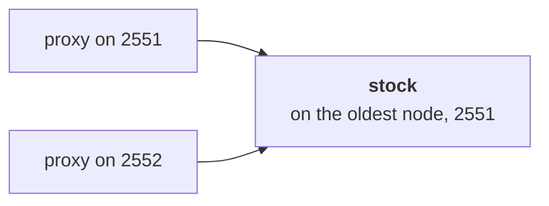

# 6. Cluster singleton

## The problem

Some things must exist exactly once in the whole shop: the stock count for a popular item, or the job that sends the nightly report. Run one on every node and their counts disagree. Run it on a node you choose and it is gone when that node is.

## The idea

A **cluster singleton** is one actor for the whole cluster, run on the oldest node. Every node gets a **proxy**, a ref that forwards to wherever the actor is at the moment. When the oldest node leaves, it stops the actor and hands over to the next oldest, which starts its own; messages sent in the meantime wait in the proxies. As long as the nodes agree on who the members are, there is never more than one.



## A first example

A stock count shared by two nodes, and what happens to it when the oldest one leaves:

```python
import asyncio
from dataclasses import dataclass

from ohra import (
    ActorContext,
    ActorRef,
    ActorSystem,
    Address,
    Behavior,
    Behaviors,
    Cluster,
    ClusterSettings,
    ClusterSingleton,
    SingletonActor,
    ask,
    remotable,
)

SEEDS = (Address("shop", "127.0.0.1", 2551),)


@remotable
@dataclass(frozen=True)
class Reserve:
    reply_to: ActorRef[str]


def stock(left: int) -> Behavior[Reserve]:
    @Behaviors.receive
    def on_message(ctx: ActorContext[Reserve], msg: Reserve) -> Behavior[Reserve]:
        port = Cluster(ctx.system).self_address.port
        msg.reply_to.tell(f"{left - 1} left, counted on {port}")
        return stock(left - 1)

    return on_message


def node(port: int) -> ActorSystem[None]:
    settings = ClusterSettings(seed_nodes=SEEDS)
    return ActorSystem(Behaviors.empty, "shop", address=("127.0.0.1", port), cluster=settings)


async def main() -> None:
    async with node(2551) as first, node(2552) as second:
        proxy1 = ClusterSingleton(first).init(SingletonActor(stock(10), "stock"))
        proxy2 = ClusterSingleton(second).init(SingletonActor(stock(10), "stock"))
        print("via 2551:", await ask(proxy1, Reserve, timeout=10))
        print("via 2552:", await ask(proxy2, Reserve, timeout=10))
        first.terminate()  # the oldest leaves, handing the stock over to 2552
        await first.when_terminated()
        print("via 2552:", await ask(proxy2, Reserve, timeout=10))


if __name__ == "__main__":
    asyncio.run(main())
```

It prints:

```
via 2551: 9 left, counted on 2551
via 2552: 8 left, counted on 2551
via 2552: 9 left, counted on 2552
```

- **`ClusterSingleton(system).init(SingletonActor(stock(10), "stock"))`** runs on every node and returns that node's proxy. Only the oldest node, 2551, starts the actor.
- **Both proxies reach the same actor.** The answer through 2552 also comes from 2551, and it continues the count.
- **`@remotable` on `Reserve`**, since a proxy on one node sends to an actor on another. The reply is a string, which needs no mark.
- **`first.terminate()`** makes the oldest node leave. Before it goes, it stops the stock actor and hands over to 2552, and `when_terminated()` waits until it is gone.
- **The count starts again from 10.** A singleton keeps its state in memory like any actor, so the new one starts from `stock(10)`. A singleton that must remember is [persisted](03-persistence.md).

> **Coming from Apache Pekko**
>
> - `ClusterSingleton(system).init(SingletonActor(behavior, "name"))`, `with_stop_message` and `ClusterSingletonSettings` are Pekko's, in snake_case, and `init` returns the proxy.
> - The manager and the proxy are ports of ClusterSingletonManager and ClusterSingletonProxy, without the lease, roles and data centers.
> - The proxy finds the instance by asking the manager on the oldest node, and keeps asking every `singleton_identification_interval` in place of remote DeathWatch. [Appendix B](appendix-deviations.md) has the details.

## How it works

`ClusterSingleton(system).init(SingletonActor(behavior, name))` runs on every node and returns a proxy ref. Behind it are two actors per node, ported state for state from Pekko.

- **The manager** at `/system/singletonManager<name>` tracks members ordered by age. Only the manager on the oldest Up member starts the real actor. The others wait as the next in line.
- **The proxy** at `/system/singletonProxy<name>` finds the current instance by asking each node's manager in age order, buffers messages until it does, and forwards to it. When the instance moves, the proxy buffers again and finds the new one.
- **Hand-over.** When the oldest member leaves, its manager stops the instance and confirms with `HandOverDone` to the next oldest, which then starts its own. The two coordinated-shutdown tasks in `cluster-exiting` hold the leaving node until the hand-over is through. If the oldest crashes instead, the next oldest takes over once the crashed member is removed.

There is never more than one instance as long as membership is agreed. That is why removal of a crashed member waits for the split-brain resolver rather than happening on a timeout.

### Using it

`ClusterSingleton(system).init(SingletonActor(behavior, "name"))` runs exactly one instance of `behavior` in the cluster, on the oldest member, and returns a proxy ref that works on every node: messages sent through it reach the instance wherever it is, buffered while its location is unknown. When the host leaves, the instance is handed over to the next oldest member during the exiting phase, so it is stopped on the old node before it starts on the new one; when the host crashes, the next oldest starts it once the crashed member has been downed and removed. Apache Pekko's ClusterSingletonManager and ClusterSingletonProxy, state for state.

```python
from ohra import ClusterSingleton, SingletonActor

proxy = ClusterSingleton(system).init(SingletonActor(counter(), "counter"))  # every node
# answered by the one instance
print(await ask(proxy, Hit, timeout=3))
```

Give the instance a stop message with `with_stop_message` if it needs to finish work before it goes; otherwise it is stopped after its pending messages, as Pekko's PoisonPill. `ClusterSingletonSettings` carries Pekko's `removal_margin`, `hand_over_retry_interval`, `min_number_of_hand_over_retries`, `singleton_identification_interval` and `buffer_size`. An instance that fails is not restarted by the manager; wrap it in `Behaviors.supervise` as in Pekko.

---

[← Cluster membership](05-cluster.md) · [Contents](README.md) · [Sharding →](07-sharding.md)
