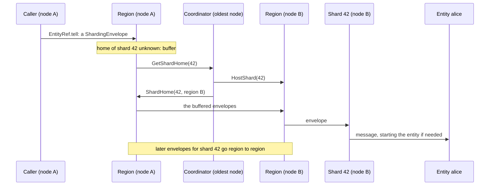
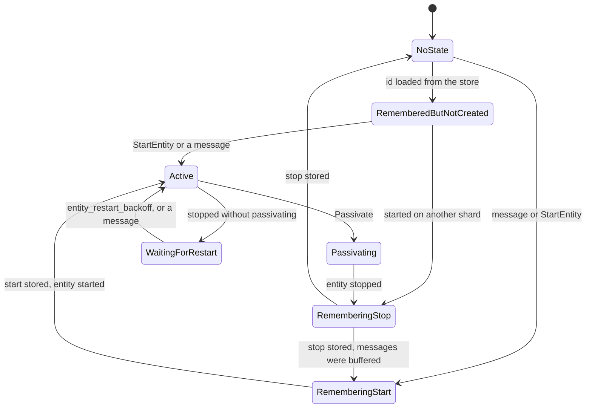
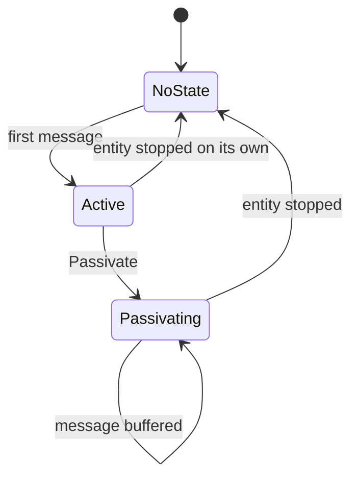

# 7. Sharding

## The problem

A shop with a million customers cannot keep a million carts on one machine, and it should not have to look up where a cart is before talking to it. Chapter 2's shop handed out one cart per customer, but every cart lived in its one process, and the shop itself was one more thing that could fail.

## The idea

**Sharding** spreads the carts, the **entities**, over the nodes, and gives you a ref by id: `entity_ref_for(CART, "alice")`, on any node, reaches alice's cart wherever it is, and starts it on its first message. Ids are grouped into **shards** by a hash, and each shard lives on one node. A **coordinator**, which is a cluster singleton, decides which node hosts each shard, and moves shards when nodes join or leave. Ordinary messages do not go through it: each node remembers where the shards are and sends straight there.


## A first example

Chapter 1's cart, one per customer, over two nodes:

```python
import asyncio

from cart import AddItem, CartCmd, GetCart, cart
from ohra import (
    ActorSystem,
    Address,
    Behaviors,
    ClusterSettings,
    ClusterSharding,
    Entity,
    EntityTypeKey,
    ask,
    remotable,
)

remotable(AddItem)
remotable(GetCart)
CART = EntityTypeKey[CartCmd]("Cart")
SEEDS = (Address("shop", "127.0.0.1", 2551),)


def node(port: int) -> ActorSystem[None]:
    settings = ClusterSettings(seed_nodes=SEEDS)
    system = ActorSystem(Behaviors.empty, "shop", address=("127.0.0.1", port), cluster=settings)
    ClusterSharding(system).init(Entity(CART, lambda entity: cart({})))  # on every node
    return system


async def main() -> None:
    async with node(2551) as first, node(2552) as second:
        alice_on_1 = ClusterSharding(first).entity_ref_for(CART, "alice")
        alice_on_2 = ClusterSharding(second).entity_ref_for(CART, "alice")
        bob_on_2 = ClusterSharding(second).entity_ref_for(CART, "bob")
        await ask(alice_on_1, lambda r: AddItem("book", 1, r), timeout=10)
        await ask(alice_on_2, lambda r: AddItem("pen", 2, r), timeout=10)
        await ask(bob_on_2, lambda r: AddItem("mug", 1, r), timeout=10)
        print("alice:", await ask(alice_on_1, GetCart, timeout=10))
        print("bob:", await ask(bob_on_2, GetCart, timeout=10))


if __name__ == "__main__":
    asyncio.run(main())
```

It prints:

```
alice: {'book': 1, 'pen': 2}
bob: {'mug': 1}
```

- **`ClusterSharding(system).init(Entity(CART, ...))`** makes the cart an entity type on every node. The function starts a new entity. It receives an `EntityContext` with the entity's id, which an empty cart does not need.
- **`entity_ref_for(CART, "alice")`** is a ref by id, and works on either node. Both of alice's refs reach the same cart, which is why it holds the book added through 2551 and the pen added through 2552.
- **Entities start on demand.** No cart existed before its first message. The node hosting its shard started it.
- **`remotable(AddItem)` and `remotable(GetCart)`**, as in [chapter 4](04-remoting.md): a node often sends to an entity hosted on the other.
- **The first ask waits a moment** while the cluster forms and the coordinator starts. Messages are buffered meanwhile, hence `timeout=10`.

When a node leaves, its shards move to the others, and their entities start again there, empty. With `Behaviors.persisted`, as in [chapter 3](03-persistence.md), they start from their saved state instead, which is what the carts in [chapter 11](11-putting-it-together.md) do.

> **Coming from Apache Pekko**
>
> - `ClusterSharding(system).init(Entity(key, create))`, `entity_ref_for`, `EntityTypeKey`, `EntityContext`, `ShardingEnvelope` and `Passivate` are Pekko's. `Entity` takes `create` as its second argument instead of a second argument list.
> - The shard id is `crc32(id) % number_of_shards` by default, as `HashCodeMessageExtractor`, with Pekko's default of 1000 shards. `Entity.with_message_extractor` takes Pekko Typed's `ShardingMessageExtractor`.
> - `Sharding.init` is the region on one node with no coordinator, for apps that run in one process.
> - [Remembered entities](#remembered-entities) keep their ids in Distributed Data, as Pekko's `remember-entities-store = ddata`. There are no custom allocation strategies. [Appendix B](appendix-deviations.md) has the full list.

## How it works

Sharding runs many small stateful actors, entities, each addressed by an id, without the caller knowing where they live. Three kinds of actor do the work, all under `/system/sharding`:

- **A region per entity type on every node.** It routes messages, hosts the shards assigned to this node and registers with the coordinator. With a [role](#roles), a node without it gets a proxy-only region, which routes and hosts nothing.
- **A shard per shard id.** A shard is a child of the region that hosts it and owns the entities whose ids hash to it. It starts an entity on its first message and passivates it when idle.
- **One coordinator per entity type,** run as a cluster singleton on the oldest node, or with a [role](#roles) the oldest node with the coordinator's role. It decides which region hosts each shard.

An entity id maps to a shard id by `crc32(id) % number_of_shards`, 1000 by default, unless a [message extractor](#message-extractors) says otherwise. The hash is the same on every node, so every region computes the same shard for an id. Only the shard's location needs a decision.



**The first message for a shard.** `EntityRef.tell` wraps the message in a `ShardingEnvelope` and gives it to the local region. A region that does not know the shard's home buffers the message and asks the coordinator with `GetShardHome`. The coordinator allocates the shard to the least loaded region, tells that region `HostShard`, and answers `ShardHome`. From then on the asking region sends envelopes for that shard straight to the owning region, which hands them to the shard and the shard to the entity. The coordinator is never on the path of ordinary traffic.

**Rebalance and hand-off.** Every 10 seconds the coordinator compares shard counts and may move a few shards from the busiest region to the least busy. A move is a hand-off. The coordinator tells every region `BeginHandOff`, so they start buffering for that shard. Once all have acknowledged, it sends `HandOff` to the owner, whose shard stops its entities and reports `ShardStopped`. Then the shard is allocated afresh and the buffers drain to the new home. A leaving node does the same for all of its shards, in the `cluster-sharding-shutdown-region` phase.

**After a crash.** The coordinator keeps its shard map in [Distributed Data](14-distributed-data.md), in an `LWWRegister` on sharding's own Replicator at `/system/sharding/replicator`, or `/system/sharding/<role>Replicator` with a [role](#roles). A new coordinator reads the map from a majority of the nodes before it answers anyone, and each change is written to a majority before it takes effect. With the defaults, every node of a cluster of up to eight takes part in each write, and of up to twelve in each read, so while a crashed node has not yet been removed, a new shard's allocation waits for it and is retried. A crashed node's shards are allocated again once it is removed. Their entities start fresh on the new node, which is why entities that must keep state use [persistence](03-persistence.md). [Remembered entities](#remembered-entities) start there without waiting for a message.

### Sharding in one process

`Sharding.init(Entity(key, create))` is a shard region: one entity actor per id, created by its first message, passivated by the [passivation strategy](#passivation-strategies) (idle for 120 s unless set otherwise) or when it asks, with messages that arrive while it is passivating buffered for the next incarnation. An entity that stops on its own, by returning `Behaviors.stopped()`, loses what is queued behind it, as in Pekko, so an entity should passivate rather than stop itself. This is the region layer of Apache Pekko's `ClusterSharding` inside one process, which is what most single-node apps use it for: address by id, create on demand, and keep only hot entities in memory.

```python
from ohra import (
    ClusterShardingSettings,
    Entity,
    EntityContext,
    EntityTypeKey,
    PassivationStrategySettings,
    Sharding,
)

Cart = EntityTypeKey[Command]("Cart")


def cart(entity: EntityContext[Command]) -> Behavior[Command]:
    # entity.entity_id names this cart; entity.shard.tell(Passivate(ctx.self)) stops it early
    return counter()


lru = PassivationStrategySettings.defaults.with_active_entity_limit(10_000)
settings = ClusterShardingSettings().with_passivation_strategy(
    lru.with_least_recently_used_replacement()
)
region = Sharding.init(Entity(Cart, cart).with_settings(settings))
```

Spawn `region` like any behavior, then `Sharding.entity_ref_for(region_ref, "cart-42")` gives an `EntityRef`, an `ActorRef` that `tell`s and `ask`s the entity whether or not it exists yet. `GetShardRegionState` asks the region which entities are live. Under the region, as in Pekko, a Shard actor per shard id hosts its entities; the same Shards serve the cluster-wide regions of the "Sharding across nodes" section. `GetShardRegionState` is answered through a child that asks every Shard, so the reply arrives once all have answered or after `shard_region_query_timeout`.

### Sharding across nodes

`ClusterSharding(system).init(Entity(key, create))` is `Sharding.init` for the whole cluster: the same entity type on every node, each entity living on exactly one of them. A ShardCoordinator, run as a cluster singleton, decides which node hosts each shard with Pekko's least-shard allocation; every node's region routes a message to the shard's home, local or remote, and buffers while the home is unknown. `entity_ref_for(key, id)` works on any node. Call `init` on every member (on members outside a [role](#roles) it starts a proxy): the first `init` starts sharding's Replicator, and a member without one never answers the coordinator's reads and writes, which with the defaults need every node of a small cluster, so the coordinator never gets its state and logs "Has ClusterSharding been started on all nodes?". When a node joins, the coordinator moves shards to it over the following rebalance intervals; when a node leaves, its region hands every shard off during the exiting phase before the node confirms its exit; when a node crashes, its shards are served again once it has been downed and removed, and not before, so no entity ever runs twice.

```python
from ohra import ClusterSharding, Entity, EntityTypeKey

COUNTER = EntityTypeKey[CountUp]("Counter")
region = ClusterSharding(system).init(Entity(COUNTER, lambda entity: counter()))  # every node
print(await ask(ClusterSharding(system).entity_ref_for(COUNTER, "alice"), CountUp, timeout=3))
```

Entities are in memory: a moved or handed-off entity starts fresh on its new node, and `Behaviors.persisted` is how state outlives that. A rebalance can drop messages that reach the old host in its hand-off window, as Pekko's does; a message that reaches a shard handing off is unhandled, and a message buffered for a passivating entity is dropped when its shard stops or hands off. `ClusterShardingSettings` carries Pekko's `number_of_shards`, `retry_interval`, `rebalance_interval`, `handoff_timeout`, `shard_start_timeout`, `buffer_size`, `rebalance_absolute_limit`, `rebalance_relative_limit` and `coordinator_singleton_settings` (the coordinator's `ClusterSingletonSettings`), plus `shard_region_query_timeout`, `passivation_strategy_settings`, `lease_settings`, `verbose_debug_logging`, `fail_on_invalid_entity_state_transition`, `entity_restart_backoff` and `shard_failure_backoff`; the [remembered entities](#remembered-entities) section has the rest. A coordinator that fails on a message restarts at once, as Pekko's does, and the regions register with the new one. A region whose buffer is full drops a message for a shard with no known home into dead letters, and still asks for that shard's home.

`StopShards(shards, reply_to)`, sent to the region on any node, stops shards on purpose, as Pekko's: the region passes it to the coordinator, which hands each running shard off as a rebalance would and tells `reply_to` `ShardStopped(shard)` once the shard has stopped. A shard that is not allocated is acked at once, and a shard already being handed off is acked when that hand-off ends. A request still waiting after `handoff_timeout` is dropped with an info log, and a hand-off that fails acks nothing, so a caller asks with a timeout. The shard starts again, on whichever node the coordinator picks, on its next message. The coordinator refuses `StopShards` with an error log when entities are [remembered](#remembered-entities), and ignores it with a warning when no region has registered or the cluster is preparing to shut down.

The coordinator's reads and writes of its state are tuned with six more fields. Their defaults are Pekko's.

| Field | Pekko key | Default and meaning |
|---|---|---|
| `waiting_for_state_timeout` | `waiting-for-state-timeout` | 2.0 s: how long the read of the state may take before it is retried |
| `updating_state_timeout` | `updating-state-timeout` | 5.0 s: how long a write may take before it is retried |
| `coordinator_state_read_majority_plus` | `coordinator-state.read-majority-plus` | 5; `"all"` reads from every node |
| `coordinator_state_write_majority_plus` | `coordinator-state.write-majority-plus` | 3; `"all"` writes to every node |
| `majority_min_cap` | `distributed-data.majority-min-cap` | 5: the fewest nodes a majority-plus read or write reaches |
| `distributed_data` | `distributed-data` | `None`: the cluster's `ReplicatorSettings` with `prefer_oldest=True` and `max_delta_elements=5`, durable only with [remembered entities](#remembered-entities) |

A read or write reaches a majority plus its extra nodes (5 for reads, 3 for writes), at least `majority_min_cap` and at most every node. With the defaults, writes reach every node of a cluster of up to eight nodes and reads every node of one of up to twelve; in a cluster of three, the majority of two plus the extra nodes is more than three already, so `majority_min_cap` does not come into it. A larger cluster that wants every write on every node asks for it:

```python
from cart import CartCmd, cart
from ohra import ActorSystem, ClusterSharding, ClusterShardingSettings, Entity, EntityTypeKey

CART = EntityTypeKey[CartCmd]("Cart")


def start(system: ActorSystem[None]) -> None:
    entity = Entity(CART, lambda ctx: cart({})).with_settings(
        ClusterShardingSettings(coordinator_state_write_majority_plus="all")
    )
    ClusterSharding(system).init(entity)
```

#### Message extractors

A region takes `ShardingEnvelope`s, and places an entity id on shard `crc32(id) % number_of_shards`, which is Pekko's `HashCodeMessageExtractor`. `Entity.with_message_extractor` swaps it for any `ShardingMessageExtractor[E, M]`: its `entity_id(message)` and `unwrap_message(message)` take apart the messages `E` sent to the region, and `shard_id(entity_id)` places every message, the envelopes, `StartEntity` and `entity_ref_for`'s included. The region's type then takes `E` too. `ShardingMessageExtractor.no_envelope(number_of_shards, stop_message, extract_entity_id)` is the one for messages that carry their own entity id, sent to the region as they are:

```python
from dataclasses import dataclass

from ohra import (
    ActorRef,
    ActorSystem,
    Behavior,
    Behaviors,
    ClusterSharding,
    EntityContext,
    Entity,
    EntityTypeKey,
    ShardingMessageExtractor,
)
from ohra.remote import remotable


@remotable
@dataclass(frozen=True)
class Deposit:
    account: str
    amount: int
    reply_to: ActorRef[int]


def account(ctx: EntityContext[Deposit], balance: int = 0) -> Behavior[Deposit]:
    @Behaviors.receive_message
    def on_message(msg: Deposit) -> Behavior[Deposit]:
        msg.reply_to.tell(balance + msg.amount)
        return account(ctx, balance + msg.amount)

    return on_message


def account_id(msg: Deposit) -> str:
    return msg.account


ACCOUNT = EntityTypeKey[Deposit]("Account")


def start_accounts(system: ActorSystem[None]) -> ActorRef[Deposit]:
    extractor = ShardingMessageExtractor.no_envelope(100, None, account_id)
    return ClusterSharding(system).init(Entity(ACCOUNT, account).with_message_extractor(extractor))
```

A shard id must be the same for an entity id on every node, so an extractor's `shard_id` must not depend on the node, nor on Python's salted `hash` of a string.

#### Roles

Sharding can be confined to the members with a [role](05-cluster.md), as Pekko's `role` setting: `ClusterShardingSettings(role="backend")`, or `Entity.with_role("backend")`, which wins over the settings' role. Call `init` on every member as before. On a member with the role it starts the region, `/system/sharding/<type>`, which hosts shards. On any other member it starts a proxy-only region, `/system/sharding/<type>Proxy`, which hosts nothing and sends each message to the shard's home on a member with the role; `entity_ref_for` works the same on both. The coordinator runs on the oldest member with the role. With `coordinator_singleton_override_role=False` it runs on the role of `coordinator_singleton_settings` instead, which may be a different set of members; a member with that role but not the shard role runs the coordinator next to its proxy.

```python
from cart import CartCmd, cart
from ohra import ActorSystem, ClusterSharding, Entity, EntityTypeKey

CART = EntityTypeKey[CartCmd]("Cart")


def start(system: ActorSystem[None]) -> None:
    # on every member: carts live on "backend" members, the others get a proxy
    entity = Entity(CART, lambda ctx: cart({})).with_role("backend")
    ClusterSharding(system).init(entity)
```

Each role has its own Replicator for sharding's data: `/system/sharding/replicator` with no role, `/system/sharding/<role>Replicator` (the role URL-encoded) with one. An entity type whose name would take one of these names, or another type's proxy name, such as `backendReplicator` or `CartProxy`, makes `init` raise `ValueError` before it starts anything. It counts only the members of its role, so the members without the role need no Replicator and need not answer its reads and writes. With [remembered entities](#remembered-entities) and a coordinator role apart from the shard role, the stores use the role-less Replicator, as Pekko's do. Every member with either role runs it, but it counts every member of the cluster, the proxy-only ones too, which do not run it. Its majority reads and writes therefore need enough members with one of the two roles: with one `coordinator` member, one `shard` member and three others, a majority is three of five, only two can answer, and the coordinator cannot remember a new shard.

The coordinator allocates no shard until enough regions have registered: `min_nr_of_members` of the cluster's settings, or with a role, that role's `min_nr_of_members_of_role` (1 when it names none), as Pekko's `minMembers`. A request for a shard's home before then is ignored, and the region asks again on its retry interval.

### Passivation strategies

Passivation stops an entity that is not needed, to free its memory. Pekko decides which entity with a strategy, and `ClusterShardingSettings.passivation_strategy_settings` describes one. The strategies, from Pekko's documentation:

- **Idle**: an entity passivates after it has received no message for the idle timeout. It is checked on an interval, half the timeout unless set.
- **Least recently used**, **most recently used** and **least frequently used**: a limit on the active entities of the region, divided evenly among its shards. When a shard is over its share, the entity the policy picks, the one touched longest ago, the one touched last, or the one touched least often, passivates. Idle passivation can run beside any of them.
- **Segmented least recently used**: least recently used with several levels. An entity enters the lowest and moves up a level each time it is touched again, so entities touched only once go first.
- **The composite strategy**: a main policy behind an admission window. A new entity first enters a small window with its own policy, and the window's evictee competes for a place in the main area against the main area's own candidate, decided by a frequency sketch filter that counts how often each id is touched. A hill-climbing optimizer adjusts the window's size from the hit rate it sees.

Each setting has a Pekko key in a strategy's section under `pekko.cluster.sharding.passivation` (the table leaves the section out), and a builder on `PassivationStrategySettings`. `WindowSettings`, `HillClimbingSettings` and `FrequencySketchSettings` are nested in `PassivationStrategySettings.AdmissionSettings`. Durations are in seconds.

| Pekko key | ohra | Default |
|---|---|---|
| `idle-entity.timeout` | `with_idle_entity_passivation(timeout)`, or an `IdleSettings` | none (120.0 in `default_idle_strategy`) |
| `idle-entity.interval` | `with_idle_entity_passivation(timeout, interval)`, or `IdleSettings.interval` | `None`: half the timeout |
| `active-entity-limit` | `with_active_entity_limit(limit)` | none (100_000 in `default_strategy`) |
| `replacement.policy` | `with_least_recently_used_replacement()`, `with_most_recently_used_replacement()`, `with_least_frequently_used_replacement()` | none |
| `replacement.least-recently-used.segmented.levels`, `proportions` | `LeastRecentlyUsedSettings.with_segmented(levels)` or `with_segmented(proportions)` | none |
| `replacement.least-frequently-used.dynamic-aging` | `LeastFrequentlyUsedSettings.with_dynamic_aging()` | `False` |
| `admission.window.proportion`, `minimum-proportion`, `maximum-proportion` | `WindowSettings.initial_proportion`, `minimum_proportion`, `maximum_proportion` | 0.01, 0.01, 1.0 |
| `admission.window.policy` | `WindowSettings.with_policy(...)` | none |
| `admission.window.optimizer` | `WindowSettings.with_optimizer(HillClimbingSettings)` | none |
| `admission.window.hill-climbing.adjust-multiplier`, `initial-step`, `restart-threshold`, `step-decay` | `HillClimbingSettings` fields of the same names | 10.0, 0.0625, 0.05, 0.98 |
| `admission.filter` | `AdmissionSettings.with_filter(FrequencySketchSettings)` | none |
| `admission.frequency-sketch.depth`, `counter-bits`, `width-multiplier`, `reset-multiplier` | `FrequencySketchSettings` fields of the same names | 4, 4, 4, 10.0 |

Pekko's `passivation.strategy` names a strategy section. The three Pekko ships are constants here, and any other is built with the builders: `PassivationStrategySettings.default_idle_strategy` is idle passivation after 120 s, `default_strategy` is the composite with a limit of 100_000, a least recently used window with the hill-climbing optimizer, the frequency sketch filter and a two-level segmented main area of proportions 0.2 and 0.8, and `disabled` passivates nothing. `ClusterShardingSettings()` carries `default_idle_strategy`; the shard passivates by it. `with_no_passivation_strategy()` is `disabled`.

```python
from ohra.cluster.sharding import ClusterShardingSettings, PassivationStrategySettings

lru = PassivationStrategySettings.defaults.with_active_entity_limit(10_000)
settings = ClusterShardingSettings().with_passivation_strategy(
    lru.with_least_recently_used_replacement().with_idle_entity_passivation(600.0)
)
assert settings.passivation_strategy_settings.active_entity_limit == 10_000
print(settings.passivation_strategy_settings.idle_entity_settings)
```

```
PassivationStrategySettings.IdleSettings(timeout=600.0, interval=None)
```

### Remembered entities

An entity starts on its first message. When its shard moves to another node, or restarts, the entity starts again only once a message arrives for it. Some entities have to run without being asked, such as one that polls a feed. **Remembered entities** keep the ids of a shard's entities in [Distributed Data](14-distributed-data.md), and start them again with no message:

- after a rebalance or a hand-off, on the shard's new node;
- after the shard restarts, as when its store fails;
- after a coordinator fail-over, as when the node that hosted the shard crashed: the new coordinator allocates the remembered shards, and their entities start on their new homes;
- after the whole cluster restarts, from the durable store on disk.

Turn them on with `with_remember_entities(True)`, on every node:

```python
import asyncio
import tempfile
from dataclasses import dataclass
from functools import partial

from ohra import (
    ActorContext,
    ActorSystem,
    Address,
    Behavior,
    Behaviors,
    ClusterSettings,
    ClusterSharding,
    ClusterShardingSettings,
    Entity,
    EntityContext,
    EntityTypeKey,
    StartEntity,
)
from ohra.cluster.ddata import ReplicatorSettings, sqlite_durable_store


@dataclass(frozen=True)
class Work:
    job: str


WORKER = EntityTypeKey[Work]("Worker")
started: asyncio.Queue[str] = asyncio.Queue()


def worker(entity: EntityContext[Work]) -> Behavior[Work]:
    @Behaviors.setup
    def setup(_ctx: ActorContext[Work]) -> Behavior[Work]:
        started.put_nowait(entity.entity_id)
        return Behaviors.ignore

    return setup


def remembering(directory: str) -> ClusterShardingSettings:
    durable = ReplicatorSettings(
        durable_keys=frozenset({"shard-*"}),
        durable_store=partial(sqlite_durable_store, directory),
    )
    return ClusterShardingSettings(distributed_data=durable).with_remember_entities(True)


def node() -> ActorSystem[None]:
    settings = ClusterSettings(seed_nodes=(Address("jobs", "127.0.0.1", 2551),))
    return ActorSystem(Behaviors.empty, "jobs", address=("127.0.0.1", 2551), cluster=settings)


async def main() -> None:
    with tempfile.TemporaryDirectory() as directory:
        entity = Entity(WORKER, worker).with_settings(remembering(directory))
        async with node() as system:
            ClusterSharding(system).init(entity).tell(StartEntity("alice"))
            print("first run:", await asyncio.wait_for(started.get(), 10))
        async with node() as system:  # a new cluster: nothing is sent to alice
            ClusterSharding(system).init(entity)
            print("second run:", await asyncio.wait_for(started.get(), 30))


asyncio.run(main())
```

It prints:

```
first run: alice
second run: alice
```

- **`StartEntity("alice")`** sent to the region starts alice with no message for her, and the start is remembered like any other. As in Pekko Typed, nothing answers it.
- **The second run is a new cluster,** and nothing is sent to alice. The coordinator reads the remembered shards from the durable store and allocates them; each shard loads its entity ids and starts them.
- **Passivation is off.** With remembered entities, `passivation_strategy` resolves to no passivation, as in Pekko. An entity runs until it passivates itself with `Passivate`, and a passivated entity is forgotten.
- **The durable keys.** A shard keeps its ids in five `ORSet`s, `shard-<type>-<shard id>-0` to `-4`, and the coordinator keeps its shard ids in a `GSet`, `shard-<type>-all`, all on sharding's Replicator. With remembered entities on, the `shard-*` keys are durable. With `distributed_data=None`, their SQLite database is in `ddata-<system>-replicator-<port>`, in the working directory, by [chapter 14's rule](14-distributed-data.md#durable-storage). A `distributed_data` given in the settings keeps its own `durable_keys`: pass `durable_keys=frozenset({"shard-*"})` with it, as the example does, or the entities are forgotten when the whole cluster stops.
- **`Sharding.init` refuses it** with a `ValueError`: the single-node region has no Replicator to remember entities in.

How a remembering shard runs:

- **It loads before it starts.** A shard reads its ids from its store before it tells the region it is initialized, stashing what arrives meanwhile. It hands the ids to the region's `RememberEntityStarter`, which starts them through the region, so an id whose shard has changed with `number_of_shards` starts on its new shard. The starter sends each start again every `retry_interval` until the shard acknowledges it.
- **`entity_recovery_strategy`.** `"all"`, the default, starts every remembered entity at once. `"constant"` starts `entity_recovery_constant_rate_number_of_entities` (5) at a time, every `entity_recovery_constant_rate_frequency` seconds (0.1), one shard after another, so a node with many remembered entities does not start them all in one go.
- **It writes before it acts.** A message for an entity that is not running is buffered while the shard writes the start to its store, and delivered once the entity has started. A passivated entity's stop is written once the entity has stopped. Starts and stops that arrive while a write is in flight go into the next write, as one batch.
- **The cost** is a write per entity start and stop, at the coordinator's write level: a majority plus `coordinator_state_write_majority_plus` nodes, which with the defaults is every node of a cluster of up to eight. A busy cluster that starts and stops many entities pays for each.
- **`entity_restart_backoff`.** An entity that stops without passivating is started again after 10 s, or at once when a message arrives for it.
- **A failed store.** A store write that fails, or a store that stops, restarts the shard at once. A write with no answer restarts it after `updating_state_timeout` (5 s). Either way the shard loads its ids again and keeps what it had stashed.
- **`shard_failure_backoff`.** A remembering shard that stops without being handed off, as when it loses its lease, is started again by its region after 10 s, once the coordinator has confirmed the shard's home.

The states of an entity in a remembering shard, after Pekko's diagram in `Shard.scala`:



### Sharded daemon process

Some work is split into a fixed number of parts, each with a worker that runs all the time, such as Pekko's tag processors: events are tagged with one of N tags, and one worker per tag consumes its events. A **sharded daemon process** keeps N such workers running, spread over the cluster, and starts each again if it stops. Call `init` with the same arguments on every node:

```python
import asyncio

from ohra import (
    ActorContext,
    ActorSystem,
    Address,
    Behavior,
    Behaviors,
    ClusterSettings,
    ShardedDaemonProcess,
)

started: asyncio.Queue[str] = asyncio.Queue()


def tag_processor(tag: str) -> Behavior[str]:
    @Behaviors.setup
    def setup(_ctx: ActorContext[str]) -> Behavior[str]:
        started.put_nowait(tag)  # a real one would consume the events tagged with tag
        return Behaviors.ignore

    return setup


def node() -> ActorSystem[None]:
    settings = ClusterSettings(seed_nodes=(Address("tags", "127.0.0.1", 2551),))
    return ActorSystem(Behaviors.empty, "tags", address=("127.0.0.1", 2551), cluster=settings)


async def main() -> None:
    tags = ["tag-1", "tag-2", "tag-3"]
    async with node() as system:
        ShardedDaemonProcess(system).init(
            "TagProcessors", len(tags), lambda n: tag_processor(tags[n])
        )
        print(sorted([await asyncio.wait_for(started.get(), 10) for _ in tags]))


asyncio.run(main())
```

It prints:

```
['tag-1', 'tag-2', 'tag-3']
```

- **The workers are sharded entities.** `init("TagProcessors", n, factory)` runs the entity type `sharded-daemon-process-TagProcessors` with one shard per worker. The entity ids are the process numbers `0` to `n - 1`, and the factory gets the number of the worker it makes. `init` returns nothing: the workers are not sent messages through sharding. Pekko's docs suggest a [receptionist](02-actor-system.md#receptionist) key that the workers register with.
- **The keep-alive.** A coordinator, a cluster singleton named `ShardedDaemonProcessCoordinator-TagProcessors`, sends the region a `StartEntity` for every worker, one every `keep_alive_throttle_interval`, and starts the next round `keep_alive_interval` after a round ends. That starts the workers at first, and starts again a worker that stopped, or that moved.
- **A worker moves when its node leaves.** The leaving node's region hands the worker's shard off, which stops the worker, and the next keep-alive starts it on another node. With `stop_message`, the worker gets that message and stops itself instead of being stopped outright. A worker also moves when sharding's coordinator rebalances its shard to a new node. If the leaving node is the oldest, the coordinator moves with it, as any singleton does.
- **The role.** `with_role("workers")` runs the workers and the coordinator only on nodes with that role. The other nodes still call `init`, and start a proxy region and the default Replicator.
- **Sharding is forced to fit.** The daemon's sharding settings are `sharding_settings` with `number_of_shards` set to the number of workers, the daemon's role, no remembered entities and no passivation. A second `init` of a name on a node does nothing.

| Field | Pekko key | Default and meaning |
|---|---|---|
| `keep_alive_interval` | `keep-alive-interval` | 10.0 s: the pause after a round of `StartEntity`s ends before the next starts |
| `keep_alive_throttle_interval` | `keep-alive-throttle-interval` | 0.1 s: the pause between two `StartEntity`s of a round; 0 sends them all at once |
| `keep_alive_from_number_of_nodes` | `keep-alive-from-number-of-nodes` | 3: unused, as in Pekko |
| `sharding_settings` | `sharding` | `None`: `ClusterShardingSettings()`, as Pekko's `sharding = ${pekko.cluster.sharding}` |
| `role` | `withRole` | `None`: every node runs workers |

The settings are a frozen dataclass with Pekko's `with_*` builders: `ShardedDaemonProcessSettings().with_keep_alive_interval(1.0).with_role("workers")`.

#### Rescaling

`init` keeps a fixed number of workers. `init_with_context` starts a set that can be rescaled while it runs. It takes the initial number of workers, and its factory gets a `ShardedDaemonProcessContext` instead of a number:

- `process_number`, from `0` to `total_processes - 1`;
- `total_processes`, the number of workers in the worker's set;
- `name`, the daemon process's name;
- `revision`, which is 0 for the initial set and goes up by one with each rescale.

`init_with_context` returns an `ActorRef[ShardedDaemonProcessCommand]`, a proxy of the coordinator singleton, so any node can send it commands. `ChangeNumberOfProcesses(n, reply_to)` rescales to `n` workers, and its reply is a `StatusReply[Done]`, so `ask_with_status` awaits it. `GetNumberOfProcesses(reply_to)` replies with `NumberOfProcesses(number_of_processes, started, rescale_in_progress, revision)`, where `started` is when the change to this number began, in epoch seconds:

```python
import asyncio

from ohra import (
    ActorContext,
    ActorSystem,
    Address,
    Behavior,
    Behaviors,
    ChangeNumberOfProcesses,
    ClusterSettings,
    GetNumberOfProcesses,
    ShardedDaemonProcess,
    ShardedDaemonProcessContext,
    ask,
    ask_with_status,
)

started: asyncio.Queue[tuple[int, int, int]] = asyncio.Queue()


def tag_processor(sdp: ShardedDaemonProcessContext) -> Behavior[str]:
    @Behaviors.setup
    def setup(_ctx: ActorContext[str]) -> Behavior[str]:
        started.put_nowait((sdp.revision, sdp.process_number, sdp.total_processes))
        return Behaviors.ignore

    return setup


async def workers_started(n: int) -> list[tuple[int, int, int]]:
    return sorted([await asyncio.wait_for(started.get(), 10) for _ in range(n)])


def node() -> ActorSystem[None]:
    settings = ClusterSettings(seed_nodes=(Address("tags", "127.0.0.1", 2551),))
    return ActorSystem(Behaviors.empty, "tags", address=("127.0.0.1", 2551), cluster=settings)


async def main() -> None:
    async with node() as system:
        ref = ShardedDaemonProcess(system).init_with_context("TagProcessors", 2, tag_processor)
        print(await workers_started(2))
        await ask_with_status(ref, lambda r: ChangeNumberOfProcesses(3, r), 10.0)
        print(await workers_started(3))
        reply = await ask(ref, GetNumberOfProcesses, 3.0)
        print(reply.number_of_processes, reply.revision, reply.rescale_in_progress)


asyncio.run(main())
```

It prints the two workers of revision 0, as `(revision, process_number, total_processes)`, then the three of revision 1:

```
[(0, 0, 2), (0, 1, 2)]
[(1, 0, 3), (1, 1, 3), (1, 2, 3)]
3 1 False
```

- **The workflow** is the one in the class comment of Pekko's coordinator. The coordinator stops pinging the workers, and writes the new number and revision to [Distributed Data](14-distributed-data.md), marked in progress. It stops every shard of the old set through `StopShards`, retrying with all of them each `handoff_timeout / 4` until each has stopped. It acks the request, marks the rescale completed, and pings the new set. A coordinator that moves to another node mid-rescale finds the state in progress when it starts, and runs the rescale again from the stopping of the shards. It takes the initial number of workers as the previous one, as Pekko's code does, so after an earlier rescale it can leave old workers of process numbers at or above the initial number running ([appendix B](appendix-deviations.md)).
- **The entity ids** of revision 0 are the process numbers, as with `init`. From revision 1 on they are `revision|total_processes|process_number`, and the shard is still the process number.
- **The replies.** A rescale to the current number is acked at once. A second `ChangeNumberOfProcesses` while one runs gets `StatusReply.error("Rescale in progress, retry later")`, and one to fewer than one process gets `StatusReply.error("number_of_processes must be >= 1, got n")`. `GetNumberOfProcesses` is answered during a rescale too, with `rescale_in_progress` set.
- **A keep-alive round in flight.** A rescale shuts the rest of the round down. At most the one id that the round's throttle already holds still goes out after the command. That ping is harmless: its shard is one of those `StopShards` stops, or the worker it starts refuses its old revision.
- **Each worker checks its revision before it starts.** A worker of `init_with_context` first reads the state from its node's Replicator, and runs the factory's behavior only if its revision is the latest; a worker of an old revision stops instead. Messages that reach the worker before that reply, `stop_message` included, are unhandled.

### The shard

A shard hosts the entities of one shard id. Both `Sharding.init` and the cluster regions run it. It follows Pekko's `Shard`, and the [remembered entities](#remembered-entities) section has what it does when it remembers.

- **Entity states.** An entity is `NoState`, `Active` or `Passivating`. The first message makes it `Active`. `Passivate` makes it `Passivating`, and its termination makes it `NoState` again. Remembered entities add four more, in the [diagram above](#remembered-entities).



- **Buffering.** Messages for a `Passivating` entity wait in a buffer and go to its next incarnation. `buffer_size` caps them in total across the shard's entities. Past the cap a message is dropped and published as `Dropped` on the event stream.
- **Idle passivation.** `ClusterShardingSettings()` passivates an entity that has had no message for 120 s, checked every 60 s, so between 120 and 180 s after its last message.
- **The active-entity limit.** A limit of the region is divided among the shards the region has, so a shard's share changes when a shard starts or is handed off. The region tells its shards the count with `ShardsUpdated`, and `SetActiveEntityLimit(limit)` sent to a region sets the limit of the shards it has then, as Pekko's does. A shard started later uses the configured limit.
- **Hand-off.** On `HandOff`, the shard starts a `HandOffStopper` that sends the entities the stop message (`Entity.with_stop_message`) or, with none, stops each after its pending messages. It warns after 5 s if entities are left, and stops them at `max(handoff_timeout - 5, 1)` seconds. The stopper replies `ShardStopped` once all have terminated, and the shard then stops. A shard with no entities replies at once. Messages that reach the shard meanwhile are unhandled.
- **The lease.** `ClusterShardingSettings().with_lease_settings(LeaseUsageSettings("my-lease"))` makes every shard acquire a [lease](05-cluster.md#leases) before it starts its entities. `"my-lease"` is the name the implementation was registered under with `LeaseProvider(system).register`. Its name is `<system>-shard-<type>-<shard id>` and its owner is `system@host:port`. A failed acquire is retried after `lease_retry_interval`, 5 s by default. Messages that arrive meanwhile wait. Under `Sharding.init` the shard stashes them with no limit, as Pekko's classic `Stash`, and replays them all in one turn once it holds the lease. A cluster region buffers them instead, up to `buffer_size`. A lease that is lost stops the shard and its entities at once, and the region starts it again with the next message for it.
- **Full cluster shutdown.** Once a member is preparing for shutdown, the coordinator stops rebalancing, the regions ignore `BeginHandOff` and skip their graceful shutdown, and a shard that gets `HandOff` stops its entities and itself at once, without a `HandOffStopper`. [Chapter 5](05-cluster.md#full-cluster-shutdown) has the sequence.
- **Stats.** `GetShardRegionStats(reply_to)` sent to a region answers `ShardRegionStats(stats, failed)`: the entity count of each shard, passivating entities included, and the shards that did not answer within `shard_region_query_timeout`. `GetClusterShardingStats(timeout, reply_to)` sent to a cluster region gathers every region's stats through the coordinator and answers `ClusterShardingStats`, keyed by node address. It is empty when a region did not answer in time.

```python
import asyncio
from dataclasses import dataclass

from ohra import (
    ActorRef,
    ActorSystem,
    Behavior,
    Behaviors,
    ClusterShardingSettings,
    Entity,
    EntityContext,
    EntityTypeKey,
    GetShardRegionStats,
    PassivationStrategySettings,
    Sharding,
    ask,
)


@dataclass(frozen=True)
class Ping:
    reply_to: ActorRef[str]


PINGED = EntityTypeKey[Ping]("Pinged")


def pinged(entity: EntityContext[Ping]) -> Behavior[Ping]:
    def on_ping(_ctx: object, msg: Ping) -> Behavior[Ping]:
        msg.reply_to.tell(entity.entity_id)
        return Behaviors.same

    return Behaviors.receive(on_ping)


async def main() -> None:
    lru = PassivationStrategySettings.defaults.with_active_entity_limit(2)
    settings = ClusterShardingSettings(number_of_shards=1).with_passivation_strategy(
        lru.with_least_recently_used_replacement()
    )
    entity = Entity(PINGED, pinged).with_settings(settings)
    async with ActorSystem(Sharding.init(entity), "shop") as system:
        for name in ("a", "b", "c"):
            await ask(Sharding.entity_ref_for(system, name), Ping, timeout=1)
        print(await ask(system, GetShardRegionStats, timeout=1))


asyncio.run(main())
```

```
ShardRegionStats(stats={'0': 2}, failed=frozenset())
```

The limit is 2 and one shard holds all three entities, so touching `c` passivated `a`, the least recently used. `a` had stopped by the time the stats were asked for; an entity still stopping is counted.

---

[← Cluster singleton](06-singleton.md) · [Contents](README.md) · [Management and Kubernetes →](08-management-and-kubernetes.md)
