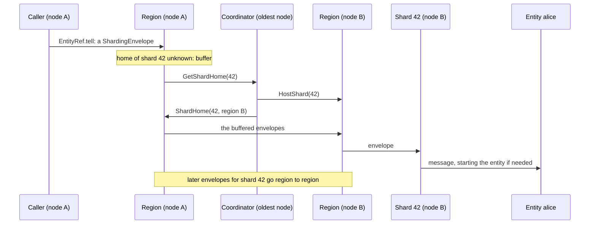

# 7. Sharding

## The problem

A shop with a million customers cannot keep a million carts on one machine, and it should not have to look up where a cart is before talking to it. Chapter 2's shop handed out one cart per customer, but every cart lived in its one process, and the shop itself was one more thing that could fail.

## The idea

**Sharding** spreads the carts, the **entities**, over the nodes, and gives you a ref by id: `entity_ref_for(CART, "alice")`, on any node, reaches alice's cart wherever it is, and starts it on its first message. Ids are grouped into **shards** by a hash, and each shard lives on one node. A **coordinator**, which is a cluster singleton, decides which node hosts each shard, and moves shards when nodes join or leave. Ordinary messages do not go through it: each node remembers where the shards are and sends straight there.


## A first example

Chapter 1's cart, one per customer, over two nodes:

```python
import asyncio

from cart import AddItem, CartCmd, GetCart, cart
from ohra import (
    ActorSystem,
    Address,
    Behaviors,
    ClusterSettings,
    ClusterSharding,
    Entity,
    EntityTypeKey,
    ask,
    remotable,
)

remotable(AddItem)
remotable(GetCart)
CART = EntityTypeKey[CartCmd]("Cart")
SEEDS = (Address("shop", "127.0.0.1", 2551),)


def node(port: int) -> ActorSystem[None]:
    settings = ClusterSettings(seed_nodes=SEEDS)
    system = ActorSystem(Behaviors.empty, "shop", address=("127.0.0.1", port), cluster=settings)
    ClusterSharding(system).init(Entity(CART, lambda entity: cart({})))  # on every node
    return system


async def main() -> None:
    async with node(2551) as first, node(2552) as second:
        alice_on_1 = ClusterSharding(first).entity_ref_for(CART, "alice")
        alice_on_2 = ClusterSharding(second).entity_ref_for(CART, "alice")
        bob_on_2 = ClusterSharding(second).entity_ref_for(CART, "bob")
        await ask(alice_on_1, lambda r: AddItem("book", 1, r), timeout=10)
        await ask(alice_on_2, lambda r: AddItem("pen", 2, r), timeout=10)
        await ask(bob_on_2, lambda r: AddItem("mug", 1, r), timeout=10)
        print("alice:", await ask(alice_on_1, GetCart, timeout=10))
        print("bob:", await ask(bob_on_2, GetCart, timeout=10))


if __name__ == "__main__":
    asyncio.run(main())
```

It prints:

```
alice: {'book': 1, 'pen': 2}
bob: {'mug': 1}
```

- **`ClusterSharding(system).init(Entity(CART, ...))`** makes the cart an entity type on every node. The function starts a new entity. It receives an `EntityContext` with the entity's id, which an empty cart does not need.
- **`entity_ref_for(CART, "alice")`** is a ref by id, and works on either node. Both of alice's refs reach the same cart, which is why it holds the book added through 2551 and the pen added through 2552.
- **Entities start on demand.** No cart existed before its first message. The node hosting its shard started it.
- **`remotable(AddItem)` and `remotable(GetCart)`**, as in [chapter 4](04-remoting.md): a node often sends to an entity hosted on the other.
- **The first ask waits a moment** while the cluster forms and the coordinator starts. Messages are buffered meanwhile, hence `timeout=10`.

When a node leaves, its shards move to the others, and their entities start again there, empty. With `Behaviors.persisted`, as in [chapter 3](03-persistence.md), they start from their saved state instead, which is what the carts in [chapter 11](11-putting-it-together.md) do.

> **Coming from Apache Pekko**
>
> - `ClusterSharding(system).init(Entity(key, create))`, `entity_ref_for`, `EntityTypeKey`, `EntityContext`, `ShardingEnvelope` and `Passivate` are Pekko's. `Entity` takes `create` as its second argument instead of a second argument list.
> - The shard id is `crc32(id) % number_of_shards`, as `HashCodeMessageExtractor`, with Pekko's default of 1000 shards.
> - `Sharding.init` is the region on one node with no coordinator, for apps that run in one process.
> - The coordinator keeps its state in memory and rebuilds it from the regions' registrations, where Pekko uses distributed data. There are no remembered entities and no custom allocation strategies. [Appendix B](appendix-deviations.md) has the full list.

## How it works

Sharding runs many small stateful actors, entities, each addressed by an id, without the caller knowing where they live. Three kinds of actor do the work, all under `/system/sharding`:

- **A region per entity type on every node.** It routes messages, hosts the shards assigned to this node and registers with the coordinator.
- **A shard per shard id.** A shard is a child of the region that hosts it and owns the entities whose ids hash to it. It starts an entity on its first message and passivates it when idle.
- **One coordinator per entity type,** run as a cluster singleton on the oldest node. It decides which region hosts each shard.

An entity id maps to a shard id by `crc32(id) % number_of_shards`, 1000 by default. The hash is the same on every node, so every region computes the same shard for an id. Only the shard's location needs a decision.



**The first message for a shard.** `EntityRef.tell` wraps the message in a `ShardingEnvelope` and gives it to the local region. A region that does not know the shard's home buffers the message and asks the coordinator with `GetShardHome`. The coordinator allocates the shard to the least loaded region, tells that region `HostShard`, and answers `ShardHome`. From then on the asking region sends envelopes for that shard straight to the owning region, which hands them to the shard and the shard to the entity. The coordinator is never on the path of ordinary traffic.

**Rebalance and hand-off.** Every 10 seconds the coordinator compares shard counts and may move a few shards from the busiest region to the least busy. A move is a hand-off. The coordinator tells every region `BeginHandOff`, so they start buffering for that shard. Once all have acknowledged, it sends `HandOff` to the owner, whose shard stops its entities and reports `ShardStopped`. Then the shard is allocated afresh and the buffers drain to the new home. A leaving node does the same for all of its shards, in the `cluster-sharding-shutdown-region` phase.

**After a crash.** The coordinator does not persist its state. A new coordinator rebuilds the allocation from the regions' registrations, and a crashed node's shards are allocated again once it is removed. Their entities start fresh on the new node, which is why entities that must keep state use [persistence](03-persistence.md).

### Sharding in one process

`Sharding.init(Entity(key, create))` is a shard region: one entity actor per id, created by its first message, passivated when idle or when it asks, with messages that arrive while it is passivating buffered for the next incarnation. An entity that stops on its own, by returning `Behaviors.stopped()`, loses what is queued behind it, as in Pekko, so an entity should passivate rather than stop itself. This is the region layer of Apache Pekko's `ClusterSharding` inside one process, which is what most single-node apps use it for: address by id, create on demand, and keep only hot entities in memory.

```python
from ohra import Entity, EntityContext, EntityTypeKey, Sharding

Cart = EntityTypeKey[Command]("Cart")


def cart(entity: EntityContext[Command]) -> Behavior[Command]:
    # entity.entity_id names this cart; entity.shard.tell(Passivate(ctx.self)) stops it early
    return counter()


region = Sharding.init(Entity(Cart, cart).with_passivate_after(30.0))
```

Spawn `region` like any behavior, then `Sharding.entity_ref_for(region_ref, "cart-42")` gives an `EntityRef`, an `ActorRef` that `tell`s and `ask`s the entity whether or not it exists yet. `GetShardRegionState` asks the region which entities are live. Under the region, as in Pekko, a Shard actor per shard id hosts its entities; the same Shards serve the cluster-wide regions of the "Sharding across nodes" section. `GetShardRegionState` is answered through a child that asks every Shard, so the reply arrives once all have answered or after `shard_region_query_timeout`.

### Sharding across nodes

`ClusterSharding(system).init(Entity(key, create))` is `Sharding.init` for the whole cluster: the same entity type on every node, each entity living on exactly one of them. A ShardCoordinator, run as a cluster singleton, decides which node hosts each shard with Pekko's least-shard allocation; every node's region routes a message to the shard's home, local or remote, and buffers while the home is unknown. `entity_ref_for(key, id)` works on any node. When a node joins, the coordinator moves shards to it over the following rebalance intervals; when a node leaves, its region hands every shard off during the exiting phase before the node confirms its exit; when a node crashes, its shards are served again once it has been downed and removed, and not before, so no entity ever runs twice.

```python
from ohra import ClusterSharding, Entity, EntityTypeKey

COUNTER = EntityTypeKey[CountUp]("Counter")
region = ClusterSharding(system).init(Entity(COUNTER, lambda entity: counter()))  # every node
print(await ask(ClusterSharding(system).entity_ref_for(COUNTER, "alice"), CountUp, timeout=3))
```

Entities are in memory: a moved or handed-off entity starts fresh on its new node, and `Behaviors.persisted` is how state outlives that. A rebalance can drop messages that reach the old host in its hand-off window, as Pekko's does; they are dead letters, never silent. `ClusterShardingSettings` carries Pekko's `number_of_shards`, `retry_interval`, `rebalance_interval`, `handoff_timeout`, `shard_start_timeout`, `buffer_size`, `rebalance_absolute_limit`, `rebalance_relative_limit` and `coordinator_singleton_settings` (the coordinator's `ClusterSingletonSettings`), plus `passivate_after` and `shard_region_query_timeout`.

---

[← Cluster singleton](06-singleton.md) · [Contents](README.md) · [Management and Kubernetes →](08-management-and-kubernetes.md)
