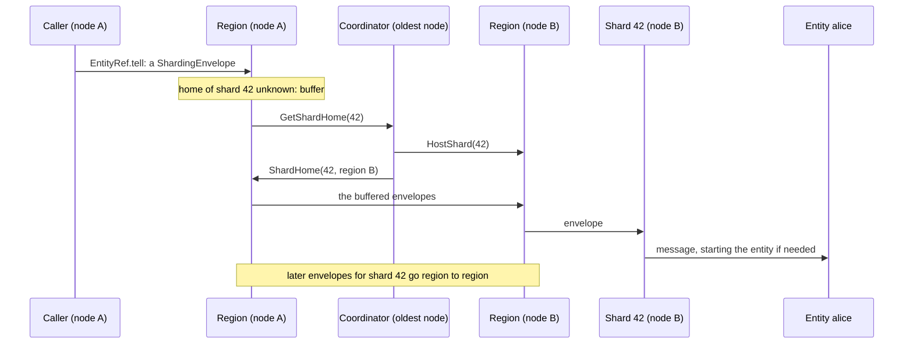
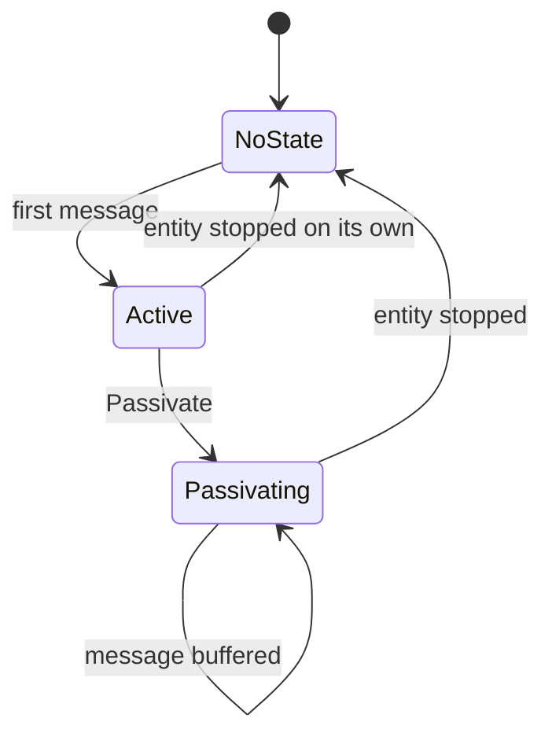

# 7. Sharding

## The problem

A shop with a million customers cannot keep a million carts on one machine, and it should not have to look up where a cart is before talking to it. Chapter 2's shop handed out one cart per customer, but every cart lived in its one process, and the shop itself was one more thing that could fail.

## The idea

**Sharding** spreads the carts, the **entities**, over the nodes, and gives you a ref by id: `entity_ref_for(CART, "alice")`, on any node, reaches alice's cart wherever it is, and starts it on its first message. Ids are grouped into **shards** by a hash, and each shard lives on one node. A **coordinator**, which is a cluster singleton, decides which node hosts each shard, and moves shards when nodes join or leave. Ordinary messages do not go through it: each node remembers where the shards are and sends straight there.


## A first example

Chapter 1's cart, one per customer, over two nodes:

```python
import asyncio

from cart import AddItem, CartCmd, GetCart, cart
from ohra import (
    ActorSystem,
    Address,
    Behaviors,
    ClusterSettings,
    ClusterSharding,
    Entity,
    EntityTypeKey,
    ask,
    remotable,
)

remotable(AddItem)
remotable(GetCart)
CART = EntityTypeKey[CartCmd]("Cart")
SEEDS = (Address("shop", "127.0.0.1", 2551),)


def node(port: int) -> ActorSystem[None]:
    settings = ClusterSettings(seed_nodes=SEEDS)
    system = ActorSystem(Behaviors.empty, "shop", address=("127.0.0.1", port), cluster=settings)
    ClusterSharding(system).init(Entity(CART, lambda entity: cart({})))  # on every node
    return system


async def main() -> None:
    async with node(2551) as first, node(2552) as second:
        alice_on_1 = ClusterSharding(first).entity_ref_for(CART, "alice")
        alice_on_2 = ClusterSharding(second).entity_ref_for(CART, "alice")
        bob_on_2 = ClusterSharding(second).entity_ref_for(CART, "bob")
        await ask(alice_on_1, lambda r: AddItem("book", 1, r), timeout=10)
        await ask(alice_on_2, lambda r: AddItem("pen", 2, r), timeout=10)
        await ask(bob_on_2, lambda r: AddItem("mug", 1, r), timeout=10)
        print("alice:", await ask(alice_on_1, GetCart, timeout=10))
        print("bob:", await ask(bob_on_2, GetCart, timeout=10))


if __name__ == "__main__":
    asyncio.run(main())
```

It prints:

```
alice: {'book': 1, 'pen': 2}
bob: {'mug': 1}
```

- **`ClusterSharding(system).init(Entity(CART, ...))`** makes the cart an entity type on every node. The function starts a new entity. It receives an `EntityContext` with the entity's id, which an empty cart does not need.
- **`entity_ref_for(CART, "alice")`** is a ref by id, and works on either node. Both of alice's refs reach the same cart, which is why it holds the book added through 2551 and the pen added through 2552.
- **Entities start on demand.** No cart existed before its first message. The node hosting its shard started it.
- **`remotable(AddItem)` and `remotable(GetCart)`**, as in [chapter 4](04-remoting.md): a node often sends to an entity hosted on the other.
- **The first ask waits a moment** while the cluster forms and the coordinator starts. Messages are buffered meanwhile, hence `timeout=10`.

When a node leaves, its shards move to the others, and their entities start again there, empty. With `Behaviors.persisted`, as in [chapter 3](03-persistence.md), they start from their saved state instead, which is what the carts in [chapter 11](11-putting-it-together.md) do.

> **Coming from Apache Pekko**
>
> - `ClusterSharding(system).init(Entity(key, create))`, `entity_ref_for`, `EntityTypeKey`, `EntityContext`, `ShardingEnvelope` and `Passivate` are Pekko's. `Entity` takes `create` as its second argument instead of a second argument list.
> - The shard id is `crc32(id) % number_of_shards`, as `HashCodeMessageExtractor`, with Pekko's default of 1000 shards.
> - `Sharding.init` is the region on one node with no coordinator, for apps that run in one process.
> - There are no remembered entities and no custom allocation strategies. [Appendix B](appendix-deviations.md) has the full list.

## How it works

Sharding runs many small stateful actors, entities, each addressed by an id, without the caller knowing where they live. Three kinds of actor do the work, all under `/system/sharding`:

- **A region per entity type on every node.** It routes messages, hosts the shards assigned to this node and registers with the coordinator.
- **A shard per shard id.** A shard is a child of the region that hosts it and owns the entities whose ids hash to it. It starts an entity on its first message and passivates it when idle.
- **One coordinator per entity type,** run as a cluster singleton on the oldest node. It decides which region hosts each shard.

An entity id maps to a shard id by `crc32(id) % number_of_shards`, 1000 by default. The hash is the same on every node, so every region computes the same shard for an id. Only the shard's location needs a decision.



**The first message for a shard.** `EntityRef.tell` wraps the message in a `ShardingEnvelope` and gives it to the local region. A region that does not know the shard's home buffers the message and asks the coordinator with `GetShardHome`. The coordinator allocates the shard to the least loaded region, tells that region `HostShard`, and answers `ShardHome`. From then on the asking region sends envelopes for that shard straight to the owning region, which hands them to the shard and the shard to the entity. The coordinator is never on the path of ordinary traffic.

**Rebalance and hand-off.** Every 10 seconds the coordinator compares shard counts and may move a few shards from the busiest region to the least busy. A move is a hand-off. The coordinator tells every region `BeginHandOff`, so they start buffering for that shard. Once all have acknowledged, it sends `HandOff` to the owner, whose shard stops its entities and reports `ShardStopped`. Then the shard is allocated afresh and the buffers drain to the new home. A leaving node does the same for all of its shards, in the `cluster-sharding-shutdown-region` phase.

**After a crash.** The coordinator keeps its shard map in [Distributed Data](14-distributed-data.md), in an `LWWRegister` on sharding's own Replicator at `/system/sharding/replicator`. A new coordinator reads the map from a majority of the nodes before it answers anyone, and each change is written to a majority before it takes effect. With the defaults, every node of a cluster of up to eight takes part in each write, and of up to twelve in each read, so while a crashed node has not yet been removed, a new shard's allocation waits for it and is retried. A crashed node's shards are allocated again once it is removed. Their entities start fresh on the new node, which is why entities that must keep state use [persistence](03-persistence.md).

### Sharding in one process

`Sharding.init(Entity(key, create))` is a shard region: one entity actor per id, created by its first message, passivated by the [passivation strategy](#passivation-strategies) (idle for 120 s unless set otherwise) or when it asks, with messages that arrive while it is passivating buffered for the next incarnation. An entity that stops on its own, by returning `Behaviors.stopped()`, loses what is queued behind it, as in Pekko, so an entity should passivate rather than stop itself. This is the region layer of Apache Pekko's `ClusterSharding` inside one process, which is what most single-node apps use it for: address by id, create on demand, and keep only hot entities in memory.

```python
from ohra import (
    ClusterShardingSettings,
    Entity,
    EntityContext,
    EntityTypeKey,
    PassivationStrategySettings,
    Sharding,
)

Cart = EntityTypeKey[Command]("Cart")


def cart(entity: EntityContext[Command]) -> Behavior[Command]:
    # entity.entity_id names this cart; entity.shard.tell(Passivate(ctx.self)) stops it early
    return counter()


lru = PassivationStrategySettings.defaults.with_active_entity_limit(10_000)
settings = ClusterShardingSettings().with_passivation_strategy(
    lru.with_least_recently_used_replacement()
)
region = Sharding.init(Entity(Cart, cart).with_settings(settings))
```

Spawn `region` like any behavior, then `Sharding.entity_ref_for(region_ref, "cart-42")` gives an `EntityRef`, an `ActorRef` that `tell`s and `ask`s the entity whether or not it exists yet. `GetShardRegionState` asks the region which entities are live. Under the region, as in Pekko, a Shard actor per shard id hosts its entities; the same Shards serve the cluster-wide regions of the "Sharding across nodes" section. `GetShardRegionState` is answered through a child that asks every Shard, so the reply arrives once all have answered or after `shard_region_query_timeout`.

### Sharding across nodes

`ClusterSharding(system).init(Entity(key, create))` is `Sharding.init` for the whole cluster: the same entity type on every node, each entity living on exactly one of them. A ShardCoordinator, run as a cluster singleton, decides which node hosts each shard with Pekko's least-shard allocation; every node's region routes a message to the shard's home, local or remote, and buffers while the home is unknown. `entity_ref_for(key, id)` works on any node. Call `init` on every member: the first `init` starts sharding's Replicator, and a member without one never answers the coordinator's reads and writes, which with the defaults need every node of a small cluster, so the coordinator never gets its state and logs "Has ClusterSharding been started on all nodes?". When a node joins, the coordinator moves shards to it over the following rebalance intervals; when a node leaves, its region hands every shard off during the exiting phase before the node confirms its exit; when a node crashes, its shards are served again once it has been downed and removed, and not before, so no entity ever runs twice.

```python
from ohra import ClusterSharding, Entity, EntityTypeKey

COUNTER = EntityTypeKey[CountUp]("Counter")
region = ClusterSharding(system).init(Entity(COUNTER, lambda entity: counter()))  # every node
print(await ask(ClusterSharding(system).entity_ref_for(COUNTER, "alice"), CountUp, timeout=3))
```

Entities are in memory: a moved or handed-off entity starts fresh on its new node, and `Behaviors.persisted` is how state outlives that. A rebalance can drop messages that reach the old host in its hand-off window, as Pekko's does; a message that reaches a shard handing off is unhandled, and a message buffered for a passivating entity is dropped when its shard stops or hands off. `ClusterShardingSettings` carries Pekko's `number_of_shards`, `retry_interval`, `rebalance_interval`, `handoff_timeout`, `shard_start_timeout`, `buffer_size`, `rebalance_absolute_limit`, `rebalance_relative_limit` and `coordinator_singleton_settings` (the coordinator's `ClusterSingletonSettings`), plus `shard_region_query_timeout`, `passivation_strategy_settings`, `lease_settings`, `verbose_debug_logging`, `fail_on_invalid_entity_state_transition`, `entity_restart_backoff` and `shard_failure_backoff`. The last two are unused until remembered entities arrive. A coordinator that fails on a message restarts at once, as Pekko's does, and the regions register with the new one. A region whose buffer is full drops a message for a shard with no known home into dead letters, and still asks for that shard's home.

The coordinator's reads and writes of its state are tuned with six more fields. Their defaults are Pekko's.

| Field | Pekko key | Default and meaning |
|---|---|---|
| `waiting_for_state_timeout` | `waiting-for-state-timeout` | 2.0 s: how long the read of the state may take before it is retried |
| `updating_state_timeout` | `updating-state-timeout` | 5.0 s: how long a write may take before it is retried |
| `coordinator_state_read_majority_plus` | `coordinator-state.read-majority-plus` | 5; `"all"` reads from every node |
| `coordinator_state_write_majority_plus` | `coordinator-state.write-majority-plus` | 3; `"all"` writes to every node |
| `majority_min_cap` | `distributed-data.majority-min-cap` | 5: the fewest nodes a majority-plus read or write reaches |
| `distributed_data` | `distributed-data` | `None`: the cluster's `ReplicatorSettings` with `prefer_oldest=True` and `max_delta_elements=5`, never durable |

A read or write reaches a majority plus its extra nodes (5 for reads, 3 for writes), at least `majority_min_cap` and at most every node. With the defaults, writes reach every node of a cluster of up to eight nodes and reads every node of one of up to twelve; in a cluster of three, the majority of two plus the extra nodes is more than three already, so `majority_min_cap` does not come into it. A larger cluster that wants every write on every node asks for it:

```python
from cart import CartCmd, cart
from ohra import ActorSystem, ClusterSharding, ClusterShardingSettings, Entity, EntityTypeKey

CART = EntityTypeKey[CartCmd]("Cart")


def start(system: ActorSystem[None]) -> None:
    entity = Entity(CART, lambda ctx: cart({})).with_settings(
        ClusterShardingSettings(coordinator_state_write_majority_plus="all")
    )
    ClusterSharding(system).init(entity)
```

### Passivation strategies

Passivation stops an entity that is not needed, to free its memory. Pekko decides which entity with a strategy, and `ClusterShardingSettings.passivation_strategy_settings` describes one. The strategies, from Pekko's documentation:

- **Idle**: an entity passivates after it has received no message for the idle timeout. It is checked on an interval, half the timeout unless set.
- **Least recently used**, **most recently used** and **least frequently used**: a limit on the active entities of the region, divided evenly among its shards. When a shard is over its share, the entity the policy picks, the one touched longest ago, the one touched last, or the one touched least often, passivates. Idle passivation can run beside any of them.
- **Segmented least recently used**: least recently used with several levels. An entity enters the lowest and moves up a level each time it is touched again, so entities touched only once go first.
- **The composite strategy**: a main policy behind an admission window. A new entity first enters a small window with its own policy, and the window's evictee competes for a place in the main area against the main area's own candidate, decided by a frequency sketch filter that counts how often each id is touched. A hill-climbing optimizer adjusts the window's size from the hit rate it sees.

Each setting has a Pekko key in a strategy's section under `pekko.cluster.sharding.passivation` (the table leaves the section out), and a builder on `PassivationStrategySettings`. `WindowSettings`, `HillClimbingSettings` and `FrequencySketchSettings` are nested in `PassivationStrategySettings.AdmissionSettings`. Durations are in seconds.

| Pekko key | ohra | Default |
|---|---|---|
| `idle-entity.timeout` | `with_idle_entity_passivation(timeout)`, or an `IdleSettings` | none (120.0 in `default_idle_strategy`) |
| `idle-entity.interval` | `with_idle_entity_passivation(timeout, interval)`, or `IdleSettings.interval` | `None`: half the timeout |
| `active-entity-limit` | `with_active_entity_limit(limit)` | none (100_000 in `default_strategy`) |
| `replacement.policy` | `with_least_recently_used_replacement()`, `with_most_recently_used_replacement()`, `with_least_frequently_used_replacement()` | none |
| `replacement.least-recently-used.segmented.levels`, `proportions` | `LeastRecentlyUsedSettings.with_segmented(levels)` or `with_segmented(proportions)` | none |
| `replacement.least-frequently-used.dynamic-aging` | `LeastFrequentlyUsedSettings.with_dynamic_aging()` | `False` |
| `admission.window.proportion`, `minimum-proportion`, `maximum-proportion` | `WindowSettings.initial_proportion`, `minimum_proportion`, `maximum_proportion` | 0.01, 0.01, 1.0 |
| `admission.window.policy` | `WindowSettings.with_policy(...)` | none |
| `admission.window.optimizer` | `WindowSettings.with_optimizer(HillClimbingSettings)` | none |
| `admission.window.hill-climbing.adjust-multiplier`, `initial-step`, `restart-threshold`, `step-decay` | `HillClimbingSettings` fields of the same names | 10.0, 0.0625, 0.05, 0.98 |
| `admission.filter` | `AdmissionSettings.with_filter(FrequencySketchSettings)` | none |
| `admission.frequency-sketch.depth`, `counter-bits`, `width-multiplier`, `reset-multiplier` | `FrequencySketchSettings` fields of the same names | 4, 4, 4, 10.0 |

Pekko's `passivation.strategy` names a strategy section. The three Pekko ships are constants here, and any other is built with the builders: `PassivationStrategySettings.default_idle_strategy` is idle passivation after 120 s, `default_strategy` is the composite with a limit of 100_000, a least recently used window with the hill-climbing optimizer, the frequency sketch filter and a two-level segmented main area of proportions 0.2 and 0.8, and `disabled` passivates nothing. `ClusterShardingSettings()` carries `default_idle_strategy`; the shard passivates by it. `with_no_passivation_strategy()` is `disabled`.

```python
from ohra.cluster.sharding import ClusterShardingSettings, PassivationStrategySettings

lru = PassivationStrategySettings.defaults.with_active_entity_limit(10_000)
settings = ClusterShardingSettings().with_passivation_strategy(
    lru.with_least_recently_used_replacement().with_idle_entity_passivation(600.0)
)
assert settings.passivation_strategy_settings.active_entity_limit == 10_000
print(settings.passivation_strategy_settings.idle_entity_settings)
```

```
PassivationStrategySettings.IdleSettings(timeout=600.0, interval=None)
```

### The shard

A shard hosts the entities of one shard id. Both `Sharding.init` and the cluster regions run it. It follows Pekko's `Shard` with remembered entities off.

- **Entity states.** An entity is `NoState`, `Active` or `Passivating`. The first message makes it `Active`. `Passivate` makes it `Passivating`, and its termination makes it `NoState` again. The remember-entity states (`RememberingStart`, `RememberingStop`, `RememberedButNotCreated`, `WaitingForRestart`) are the ones remembered entities will use.



- **Buffering.** Messages for a `Passivating` entity wait in a buffer and go to its next incarnation. `buffer_size` caps them in total across the shard's entities. Past the cap a message is dropped and published as `Dropped` on the event stream.
- **Idle passivation.** `ClusterShardingSettings()` passivates an entity that has had no message for 120 s, checked every 60 s, so between 120 and 180 s after its last message.
- **The active-entity limit.** A limit of the region is divided among the shards the region has, so a shard's share changes when a shard starts or is handed off. The region tells its shards the count with `ShardsUpdated`, and `SetActiveEntityLimit(limit)` sent to a region sets the limit of its shards at run time.
- **Hand-off.** On `HandOff`, the shard starts a `HandOffStopper` that sends the entities the stop message (`Entity.with_stop_message`) or, with none, stops each after its pending messages. It warns after 5 s if entities are left, and stops them at `max(handoff_timeout - 5, 1)` seconds. The stopper replies `ShardStopped` once all have terminated, and the shard then stops. A shard with no entities replies at once. Messages that reach the shard meanwhile are unhandled.
- **The lease.** `ClusterShardingSettings().with_lease_settings(LeaseUsageSettings("my-lease"))` makes every shard acquire a [lease](05-cluster.md#leases) before it starts its entities. `"my-lease"` is the name the implementation was registered under with `LeaseProvider(system).register`. Its name is `<system>-shard-<type>-<shard id>` and its owner is `system@host:port`. A failed acquire is retried after `lease_retry_interval`, 5 s by default. Messages that arrive meanwhile wait: the shard stashes them under `Sharding.init`, and a cluster region buffers them, up to `buffer_size`. A lease that is lost stops the shard and its entities at once, and the region starts it again with the next message for it.
- **Full cluster shutdown.** Once a member is preparing for shutdown, the coordinator stops rebalancing, the regions ignore `BeginHandOff` and skip their graceful shutdown, and a shard that gets `HandOff` stops its entities and itself at once, without a `HandOffStopper`. [Chapter 5](05-cluster.md#full-cluster-shutdown) has the sequence.
- **Stats.** `GetShardRegionStats(reply_to)` sent to a region answers `ShardRegionStats(stats, failed)`: the entity count of each shard, passivating entities included, and the shards that did not answer within `shard_region_query_timeout`. `GetClusterShardingStats(timeout, reply_to)` sent to a cluster region gathers every region's stats through the coordinator and answers `ClusterShardingStats`, keyed by node address. It is empty when a region did not answer in time.

```python
import asyncio
from dataclasses import dataclass

from ohra import (
    ActorRef,
    ActorSystem,
    Behavior,
    Behaviors,
    ClusterShardingSettings,
    Entity,
    EntityContext,
    EntityTypeKey,
    GetShardRegionStats,
    PassivationStrategySettings,
    Sharding,
    ask,
)


@dataclass(frozen=True)
class Ping:
    reply_to: ActorRef[str]


PINGED = EntityTypeKey[Ping]("Pinged")


def pinged(entity: EntityContext[Ping]) -> Behavior[Ping]:
    def on_ping(_ctx: object, msg: Ping) -> Behavior[Ping]:
        msg.reply_to.tell(entity.entity_id)
        return Behaviors.same

    return Behaviors.receive(on_ping)


async def main() -> None:
    lru = PassivationStrategySettings.defaults.with_active_entity_limit(2)
    settings = ClusterShardingSettings(number_of_shards=1).with_passivation_strategy(
        lru.with_least_recently_used_replacement()
    )
    entity = Entity(PINGED, pinged).with_settings(settings)
    async with ActorSystem(Sharding.init(entity), "shop") as system:
        for name in ("a", "b", "c"):
            await ask(Sharding.entity_ref_for(system, name), Ping, timeout=1)
        print(await ask(system, GetShardRegionStats, timeout=1))


asyncio.run(main())
```

```
ShardRegionStats(stats={'0': 2}, failed=frozenset())
```

The limit is 2 and one shard holds all three entities, so touching `c` passivated `a`, the least recently used. `a` had stopped by the time the stats were asked for; an entity still stopping is counted.

---

[← Cluster singleton](06-singleton.md) · [Contents](README.md) · [Management and Kubernetes →](08-management-and-kubernetes.md)
