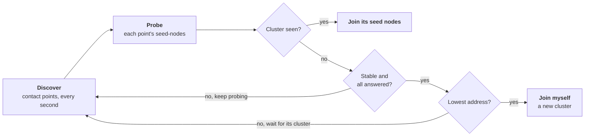

# 8. Management and Kubernetes

## The problem

On Kubernetes, pods come and go with new addresses, so there is no fixed list of seed nodes to write into the settings. Kubernetes also asks each pod, over HTTP, whether it is alive and whether it is ready for traffic. A pod whose process has started is not ready yet: it still has to join the cluster.

## The idea

**Management** is a small HTTP server on every node. Kubernetes' probes call its health checks: `/alive`, and `/ready`, which answers yes only once the node is Up in the cluster. The same server lets the nodes form a cluster with no seed list, which is the **bootstrap**. Each node asks **discovery** for its peers (on Kubernetes, the API server lists the pods), asks each peer over HTTP whether it already belongs to a cluster, and joins that cluster if it does. If no peer does, and the set of peers has stopped changing, the peer with the lowest address starts a cluster and the others join it. Every node applies the same rule to the same answers, so exactly one cluster forms.

## A first example

Two nodes in one process, with a fixed list for discovery in place of Kubernetes:

```python
import asyncio
import json
import urllib.error
import urllib.request

from ohra import (
    ActorSystem,
    Behaviors,
    Cluster,
    ClusterBootstrapSettings,
    ClusterSettings,
    ConfigServiceDiscovery,
    Management,
    ManagementSettings,
    ResolvedTarget,
)

# on Kubernetes, KubernetesApiServiceDiscovery() asks the API server for this list
DISCOVERY = ConfigServiceDiscovery(
    {
        "shop": [
            ResolvedTarget("127.0.0.1", 8551, "127.0.0.1"),
            ResolvedTarget("127.0.0.1", 8552, "127.0.0.1"),
        ]
    }
)


def node(port: int) -> ActorSystem[None]:
    management = ManagementSettings(
        hostname="127.0.0.1",
        port=port + 6000,  # 8551 and 8552
        discovery=DISCOVERY,
        bootstrap=ClusterBootstrapSettings(
            service_name="shop",
            stable_margin=1.0,
            filter_on_fallback_port=False,  # two nodes on one host: two management ports
        ),
    )
    return ActorSystem(
        Behaviors.empty,
        "shop",
        address=("127.0.0.1", port),
        cluster=ClusterSettings(),  # no seed nodes
        management=management,
    )


def get(url: str) -> tuple[int, str]:
    try:
        with urllib.request.urlopen(url) as response:
            return response.status, response.read().decode()
    except urllib.error.HTTPError as error:  # 4xx and 5xx
        return error.code, error.read().decode()


async def main() -> None:
    async with node(2551) as first, node(2552) as second:
        await Management(first).start()  # serves HTTP, then starts the bootstrap
        await Management(second).start()
        print(await asyncio.to_thread(get, "http://127.0.0.1:8551/ready"))
        while sum(m.status == "up" for m in Cluster(first).state.members) < 2:
            await asyncio.sleep(0.1)
        print(await asyncio.to_thread(get, "http://127.0.0.1:8551/ready"))
        _, body = await asyncio.to_thread(get, "http://127.0.0.1:8551/cluster/members")
        for member in json.loads(body)["members"]:
            print(member["node"], member["status"])


if __name__ == "__main__":
    asyncio.run(main())
```

It prints:

```
(500, 'Not Healthy: Check [cluster-membership] not ok')
(200, 'OK')
ohra://shop@127.0.0.1:2551 Up
ohra://shop@127.0.0.1:2552 Up
```

- **`ClusterSettings()`** has no seed nodes, so neither node knows whom to join.
- **`ConfigServiceDiscovery`** is a fixed list of where to find each node's management server. On Kubernetes, `KubernetesApiServiceDiscovery()` builds the list from the pods instead.
- **`ClusterBootstrapSettings`** turns the bootstrap on. `stable_margin=1.0` shortens how long the list of peers must stay unchanged before a cluster is started, and `filter_on_fallback_port=False` is needed only because both nodes share one host.
- **`Management(system).start()`** opens the HTTP server, here on 8551 and 8552, and starts the bootstrap.
- **`/ready` answers 500 at first**, since the node is running but not yet in a cluster. Once both nodes are Up it answers 200, and `/cluster/members` lists them. Kubernetes' readiness probe calls `/ready`, so no traffic reaches a pod before that.

The rest of this chapter has the Kubernetes side: the permissions, the probes, and a three-pod cluster on Docker Desktop.

> **Coming from Apache Pekko**
>
> - `Management(system).start()` is `PekkoManagement(system).start()`, and `ManagementSettings` replaces `pekko.management.http`. The class lost the Pekko prefix along with the project's name.
> - Cluster bootstrap, its lowest-address rule and `ClusterBootstrapSettings` are Pekko's. The bootstrap starts from `Management.start()`, not as its own extension.
> - Your own health checks are added in code, with `Management(system).health.add_readiness_check(name, check)`, instead of by class name in the configuration.
> - The server is the standard library's: GET only, no HTTPS, and read-only cluster routes. Only Kubernetes API and fixed-list discovery exist. [Appendix B](appendix-deviations.md) has the details.

## How it works

`Management(system).start()` binds a small HTTP/1.1 server, port 7626 by default, written on the standard library. It serves three groups of routes:

- **Health checks** for Kubernetes probes. `/ready` answers 200 once every readiness check passes, and on a cluster node that includes being Up or WeaklyUp. `/alive` and `/startup` work the same way with their own checks.
- **Read-only cluster routes.** `/cluster/members` lists the membership with the leader and the oldest member. `/cluster/shards/{type}` lists this node's shards and their entity counts.
- **`/bootstrap/seed-nodes`**, which tells a probing peer which cluster this node belongs to, if any.

**Discovery.** `KubernetesApiServiceDiscovery` lists the pods labelled `app=<service>` through the API server, using the pod's service-account token and CA, and returns each Running pod's IP and its port named `management`. `ConfigServiceDiscovery` is a fixed list for local runs.

### Forming a cluster with no seed list

With no seed nodes configured, `start()` also starts a bootstrap coordinator actor. Every second it looks up the service's contact points, keeps one probe child per contact point polling its `/bootstrap/seed-nodes`, and hands the observations to the join decider.



The decider is Pekko's lowest-address rule. If any probe saw a cluster, join its seed nodes. Otherwise wait until at least `required_contact_point_nr` points have answered, the set has not changed for `stable_margin`, and every discovered point has answered. Then the node with the lowest address joins itself and the others find its cluster on their next probe. Every node runs the same rule on the same observations, so exactly one forms the cluster. After a cluster exists, `new_cluster_enabled=False` stops a minority that loses contact from ever starting a second one.

### Using it

Apache Pekko Management, narrowed to what a Kubernetes deployment uses: an HTTP endpoint on port 7626 with the health checks Kubernetes probes (`/startup`, `/ready`, `/alive`; a cluster node is ready when it is Up or WeaklyUp), read-only cluster routes (`/cluster/members`, `/cluster/members/{address}`, `/cluster/shards/{type}`), and cluster bootstrap: with no seed nodes configured, each node lists its peers through service discovery, probes their endpoints for seed nodes, joins any cluster it sees, and when nobody has one and the peer set has been stable for `stable_margin`, the lowest address joins itself. `KubernetesApiServiceDiscovery` lists the pods carrying the app label through the API server with the pod's service account; `ConfigServiceDiscovery` is a fixed list for local runs, and any `ServiceDiscovery` subclass with one `lookup` method works.

```python
from ohra import (
    ClusterBootstrapSettings,
    KubernetesApiServiceDiscovery,
    Management,
    ManagementSettings,
)

management = ManagementSettings(
    discovery=KubernetesApiServiceDiscovery(),
    bootstrap=ClusterBootstrapSettings(service_name="myapp", port_name="management"),
)


async def main() -> None:
    system = ActorSystem(
        guardian, "myapp", address=(pod_ip, 2552), cluster=ClusterSettings(), management=management
    )
    await Management(system).start()  # binds 7626, then starts the bootstrap
    Management(system).health.add_readiness_check("db", db.ping)  # your own checks join Pekko's
    await system.when_terminated()
```

On Kubernetes: give the pods the label `app=myapp`; bind a Role with `get` and `list` on `pods` to their service account; declare container ports for remoting and a port named `management` on 7626; point the readiness probe at `/ready` and the liveness probe at `/alive` on 7626; the namespace comes from `KUBERNETES_NAMESPACE` or the mounted service-account file; if the cluster's DNS does not resolve pod names (`10-1-0-5.ns.pod.cluster.local`), set `KubernetesApiSettings(use_raw_ip=True)` so the contact points are the pod IPs. Once a cluster exists, `new_cluster_enabled=False` forbids a partitioned minority from ever starting a second one. Locally, `examples/cluster/node.py one 2551 --bootstrap 2551 2552 2553` in three terminals forms a cluster with no seeds; its management runs on port + 1000.

#### Running on Docker Desktop Kubernetes

`examples/k8s/` is a complete deployment: `node.py` spreads a simulated calculation over the pods with sharding (each pod submits one task a second, and whichever pod owns the task's shard computes it and names itself in the result), `Dockerfile` builds the image from this checkout, and `cluster.yaml` holds the service account that may list pods, its Role and RoleBinding, and a three-replica Deployment with the pod IP and name from the downward API and the health checks as probes. Enable Kubernetes in Docker Desktop's settings (`kubectl config current-context` prints `docker-desktop`), then from the repository root, with your Docker Hub user for `YOU`:

```sh
docker build -t YOU/ohra-cluster:dev -f examples/k8s/Dockerfile .
docker login && docker push YOU/ohra-cluster:dev        # Docker Desktop's Kubernetes has its own image store, so the push is needed
kubectl create secret docker-registry regcred --docker-username=YOU --docker-password=ACCESS_TOKEN   # only if the repository is private
sed "s|IMAGE|YOU/ohra-cluster:dev|" examples/k8s/cluster.yaml | kubectl apply -f -
kubectl get pods -l app=cluster -w                            # three pods, Ready once they are Up
kubectl logs -l app=cluster -f --prefix                       # members joining, then the tasks and the pod that computed each
kubectl port-forward deploy/cluster 7626 &
curl -s localhost:7626/cluster/members | python -m json.tool  # also /cluster/shards/calculator, /ready, /alive, /bootstrap/seed-nodes
kubectl delete pod $(kubectl get pods -l app=cluster -o name | head -1)   # SIGTERM: the pod leaves gracefully, its shards move, a new pod bootstraps in
kubectl scale deploy/cluster --replicas=5                     # the new pods find the cluster and take shards
kubectl delete -f examples/k8s/cluster.yaml
```

`ErrImagePull` with `pull access denied` means the repository is private: make it public in its settings on hub.docker.com, or create the `regcred` secret above with a Docker Hub access token; the manifest references it and the kubelet ignores it when it is missing. A new image needs a push and `kubectl rollout restart deploy/cluster` (or a new tag), since `IfNotPresent` keeps the one it has; the restart is itself a demonstration, since the old pods leave gracefully while the new ones bootstrap in. Any other cluster works the same way once the image is in a registry it can pull from.

#### Carts: cluster sharding behind a web app

`examples/k8s/carts.py` is `examples/fastapi_carts.py` on the cluster: FastAPI on every pod, one sharded cart entity per cart id persisted with `PostgresStore`, and `ClusterSharding.entity_ref_for` in the routes, so any pod serves any cart. Every response names the pod that took the request (`served_by`) and the pod running the cart (`hosted_on`). `examples/k8s/carts.yaml` runs three pods from the same image under uvicorn, with a LoadBalancer Service that Docker Desktop publishes on `localhost:8000`, and a one-replica Postgres StatefulSet whose volume claim outlives its pod. An init container holds each cart pod until Postgres accepts connections. The carts are stored as JSON, so psql can show them. With the image built and pushed as above:

```sh
sed "s|IMAGE|YOU/ohra-cluster:dev|" examples/k8s/carts.yaml | kubectl apply -f -
curl -X POST localhost:8000/carts/alice/items -H 'content-type: application/json' -d '{"sku": "book", "qty": 2}'
curl localhost:8000/carts/alice          # repeat: served_by changes from request to request, hosted_on stays put
kubectl delete pod CARTS-POD-FROM-HOSTED_ON
curl localhost:8000/carts/alice          # the same items, now hosted_on another pod: recovered from the store
kubectl exec postgres-0 -- psql -U postgres -d carts -c \
  "SELECT persistence_id, revision, convert_from(state_payload, 'UTF8') FROM durable_state"   # one row per cart
kubectl delete pod postgres-0             # the database restarts on its volume; the next requests reconnect
curl -X DELETE localhost:8000/carts/alice   # checkout; the cart is then 404
kubectl delete -f examples/k8s/carts.yaml   # the volume claim stays: kubectl delete pvc data-postgres-0 removes the carts
```

uvicorn owns SIGTERM here: it stops taking requests first, then the app's lifespan exits and runs the coordinated shutdown, so a deleted pod has stopped serving before its carts hand off and it leaves. Sharding keeps one writer per cart, and the store's revision check catches anything else. Every pod reaches the same database, so the example runs the same on a cluster with several nodes. The password in the manifest's Secret is an example; replace it outside a local cluster.

---

[← Sharding](07-sharding.md) · [Contents](README.md) · [FastAPI →](09-fastapi.md)
