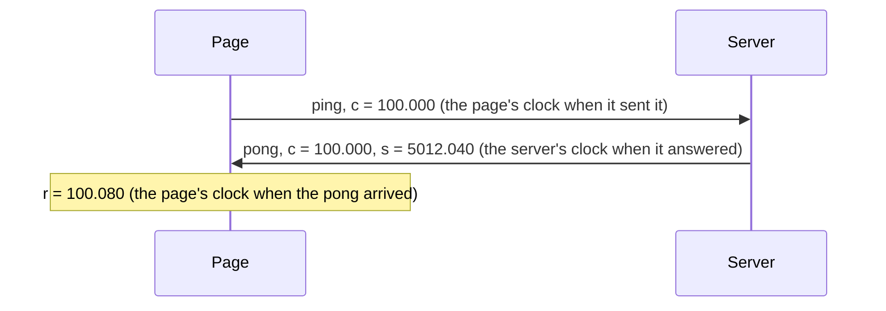

# 9. FastAPI

## The problem

Most Python services are web apps, and the web framework already runs the event loop. The actor system has to start with the app and stop with it, and every route has to reach it.

## The idea

`ohra.ext.fastapi.Actors` ties an actor system to a FastAPI app. The system starts when the app starts and shuts down, through the coordinated shutdown of [chapter 2](02-actor-system.md), when the app stops, and each route receives it as a dependency.

## A first example

Chapter 1's cart behind two routes. It needs the `web` extra (`pip install 'ohra[web]'`):

```python
from fastapi import FastAPI

from cart import AddItem, CartCmd, GetCart, cart
from ohra import ActorSystem
from ohra.ext.fastapi import Actors

actors = Actors(cart({}), "shop")  # the actor system lives as long as the app
app = FastAPI(lifespan=actors.lifespan, exception_handlers=actors.exception_handlers)


@app.post("/items/{sku}")
async def add_item(
    sku: str, qty: int = 1, system: ActorSystem[CartCmd] = actors.depends()
) -> dict[str, int]:
    return await system.ask(lambda r: AddItem(sku, qty, r), timeout=1)


@app.get("/cart")
async def get_cart(system: ActorSystem[CartCmd] = actors.depends()) -> dict[str, int]:
    return await system.ask(GetCart, timeout=1)
```

Start it in one terminal, and call it from another:

```
$ uvicorn web_cart:app
```

```
$ curl -X POST localhost:8000/items/book
{"book":1}
$ curl -X POST 'localhost:8000/items/pen?qty=2'
{"book":1,"pen":2}
$ curl localhost:8000/cart
{"book":1,"pen":2}
```

- **`Actors(cart({}), "shop")`** takes the same arguments as `ActorSystem`.
- **`lifespan=actors.lifespan`** lets FastAPI start the system and stop it.
- **`exception_handlers=actors.exception_handlers`** maps an ask timeout to a 504. Starlette reads the handlers when it builds the app, before the lifespan runs, so they go to `FastAPI(...)`; the lifespan logs a warning when they are missing.
- **`actors.depends()`** hands each route the system, with its type: `system.ask(GetCart, ...)` returns a `dict[str, int]`, and pyright checks that against the route's return type.
- **Each request is a message.** Two requests at the same moment still reach the cart one at a time, as in chapter 1.
- **A cart that does not answer within the timeout** turns into a 504 response.

> **Coming from Apache Pekko**
>
> - FastAPI routes play the part of Pekko HTTP routes that ask actors. The integration itself has no Pekko counterpart.
> - Under uvicorn the server keeps its signals. Its shutdown runs `system.terminate()` through the lifespan, instead of the system's `run_on_signals` hook, as [appendix B](appendix-deviations.md) explains.

## How it works

This integration is not part of Apache Pekko. It is what a Python service over actors otherwise writes by hand.

`ohra.ext.fastapi.Actors` owns an `ActorSystem` for the life of a FastAPI app and hands it to routes as a typed dependency, so `ask` replies are type-checked all the way to the response. With `actors.exception_handlers` passed to `FastAPI`, an `AskTimeoutError` that escapes a route becomes a 504. Keyword arguments after the name go to `ActorSystem` (`address`, `cluster`, `shutdown`, `management`), so a cluster node can be owned by the app. Needs the `web` extra. To stop taking requests before a cluster node leaves, add a task to the `service-unbind` phase of the coordinated shutdown, and let uvicorn keep its signals: its shutdown should call `system.terminate()` rather than `run_on_signals` taking SIGTERM.

```python
from fastapi import FastAPI
from ohra.ext.fastapi import Actors

actors = Actors(counter(), "web")
app = FastAPI(lifespan=actors.lifespan, exception_handlers=actors.exception_handlers)


@app.get("/total")
async def total(system: ActorSystem[Command] = actors.depends()) -> dict[str, int]:
    return {"total": await system.ask(GetTotal, timeout=1)}
```

## WebSockets: the route owns the connection

A WebSocket route takes the same dependency. What it shouldn't do is hand the socket to an actor. Writing to a socket is an await, and an actor that awaits in its handler is held until the await returns: no other message gets through, not even a stop. One slow client is then enough to wedge its actor.

The route keeps the socket instead, and `actors.websocket` gives each connection an actor of its own, as Play Framework's `ActorFlow.actorRef` does:

```python
from dataclasses import dataclass

from fastapi import FastAPI, WebSocket

from ohra import ActorRef, Behavior, Behaviors
from ohra.ext.fastapi import Actors

type Frame = dict[str, str]


@dataclass(frozen=True)
class Said:
    text: str


def echo(out: ActorRef[Frame]) -> Behavior[Said]:
    @Behaviors.receive_message
    def on_message(msg: Said) -> Behavior[Said]:
        out.tell({"echo": msg.text})  # a tell: the actor never waits on the socket
        return Behaviors.same

    return on_message


actors = Actors(Behaviors.ignore, "echo")
app = FastAPI(lifespan=actors.lifespan, exception_handlers=actors.exception_handlers)


@app.websocket("/ws")
async def chat(ws: WebSocket) -> None:
    await actors.websocket(ws, echo, Said)  # one actor per connection, for its lifetime
```

- **One actor per connection.** `actors.websocket(ws, echo, Said)` accepts the socket, spawns `echo(out)`, tells it `Said(text)` for every frame that comes in, and sends every message it tells `out` as JSON. It returns when the connection is over.
- **The two lives are tied.** A closed socket stops the actor, after the frames it already has. An actor that stops, by returning `Behaviors.stopped()` or by failing, closes the socket once the frames it told `out` are sent, and so does the system shutting down: `terminate()` drains every open connection in the coordinated shutdown's `service-stop` phase, up to the phase's timeout, and closes it with 1000.
- **`out` holds 16 frames** (`buffer_size`). A client that falls further behind is closed with code 1008 under the default `OverflowStrategy.fail`, even one that has stopped reading so that a send never returns. The drop strategies drop frames instead. Either way it is a buffer with a policy, not backpressure: `tell` never waits, so a slow client never slows the actor down, and it is closed or loses frames instead. Backpressure, where the producer waits for the consumer, is what streams do ([chapter 13](13-streams.md)).
- **A connection that arrives while the system shuts down** is closed with 1001 (going away).
- **`decode` is the trust boundary.** A frame it rejects by raising closes the socket with 1003 (unsupported data), logged with its traceback on `ohra.ext.fastapi`, and stops the actor. Frames the actor tells after that close are dropped: they have nowhere to go, and they are not the route's error.

`examples/fastapi_chatroom.py` is the full version: a connection actor per socket that joins a room through a lobby, turns the client's frames into posts and room events into frames for `out`, and a room that watches its connection actors to tell the others when someone leaves.

### How it works: an `ActorSource` into a `Sink.queue`

`out` is the materialized ref of a stream from [chapter 13](13-streams.md): an `ActorSource` into a `Sink.queue`, which `actors.websocket` runs for each connection. Actors tell the ref, which never waits, and the route pulls from the queue with `async for` and sends. A route can wire it by hand, for a connection that doesn't fit one actor:

```python
import asyncio
from dataclasses import dataclass

from fastapi import FastAPI, WebSocket, WebSocketDisconnect

from ohra import ActorRef, ActorSystem, Behavior, Behaviors
from ohra.ext.fastapi import Actors
from ohra.stream import ActorSource, BufferOverflowError, Keep, OverflowStrategy, Sink, Source

type Frame = dict[str, str]


@dataclass(frozen=True)
class Say:
    text: str
    outbox: ActorRef[Frame]


def echo() -> Behavior[Say]:
    @Behaviors.receive_message
    def on_message(msg: Say) -> Behavior[Say]:
        msg.outbox.tell({"echo": msg.text})  # a tell: the actor never waits on the socket
        return Behaviors.same

    return on_message


actors = Actors(echo(), "echo")
app = FastAPI(lifespan=actors.lifespan, exception_handlers=actors.exception_handlers)


@app.websocket("/ws")
async def chat(ws: WebSocket, system: ActorSystem[Say] = actors.depends()) -> None:
    await ws.accept()
    frames: Source[Frame, ActorRef[Frame]] = ActorSource.actor_ref(
        completion_matcher=lambda _: False,
        failure_matcher=lambda _: None,
        buffer_size=256,
        overflow_strategy=OverflowStrategy.fail,
    )
    outbox, queue = frames.to_mat(Sink.queue(), Keep.both).run(system)

    async def send() -> None:  # the route, not an actor, writes to the socket
        try:
            async for frame in queue:
                await ws.send_json(frame)
        except BufferOverflowError:
            await ws.close(code=1008, reason="too slow")

    sending = asyncio.create_task(send())
    try:
        while True:
            system.tell(Say(await ws.receive_text(), outbox))
    except WebSocketDisconnect:
        pass
    finally:
        queue.cancel()
        sending.cancel()
        await asyncio.wait([sending])
```

- **`outbox`** is an ordinary `ActorRef[Frame]`, so it travels in messages like any other ref. Each run of `frames` makes a new one.
- **The buffer holds 256 frames.** A client that falls that far behind fails the stream with `BufferOverflowError` under `OverflowStrategy.fail`, and the route closes the socket with code 1008. The loop sees the error at its next pull, so a send that never returns hides it; `actors.websocket` puts `watch_termination` right on the source, which sees the overflow at once, and cancels such a send. `drop_head`, `drop_tail` and `drop_buffer` drop frames instead, and with `buffer_size=0` a frame is dropped unless the loop is already waiting for one.
- **`completion_matcher` and `failure_matcher`** let an actor end the stream: a message the first matches ends it once the buffer is drained, and an exception the second returns fails it at once. Here neither matches, and the stream ends when the route cancels the queue.
- **Once the stream has ended,** by `queue.cancel()` or in any other way, tells to `outbox` are dead letters, logged at debug on `ohra.dead_letters`.
- **Annotate the source,** as `frames: Source[Frame, ActorRef[Frame]] = ...`: the frame type comes from the annotation, since the lambdas don't name it.

> **Coming from Apache Pekko**
>
> - `actors.websocket` follows Play Framework's `ActorFlow.actorRef`, which builds the same thing from Pekko streams: a wrapper actor that spawns yours and watches it, a `Source.actorRef` for `out`, and a `Sink.actorRef` for the frames that come in. Pekko itself has no counterpart.
> - `ActorSource.actorRef` comes from Pekko's stream-typed module, as does the rest of [chapter 13](13-streams.md). [Appendix B](appendix-deviations.md) lists where it differs.

## Devices on one clock

Some apps need several screens to act at the same instant: a row of displays that one picture moves across, phones that flash together, a quiz that shows its answer on every device at once.

### Why "now" is not enough

The obvious way is to send each page a message and have it act as soon as the message arrives. The pages then drift apart, because messages don't arrive together. A laptop on a cable may get its frame 5 ms after the server sends it, and a phone on busy Wi-Fi 200 ms after, and the gap changes from one message to the next. Each page acts when its own message lands, so the screens are apart by as much as the slowest connection.

Sending a time instead, *flash at 12:00:00.500*, removes the delay, but now the pages need to agree on what time it is, and their clocks don't. A phone's clock can be seconds off a laptop's. The clock a page should time things with, `performance.now()`, doesn't even tell the time of day: it counts from when the page loaded, so it reads differently on every page.

So the server names the moment on **its** clock, the one clock every page can share. Each page measures how far its own clock is from the server's, its *offset*, and turns the server's time into its own. A message can then arrive early or late: as long as it arrives before the moment it names, every page acts at that moment.

### How a page learns its offset

The page asks the server for the time, and times how long the answer took:



The round trip took `r - c` = 80 ms. If the way there took as long as the way back, the server read its clock halfway through, at page time `(c + r) / 2` = 100.040. The server's clock said 5012.040 at that moment, so the offset is 5012.040 − 100.040 = 4912.000 s, and from then on the server's time is the page's time plus 4912.000.

The two halves of a trip are rarely exactly equal, but the error can't be more than half the round trip, so a fast ping gives a good offset. `clock.js` sends five pings when it connects and one every 10 s after that, and uses the fastest of the last six.

That makes it an estimate, not a guarantee. A page's offset is off by at most half its fastest recent round trip, and its timers fire a few milliseconds late: on a LAN, close enough that people watching see one moment. Three things make it worse: a route that is slow one way and fast the other, which skews the offset by up to half the round trip; a busy page, whose timers fire later; and a tab in the background, whose timers the browser holds back, often by a second or more. `conn.error()` gives the first of these, half the round trip, as a bound in seconds; the others it can't see. So this is for things people watch together, not for anything that needs a hard bound.

An app can use `conn.error()` to choose its head start, the time between stamping `t` and `t` itself. Have each page report it now and then (it is `Infinity` until the first pong), and have the hub keep the worst: `t = clock() + max(0.2, 3 * worst)`, or hold the start until every page is under a threshold. The head start only has to get the frame to every page before `t`; a longer one doesn't make the pages agree any better.

### An example: every screen flashes at once

Open the page on a few devices and tap the button on any of them: every screen flashes at the same moment, half a second later.

The server has two kinds of actor. `hub` is the guardian. It knows every connected screen, and on a tap it picks the moment, on the server's clock, and tells every screen. `screen` is the actor of one connection: it passes taps on to the hub, and turns flashes into frames for its page.

```python
import time
from dataclasses import dataclass
from pathlib import Path

from fastapi import FastAPI, WebSocket
from fastapi.responses import FileResponse

from ohra import ActorContext, ActorRef, ActorSystem, Behavior, Behaviors, Signal, Terminated
from ohra.ext.fastapi import CLOCK_JS, Actors, synced

type Frame = dict[str, str | float]


@dataclass(frozen=True)
class Tap:
    pass


@dataclass(frozen=True)
class Flash:
    t: float  # on the server's clock


@dataclass(frozen=True)
class Join:
    screen: ActorRef[Flash]


type HubMsg = Join | Tap


def hub(screens: frozenset[ActorRef[Flash]] = frozenset()) -> Behavior[HubMsg]:
    @Behaviors.receive
    def on_message(ctx: ActorContext[HubMsg], msg: HubMsg) -> Behavior[HubMsg]:
        match msg:
            case Join(screen):
                ctx.watch(screen)  # its actor stops when its socket closes
                return hub(screens | {screen})
            case Tap():
                t = time.monotonic() + 0.5  # half a second from now, on the server's clock
                for screen in screens:
                    screen.tell(Flash(t))
                return Behaviors.same

    def on_signal(ctx: ActorContext[HubMsg], sig: Signal) -> Behavior[HubMsg]:
        if isinstance(sig, Terminated):
            return hub(screens - {sig.ref})
        return Behaviors.unhandled

    return on_message.receive_signal(on_signal)


def screen(hub: ActorRef[HubMsg], out: ActorRef[Frame]) -> Behavior[Tap | Flash]:
    @Behaviors.setup
    def setup(ctx: ActorContext[Tap | Flash]) -> Behavior[Tap | Flash]:
        hub.tell(Join(ctx.self))

        @Behaviors.receive_message
        def on_message(msg: Tap | Flash) -> Behavior[Tap | Flash]:
            match msg:
                case Tap():
                    hub.tell(msg)
                case Flash(t):
                    out.tell({"type": "flash", "t": t})  # the same t for every page
            return Behaviors.same

        return on_message

    return setup


def decode(text: str) -> Tap:
    return Tap()  # the page sends nothing but taps (and pings, which synced answers)


actors = Actors(hub(), "flash")
app = FastAPI(lifespan=actors.lifespan, exception_handlers=actors.exception_handlers)

app.get("/ohra/clock.js")(lambda: FileResponse(CLOCK_JS, media_type="text/javascript"))
app.get("/")(lambda: FileResponse(Path(__file__).with_name("flash.html")))


@app.websocket("/ws")
async def connection(ws: WebSocket, system: ActorSystem[HubMsg] = actors.depends()) -> None:
    await actors.websocket(ws, *synced(lambda out: screen(system, out), decode))
```

Save the server as `app.py`, and the page as `flash.html` next to it:

```html
<!doctype html>
<meta name="viewport" content="width=device-width">
<button id="tap">Flash every screen</button>
<script type="module">
  import { connect } from "/ohra/clock.js";

  const conn = connect("/ws", (msg) => {
    if (msg.type === "flash") conn.at(msg.t, flash); // msg.t is on the server's clock
  });

  function flash() {
    document.body.style.background = "gold";
    setTimeout(() => (document.body.style.background = ""), 150);
  }

  document.getElementById("tap").onclick = () => conn.send({ type: "tap" });
</script>
```

Run it with `uvicorn app:app --host 0.0.0.0` and open the server's address on each device. Here is what is passed around, and what each part does with it:

| | What is passed | Who handles it, and how |
|---|---|---|
| 1 | The page connects, and `clock.js` sends `{"type": "ping", "c": 100.0}`: its own clock. | `synced` answers inside `actors.websocket` with `{"type": "pong", "c": 100.0, "s": 5012.04}`, `s` being `time.monotonic()`. It never reads `c`, only sends it back, and the `screen` actor never sees a ping. |
| 2 | The pong. | `clock.js` works out the offset, as above. It holds back any other message that comes before the first pong, so no time is read against a clock that isn't synced yet. |
| 3 | A tap: the page sends `{"type": "tap"}`. | Not a ping, so `synced` hands it to `decode`, which makes it a `Tap`. The `screen` actor tells the hub. |
| 4 | `Flash(t)`, with `t = time.monotonic() + 0.5`. | The hub tells it to every screen, and each `screen` tells its `out` `{"type": "flash", "t": t}`. Every page gets the same `t`. |
| 5 | The flash frame, which reaches each page at a different moment. | `conn.at(msg.t, flash)` turns `t` into the page's own time with its offset and sets a timer, so every page runs `flash` at server time `t`. |

The hub stamps `t` with `time.monotonic`, the clock `synced` answers pings with by default. The two have to match: a `t` on any other clock means nothing to the pages. Half a second is the head start: every page needs its frame before `t` comes. On a LAN that is plenty.

**One clock means one process.** `time.monotonic` counts from a point that differs from machine to machine, so a `t` means something only to a page whose pings the same process answers. In this example the hub and every connection share one process. In a cluster, where the hub might be a singleton on another node, have the hub send a delay, `Flash(0.5)`, and each `screen` actor stamp it as `clock() + delay` on its own node: the pages then land apart by however long the hub's message took to reach each node. Or give every node `synced(..., clock=time.time)`, and the nodes agree as closely as NTP keeps their clocks.

### `synced`, the server half

- **`synced(props, decode, clock=time.monotonic)`** returns the `props` and `decode` that `actors.websocket` takes, wrapped. A `{"type": "ping", "c": n}` frame is answered with `{"type": "pong", "c": n, "s": clock()}` and never reaches your actor. Every other frame goes to your `decode` and on to your actor, as it would without `synced`. A ping whose `c` is not a finite number closes the socket with 1003.
- **`t` is yours.** `synced` never reads the times your actor sends: putting them in a field `t`, on the same `clock`, is a convention between your app and your page.
- **The server keeps nothing per connection.** It doesn't know any page's offset; each page works out its own. A page that is slow to sync holds its own messages, so nothing piles up on the server.

### `clock.js`, the page half

`clock.js` is an ES module shipped in the wheel, served from `CLOCK_JS` as in the example. `connect(path, onMessage)` opens the socket and returns:

```js
conn.send({ type: "tap" }); // JSON; dropped while disconnected
conn.now();                 // the server's clock now, in seconds
conn.error();               // how far off now() can be, in seconds
conn.at(t, fn);             // run fn at server time t
conn.cancelAll();           // drop every pending at()
```

- **The offset** comes from the fastest ping of the last six, not the fastest ever: a device's clock drifts against the server's, so an old sample goes stale. `error()` is half that ping's round trip, and `Infinity` until the first pong of each connection.
- **`onMessage` gets messages in order**, starting right after the first pong of each connection. The socket reconnects on its own, with backoff, and syncs again before it delivers anything.
- **`at(t, fn)`** runs `fn` at server time `t`, however far ahead that is, and at once if `t` has passed. A `t` is never read against an unsynced clock, since messages wait for the first pong.

### Moving things: send events, not positions

For something that moves, don't stream its position. Send where it starts, its velocity, and the server time `t0` it starts at, once. Every page then draws it each frame from `conn.now()`:

```js
function draw() {
  const dt = conn.now() - puck.t0; // seconds since it started, on the server's clock
  place(puck.x + puck.vx * dt, puck.y + puck.vy * dt);
  requestAnimationFrame(draw);
}
```

Nothing is streamed, and every page agrees on where the puck is, because every page computes it from the same numbers and the same clock.

`examples/fastapi_relay_rally.py` is a game built this way: phones are the courts, a big screen is the scoreboard, and the puck is passed from phone to phone, dropping onto the next one at the moment the server named.

---

[← Management and Kubernetes](08-management-and-kubernetes.md) · [Contents](README.md) · [numpy and shared memory →](10-numpy-and-shared-memory.md)
