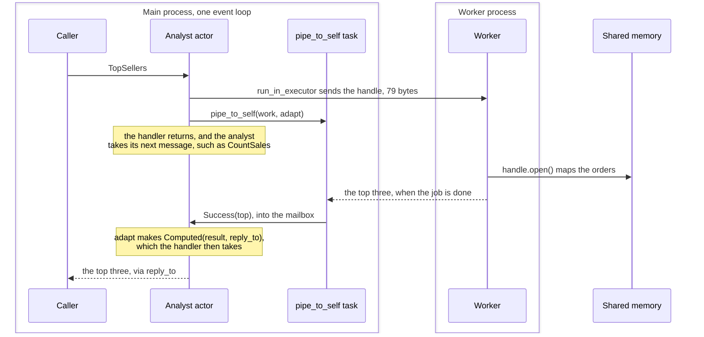

# 10. numpy and shared memory

## The problem

Some work, such as numpy over a large array, takes long enough to block the event loop. Every actor in a process shares that loop, so while one handler computes, every other actor waits, and so does every request to a web app like the one in [chapter 9](09-fastapi.md).

## The idea

Work that blocks goes to a thread, and its result comes back to the actor as a message, so the loop keeps running in the meantime and the actor keeps answering. A loop over numbers that numpy cannot express gets compiled with numba and goes to a thread the same way. Work that a thread cannot speed up goes to another process, and a large array gets there through shared memory, as a small handle instead of a copy.

## A first example: numpy in a thread

An analyst that finds the three best-selling products in 30 million orders. It needs the `numpy` extra (`pip install 'ohra[numpy]'`). Save it as `top_sellers.py`, since the second example imports from it:

```python
import asyncio
from dataclasses import dataclass

import numpy as np
import numpy.typing as npt

from ohra import ActorContext, ActorRef, ActorSystem, Behavior, Behaviors, Success, Try

type Orders = npt.NDArray[np.int64]  # one product id per sale


def top_sellers(orders: Orders) -> list[int]:
    sales_per_product = np.bincount(orders)
    return [int(p) for p in np.argsort(sales_per_product)[::-1][:3]]


@dataclass(frozen=True)
class TopSellers:
    reply_to: ActorRef[list[int]]


@dataclass(frozen=True)
class CountSales:
    reply_to: ActorRef[int]


@dataclass(frozen=True)
class Computed:
    result: Try[list[int]]
    reply_to: ActorRef[list[int]]


type AnalystCmd = TopSellers | CountSales | Computed


def analyst(orders: Orders) -> Behavior[AnalystCmd]:
    @Behaviors.receive
    def on_message(ctx: ActorContext[AnalystCmd], msg: AnalystCmd) -> Behavior[AnalystCmd]:
        match msg:
            case TopSellers(reply_to):
                work = asyncio.to_thread(top_sellers, orders)  # numpy runs in a thread
                ctx.pipe_to_self(work, lambda result: Computed(result, reply_to))
            case CountSales(reply_to):
                reply_to.tell(len(orders))
            case Computed(Success(top), reply_to):
                reply_to.tell(top)
            case Computed():
                pass  # it failed: the ask times out
        return Behaviors.same

    return on_message


async def main() -> None:
    orders = np.random.default_rng(0).integers(0, 1000, size=30_000_000)
    orders.flags.writeable = False  # a thread reads it: make sure nobody writes to it
    async with ActorSystem(analyst(orders), "reports") as system:
        report = asyncio.create_task(system.ask(TopSellers, timeout=10))
        await asyncio.sleep(0)  # let the request go out first
        print(await system.ask(CountSales, timeout=10), "sales")
        print("report still running:", not report.done())
        print("top sellers:", await report)


if __name__ == "__main__":
    asyncio.run(main())
```

It prints:

```
30000000 sales
report still running: True
top sellers: [947, 82, 762]
```

- **`asyncio.to_thread(top_sellers, orders)`** runs the numpy work in a thread, and **`ctx.pipe_to_self(work, ...)`** sends its result back to the analyst as a `Computed` message, holding a `Success` or a `Failure`.
- **The lambda keeps `reply_to`**, so the analyst knows whom to answer when the result arrives, without any state of its own.
- **The analyst stays free.** It answered `CountSales` while the report was still running. Call `top_sellers(orders)` in the handler instead and the second line says `False`: the analyst, and every other actor on the loop, would have waited for the report.
- **`orders.flags.writeable = False`**, because state and messages are shared by reference, never copied, and a thread is reading this array.

A thread pays off when numpy releases Python's global lock, as most large numpy operations do. [How it works](#how-it-works) has the details.

## A second example: shared memory

Pure-Python work gains nothing from a thread, and belongs in another process. Sending the orders to a process would pickle and copy all 240 MB. A `SharedArray` puts them in shared memory once and sends a handle instead. The same report, in a worker process:

```python
import asyncio
import pickle
from concurrent.futures import ProcessPoolExecutor

import numpy as np

from ohra import ActorContext, ActorSystem, Behavior, Behaviors, Success
from ohra.ext.shm import SharedArray
from top_sellers import AnalystCmd, Computed, CountSales, TopSellers, top_sellers


def top_sellers_in(handle: SharedArray) -> list[int]:
    with handle.open() as orders:  # maps the same memory: nothing is copied
        return top_sellers(orders)


def analyst(orders: SharedArray, pool: ProcessPoolExecutor) -> Behavior[AnalystCmd]:
    @Behaviors.receive
    def on_message(ctx: ActorContext[AnalystCmd], msg: AnalystCmd) -> Behavior[AnalystCmd]:
        match msg:
            case TopSellers(reply_to):
                loop = asyncio.get_running_loop()
                work = loop.run_in_executor(pool, top_sellers_in, orders)  # another process
                ctx.pipe_to_self(work, lambda result: Computed(result, reply_to))
            case CountSales(reply_to):
                reply_to.tell(orders.shape[0])
            case Computed(Success(top), reply_to):
                reply_to.tell(top)
            case Computed():
                pass  # it failed: the ask times out
        return Behaviors.same

    return on_message


async def main() -> None:
    sales = np.random.default_rng(0).integers(0, 1000, size=30_000_000)
    orders = SharedArray.create(sales)  # one copy, into shared memory
    print(f"{sales.nbytes // 1_000_000} MB of orders, sent as {len(pickle.dumps(orders))} bytes")
    try:
        with ProcessPoolExecutor() as pool:
            async with ActorSystem(analyst(orders, pool), "reports") as system:
                print("top sellers:", await system.ask(TopSellers, timeout=30))
    finally:
        orders.unlink()  # the owner frees the memory, once


if __name__ == "__main__":
    asyncio.run(main())
```

It prints:

```
240 MB of orders, sent as 79 bytes
top sellers: [947, 82, 762]
```

- **`SharedArray.create(sales)`** copies the array into shared memory, once. The handle, `orders`, is three small fields: the memory's name, the shape and the dtype.
- **`loop.run_in_executor(pool, top_sellers_in, orders)`** sends the handle to a worker process, and `pipe_to_self` takes the result as before. The rest of the analyst is unchanged. [What pipe_to_self does](#what-pipe_to_self-does) says which part is asyncio's and which is ohra's.
- **`handle.open()`** maps the same memory in the worker, read-only, so nothing is copied in either direction.
- **Whoever holds the handle owns the memory**, and the owner calls `unlink()` once, here when the program is done. [Appendix B](appendix-deviations.md) has the rule.

## A third example: a loop, with numba

Some work is a loop in which each step depends on the one before, and numpy cannot express it as operations on whole arrays. Which products lose the most sales because they ran out? Each order takes one from the stock, or is lost if there is none, and a product running low reorders, which arrives 5,000 orders later. In pure Python this belongs in a process, like the second example. [numba](https://numba.pydata.org) compiles the loop to machine code instead, and it can run in a thread like the first. It needs the `numba` extra (`pip install 'ohra[numba]'`):

```python
import asyncio
import time
from dataclasses import dataclass

import numpy as np
import numpy.typing as npt
from numba import njit

from ohra import ActorContext, ActorRef, ActorSystem, Behavior, Behaviors, Success, Try

type Ints = npt.NDArray[np.int64]
LEAD_TIME = 5_000  # orders between placing a reorder and its arrival


@njit(nogil=True)  # compiled to machine code, and lets go of Python's global lock
def lost_sales(orders: Ints, restock: Ints) -> Ints:
    stock = restock.copy()
    arrives = np.full(len(restock), -1)  # when each product's reorder comes in
    lost = np.zeros(len(restock), np.int64)
    for t in range(len(orders)):
        p = orders[t]
        if arrives[p] >= 0 and t >= arrives[p]:  # the reorder came in
            stock[p] += restock[p]
            arrives[p] = -1
        if stock[p] > 0:
            stock[p] -= 1
        else:
            lost[p] += 1  # out of stock: the sale is lost
        if stock[p] <= restock[p] // 4 and arrives[p] < 0:  # running low: reorder
            arrives[p] = t + LEAD_TIME
    return lost


@dataclass(frozen=True)
class WorstStockouts:
    reply_to: ActorRef[list[int]]


@dataclass(frozen=True)
class Computed:
    result: Try[Ints]
    reply_to: ActorRef[list[int]]


type StockCmd = WorstStockouts | Computed


def stock_analyst(orders: Ints, restock: Ints) -> Behavior[StockCmd]:
    @Behaviors.receive
    def on_message(ctx: ActorContext[StockCmd], msg: StockCmd) -> Behavior[StockCmd]:
        match msg:
            case WorstStockouts(reply_to):
                work = asyncio.to_thread(lost_sales, orders, restock)  # in a thread, as before
                ctx.pipe_to_self(work, lambda result: Computed(result, reply_to))
            case Computed(Success(lost), reply_to):
                reply_to.tell([int(p) for p in np.argsort(-lost)[:3]])
            case Computed():
                pass  # it failed: the ask times out
        return Behaviors.same

    return on_message


async def main() -> None:
    rng = np.random.default_rng(0)
    orders = rng.integers(0, 1000, size=30_000_000)  # one product id per sale
    restock = rng.integers(1, 10, size=1000)  # how many each reorder brings
    orders.flags.writeable = False  # a thread reads them, as in the first example
    restock.flags.writeable = False
    async with ActorSystem(stock_analyst(orders, restock), "stock") as system:
        for _ in range(2):
            start = time.perf_counter()
            worst = await system.ask(WorstStockouts, timeout=30)
            print(f"worst stockouts: {worst} in {time.perf_counter() - start:.2f}s")


if __name__ == "__main__":
    asyncio.run(main())
```

It prints:

```
worst stockouts: [737, 898, 378] in 0.75s
worst stockouts: [737, 898, 378] in 0.23s
```

- **`@njit` compiles `lost_sales` the first time it is called**, which is why the first answer took longer. After that, 30 million orders take a quarter of a second. The same loop in pure Python takes nearly four seconds over Python lists, as `examples/stockouts.py` writes it, and more than twenty with `@njit` simply removed, because indexing a numpy array one element at a time is slow in Python. `@njit(nogil=True, cache=True)` keeps the compiled code on disk, so the next run skips the compiling too.
- **`nogil=True` lets go of Python's global lock while the loop runs**, as numpy does, so the thread runs alongside the event loop and alongside other threads. The actor is the same as in the first example: `asyncio.to_thread` and `pipe_to_self`.
- **numba compiles numbers, numpy arrays, loops and branches**, not objects. Arrays go in and come out, and the actor turns the result into the reply, here a list of three product ids.
- **Without `nogil=True`, numba in a thread stops every actor.** Python switches threads between its own instructions, and compiled code has none, so the loop holds the lock until it is done. Pure Python in a thread at least gives the lock back between its instructions, so the event loop waits tens of milliseconds at a time, not the whole run.

`examples/stockouts.py` runs the same simulation four ways, one analyst and then eight at once on a machine with eight fast cores. Lag is the longest the event loop could not run:

| 20 million orders | one analyst | lag | eight at once | lag |
|---|---|---|---|---|
| pure Python, in a thread | 2.49s | 36 ms | 19.10s | 491 ms |
| pure Python, in a process with shared memory | 2.46s | 5 ms | 3.09s | 13 ms |
| numba, in a thread | 0.21s | 212 ms | 1.09s | 408 ms |
| numba with `nogil=True`, in a thread | 0.14s | 0 ms | 0.16s | 3 ms |

The third row is the warning above: one analyst's 0.21 seconds held up the event loop for 212 milliseconds, all of it.

So, for work that would block the event loop:

1. **Whole arrays at a time:** numpy, in a thread.
2. **A loop over numbers:** numba with `nogil=True`, in a thread.
3. **Any other pure-Python work,** with objects, dicts or strings: a process, with shared memory for large arrays.

> **Coming from Apache Pekko**
>
> - `ctx.pipe_to_self(awaitable, adapt)` is `pipeToSelf`, with a thread or a process in place of a Future on another dispatcher.
> - `adapt` receives a `Try`, `Success(value)` or `Failure(exception)`, as in Scala. The examples keep the `Try` in the message and match it in the handler, because a lambda cannot hold a `match`. To match in `adapt`, as `pipeToSelf(work) { case Success(...) => ...; case Failure(...) => ... }` does, leave `adapt` out: `ctx.pipe_to_self(work)` then returns a decorator, and the function under it becomes `adapt`. With a message for each outcome:
>
>   ```python
>   @dataclass(frozen=True)
>   class Computed:
>       top: list[int]
>       reply_to: ActorRef[list[int]]
>
>
>   @dataclass(frozen=True)
>   class ReportFailed:
>       exception: Exception
>
>
>   type AnalystCmd = TopSellers | CountSales | Computed | ReportFailed
>   ```
>
>   the `TopSellers` case becomes:
>
>   ```python
>   case TopSellers(reply_to):
>
>       @ctx.pipe_to_self(asyncio.to_thread(top_sellers, orders))
>       def _(result: Try[list[int]]) -> AnalystCmd:
>           match result:
>               case Success(top):
>                   return Computed(top, reply_to)
>               case Failure(exception):
>                   return ReportFailed(exception)
>   ```
>
>   The handler then answers `Computed(top, reply_to)` and logs `ReportFailed`. `ctx.ask(target, make, timeout=...)` without `adapt` is a decorator in the same way.
> - `SharedArray` and numba have no Pekko counterpart.

## How it works

This integration is not part of Apache Pekko.

A handler that blocks the event loop stalls every actor. Run numpy work with `ctx.pipe_to_self(asyncio.to_thread(fn, ...), adapt)` and stash until the result comes back. numpy releases the GIL, so eight such actors use eight cores while a timer keeps ticking on time; pure-Python work in threads gains nothing. A numeric loop compiled with numba's `@njit(nogil=True)` releases the GIL too, and goes to a thread the same way. For another process, `ohra.ext.shm.SharedArray` hands over a large array as a three-field handle instead of a copy.

Messages are shared by reference and never copied. Keep them immutable: frozen dataclasses, and for arrays either copy before sending or set `arr.flags.writeable = False`.

### What pipe_to_self does

In the second example, the two lines have different owners:

```python
work = loop.run_in_executor(pool, top_sellers_in, orders)  # asyncio
ctx.pipe_to_self(work, lambda result: Computed(result, reply_to))  # ohra
```

`loop.run_in_executor` is plain asyncio. It sends the call to the process pool and returns a future that completes when the worker is done. ohra plays no part in it. The two rules it brings come from Python's process pools: the function, `top_sellers_in`, must be defined at module level, and its arguments must pickle. That is why `orders` is a `SharedArray` handle, 79 bytes, and not the 240 MB array.

`ctx.pipe_to_self` is the only part that is ohra's, and it accepts anything that can be awaited: a coroutine, `asyncio.to_thread(...)`, or this executor future. It does four things:

1. **It starts a background task** that awaits the work.
2. **It turns the outcome into a `Try`**: `Success(value)`, or `Failure(exception)` if the work raised. A cancellation is passed on, not turned into a `Failure`.
3. **It runs `adapt` inside the actor.** The outcome goes into the actor's own mailbox as an ordinary message, and `adapt` runs when the actor takes that message, between two others, never during a handler. So `adapt` may read the actor's state safely.
4. **It ties the task to the actor.** If the actor stops first, the task is cancelled and nothing is delivered.

One `TopSellers` request, from the ask to the reply:



- **The analyst is never blocked.** Between sending the work and getting the result it handles other messages, which is how the first example answered `CountSales` while the report ran.
- **Only the handle crosses to the worker**, and only the result comes back. The orders stay in shared memory, which both processes read.
- **The result comes back as a message.** The task does not call the analyst; it puts the outcome in the analyst's mailbox, so it waits its turn behind any messages already there.

Cancelling a task only stops the waiting. A thread from `asyncio.to_thread`, or a worker process that has already started a job, runs the job to the end, and its result is thrown away. Stopping an actor in Apache Pekko does not stop a running Future either. If abandoned work matters, have the job check a flag, or keep jobs short.

---

[← FastAPI](09-fastapi.md) · [Contents](README.md) · [Putting it together: one cart request →](11-putting-it-together.md)
