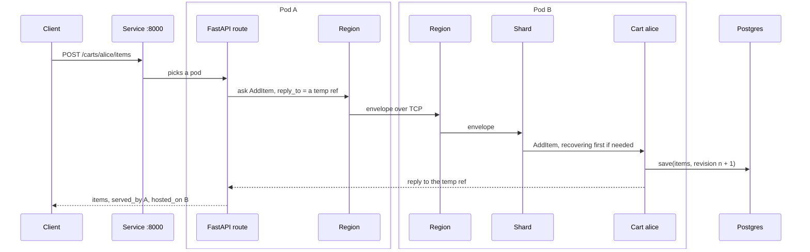

# 10. Putting it together: one cart request

`examples/k8s/carts.py` runs FastAPI on three pods, each a cluster node, with one sharded cart entity per cart id persisted in Postgres. Follow `POST /carts/alice/items` from the moment it reaches the Service. The [Kubernetes chapter](08-management-and-kubernetes.md#carts-cluster-sharding-behind-a-web-app) has the commands to run it.

1. **The Service** picks a pod, say pod A. The route there knows nothing about where alice's cart lives.
2. **The route asks** `ClusterSharding(system).entity_ref_for(CART, "alice")` with `AddItem(sku, qty, reply_to)`. The `reply_to` is a temporary ref on pod A.
3. **Pod A's region** computes alice's shard from the hash. It already knows that shard lives on pod B, from an earlier `ShardHome`, and sends the envelope over remoting. The temporary ref travels as a `/temp/` path.
4. **Pod B's region** hands the envelope to its shard, which starts the cart entity if this is its first message since it last passivated. Starting it means `recover`: one read from Postgres.
5. **The cart's handler** returns `cart(updated).then_reply(...)`. The runtime writes the new items with the next revision, then sends the reply. Pod B's region is not involved again.
6. **The reply** crosses back to pod A's temporary ref, completes the `ask`, and the route answers with `served_by` pod A and `hosted_on` pod B.

Delete pod B and its coordinated shutdown hands alice's shard off. The next request is buffered while the shard has no home, the coordinator allocates it to pod A or pod C, and the new cart entity recovers the same items from the database. The caller only sees `hosted_on` change.

---

[← FastAPI, numpy and shared memory](09-integrations.md) · [Contents](README.md) · [Appendix A: Apache Pekko names →](appendix-pekko-names.md)
