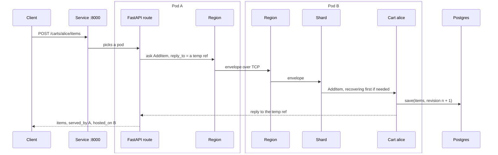

# 11. Putting it together: one cart request

## The problem

Each chapter so far added one piece. In a real deployment a single request goes through nearly all of them, and when something goes wrong it helps to know which piece was doing what.

## The idea

Follow one request, `POST /carts/alice/items`, through `examples/k8s/carts.py`: FastAPI on three Kubernetes pods, each pod a cluster node, with one sharded cart per id, saved in Postgres. Every step is one an earlier chapter explained:

| Step | Chapter |
|---|---|
| The pods found each other and formed a cluster | [8](08-management-and-kubernetes.md), [5](05-cluster.md) |
| The route asks the cart for alice | [9](09-fastapi.md), [1](01-actors.md) |
| The node finds the pod that hosts alice's shard | [7](07-sharding.md); the coordinator is a singleton, [6](06-singleton.md) |
| The message crosses to that pod | [4](04-remoting.md) |
| The cart saves the items before it replies | [3](03-persistence.md) |
| A pod that is stopped hands its shards over on the way out | [2](02-actor-system.md) |

## A first example

With the image built and the manifest applied as in [chapter 8](08-management-and-kubernetes.md#carts-cluster-sharding-behind-a-web-app), add to alice's cart and read it back:

```
$ curl -X POST localhost:8000/carts/alice/items -H 'content-type: application/json' -d '{"sku": "book", "qty": 2}'
{"cart":"alice","items":{"book":2},"served_by":"carts-7c9f6d5b8-x2k4p","hosted_on":"carts-7c9f6d5b8-q8tzm"}
$ curl localhost:8000/carts/alice
{"cart":"alice","items":{"book":2},"served_by":"carts-7c9f6d5b8-m5wn7","hosted_on":"carts-7c9f6d5b8-q8tzm"}
```

Your pod names will differ.

- **`served_by`** is the pod that took the HTTP request. It changes from request to request, as the Service spreads them over the pods.
- **`hosted_on`** is the pod that runs alice's cart. It stays the same, because alice's shard lives on one pod.
- **Delete the `hosted_on` pod** and the next request still returns `{"book":2}`, now hosted on another pod: the shard moved, and the cart recovered its items from Postgres.

Without Kubernetes, `examples/fastapi_carts.py` is the same app in one process, with `Sharding` and SQLite.

> **Coming from Apache Pekko**
>
> - This is the shape of a Pekko service built from Pekko HTTP, Cluster Sharding, durable state on the JDBC plugin's `durable_state` table, and Pekko Management's Kubernetes bootstrap.
> - FastAPI replaces Pekko HTTP, and uvicorn, not the actor system, owns SIGTERM: it stops taking requests first, then the app's lifespan runs the coordinated shutdown.

## How it works

`examples/k8s/carts.py` runs FastAPI on three pods, each a cluster node, with one sharded cart entity per cart id persisted in Postgres. Follow `POST /carts/alice/items` from the moment it reaches the Service. The [Kubernetes chapter](08-management-and-kubernetes.md#carts-cluster-sharding-behind-a-web-app) has the commands to run it.



1. **The Service** picks a pod, say pod A. The route there knows nothing about where alice's cart lives.
2. **The route asks** `ClusterSharding(system).entity_ref_for(CART, "alice")` with `AddItem(sku, qty, reply_to)`. The `reply_to` is a temporary ref on pod A.
3. **Pod A's region** computes alice's shard from the hash. It already knows that shard lives on pod B, from an earlier `ShardHome`, and sends the envelope over remoting. The temporary ref travels as a `/temp/` path.
4. **Pod B's region** hands the envelope to its shard, which starts the cart entity if this is its first message since it last passivated. Starting it means `recover`: one read from Postgres.
5. **The cart's handler** returns `cart(updated).then_reply(...)`. The runtime writes the new items with the next revision, then sends the reply. Pod B's region is not involved again.
6. **The reply** crosses back to pod A's temporary ref, completes the `ask`, and the route answers with `served_by` pod A and `hosted_on` pod B.

Delete pod B and its coordinated shutdown hands alice's shard off. The next request is buffered while the shard has no home, the coordinator allocates it to pod A or pod C, and the new cart entity recovers the same items from the database. The caller only sees `hosted_on` change.

---

[← numpy and shared memory](10-numpy-and-shared-memory.md) · [Contents](README.md) · [Appendix A: Apache Pekko names →](appendix-pekko-names.md)
