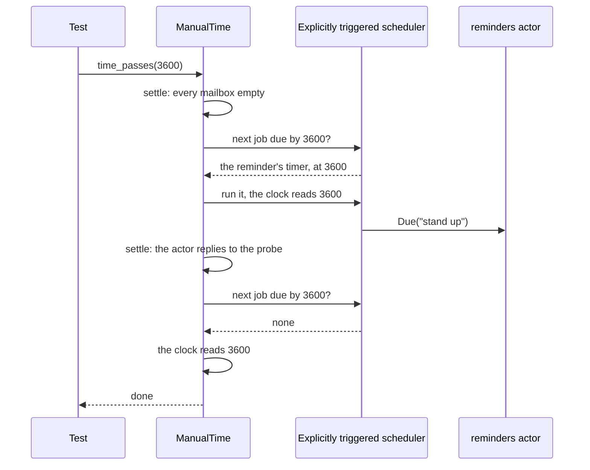
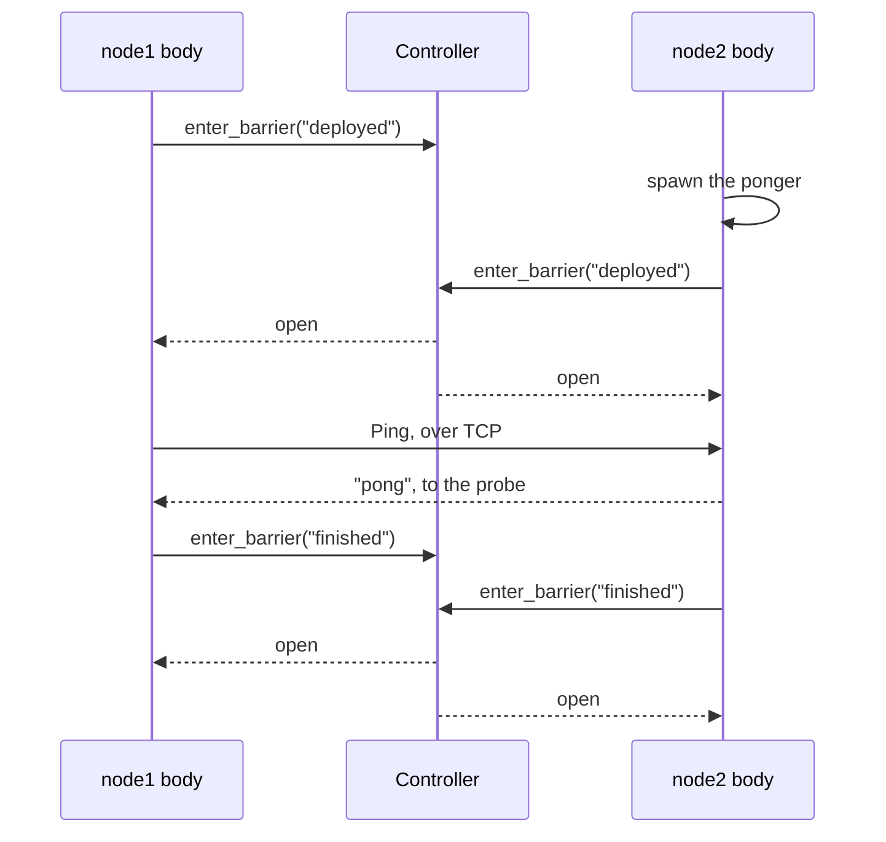

# 12. Testing

## The problem

`system.ask` tests a cart that answers whoever asked. Most actors do more than that: they reply to an address carried in the message, report to some other actor, stop when their work is done, or act on a timer an hour from now. A test needs a stand-in for the actor on the other end, a way to wait for a message without sleeping a fixed time, and a way to move a timer's clock without waiting for it.

## The idea

A test kit starts an actor system for one test and shuts it down after it. In it, a **test probe** stands in for any actor: it is a real actor with a ref you pass where the actor under test sends its messages, and the test awaits what arrives at it, with a deadline. With **manual time**, timers and timeouts wait for the test to say that time has passed, so a one-hour timer fires in a millisecond.

The test kit is Apache Pekko's actor-testkit-typed, ported. It needs the `testkit` extra, which brings pytest and pytest-asyncio: `pip install 'ohra[testkit]'`.

## A first example: a probe as reply_to

A test for the cart from [chapter 1](01-actors.md#a-first-example). Save it as `test_cart.py` next to `cart.py`, or find it with every other test in this chapter in [`examples/testing/`](../../examples/testing/):

```python
from cart import AddItem, GetCart, cart
from ohra.testkit import ActorTestKit, TestProbe


async def test_adding_an_item_replies_with_the_cart():
    async with ActorTestKit() as testkit:
        shop = testkit.spawn(cart({}), "cart")
        probe: TestProbe[dict[str, int]] = testkit.create_test_probe()
        shop.tell(AddItem("book", 1, probe.ref))
        await probe.expect_message({"book": 1})
        shop.tell(AddItem("pen", 2, probe.ref))
        shop.tell(GetCart(probe.ref))
        assert await probe.receive_messages(2) == [{"book": 1, "pen": 2}] * 2
```

Tests are `async def`, so pytest-asyncio runs them. Put `asyncio_mode = "auto"` under `[tool.pytest.ini_options]` in `pyproject.toml`, or `asyncio_mode = auto` under `[pytest]` in `pytest.ini`, then run `pytest test_cart.py`. It prints `1 passed`.

- **`ActorTestKit()`** starts an actor system named after the test, `test_adding_an_item_replies_with_the_cart`, and leaving the `async with` shuts it down.
- **`testkit.spawn(cart({}), "cart")`** starts the cart and returns its ref at once, with no `await`.
- **`probe.ref`** goes where the cart sends its answer: into `reply_to`. The annotation `TestProbe[dict[str, int]]` gives the probe its message type, so pyright checks that the cart's replies fit it.
- **`await probe.expect_message({"book": 1})`** waits for the next message and fails the test unless it equals `{"book": 1}`. The wait lasts at most 3 seconds; a test that passes never waits that long, because the message arrives first.
- **`receive_messages(2)`** returns the next two messages, for assertions of your own.

A failure says what went wrong. Expect `{"book": 2}` instead and the test fails with `AssertionError: expected {'book': 2}, found {'book': 1}`. If nothing arrives, it fails with `timeout (3s) during expect_message while waiting for {'book': 2}`.

## A second example: fishing, and waiting for a stop

A worker that adds numbers up, reports its progress as it goes, reports the total and stops. The test cares about the total, not about how many progress reports come first:

```python
import asyncio
from dataclasses import dataclass

from ohra import ActorContext, ActorRef, Behavior, Behaviors
from ohra.testkit import ActorTestKit, FishingOutcome, FishingOutcomes, TestProbe


@dataclass(frozen=True)
class Progress:
    percent: int


@dataclass(frozen=True)
class Done:
    total: int


type Report = Progress | Done


def summer(numbers: list[int], report_to: ActorRef[Report]) -> Behavior[str]:
    """Adds the numbers up, reporting progress, then stops."""

    @Behaviors.setup
    async def setup(_ctx: ActorContext[str]) -> Behavior[str]:
        total = 0
        for i, n in enumerate(numbers, 1):
            await asyncio.sleep(0.01)  # some real work
            total += n
            report_to.tell(Progress(100 * i // len(numbers)))
        report_to.tell(Done(total))
        return Behaviors.stopped()

    return setup


def until_done(report: Report) -> FishingOutcome:
    match report:
        case Progress():
            return FishingOutcomes.continue_and_ignore()
        case Done():
            return FishingOutcomes.complete()


async def test_summer_reports_the_total_and_stops():
    async with ActorTestKit() as testkit:
        probe: TestProbe[Report] = testkit.create_test_probe()
        worker = testkit.spawn(summer([1, 2, 3, 4], probe.ref))
        assert await probe.fish_for_message(1, until_done) == [Done(10)]
        await probe.expect_terminated(worker)
```

- **`fish_for_message(1, until_done)`** hands each message to `until_done` for up to one second. `continue_and_ignore()` drops the message and keeps fishing, `continue_()` keeps it and keeps fishing, `complete()` keeps it and stops, and `fail("why")` fails the test. It returns the messages kept, ending with the one that completed.
- **`expect_terminated(worker)`** has the probe watch the worker, as [DeathWatch](01-actors.md#children-stopping-and-deathwatch) does, and waits for its `Terminated`. A worker that had already stopped counts, since watching a stopped actor reports it at once.

## The pytest fixtures

The test kit ships a pytest plugin. Turn it on in `conftest.py`:

```python
pytest_plugins = ["ohra.testkit.pytest_plugin"]
```

A test that asks for the `testkit` fixture gets its own `ActorTestKit`, named after the test and shut down after it:

```python
from cart import AddItem, cart
from ohra.testkit import ActorTestKit, TestProbe


async def test_adding_an_item_replies_with_the_cart(testkit: ActorTestKit):
    shop = testkit.spawn(cart({}), "cart")
    probe: TestProbe[dict[str, int]] = testkit.create_test_probe()
    shop.tell(AddItem("book", 1, probe.ref))
    await probe.expect_message({"book": 1})
```

## A third example: a timer, with manual time

A reminder service that answers an hour after it is asked. Waiting a real hour is not a test:

```python
from dataclasses import dataclass

import pytest

from ohra import ActorContext, ActorRef, Behavior, Behaviors
from ohra.testkit import ActorTestKit, ManualTime, TestProbe


@dataclass(frozen=True)
class Remind:
    after: float
    text: str
    reply_to: ActorRef[str]


@dataclass(frozen=True)
class Due:
    text: str
    reply_to: ActorRef[str]


type ReminderCmd = Remind | Due


def reminders() -> Behavior[ReminderCmd]:
    @Behaviors.receive
    def on_message(ctx: ActorContext[ReminderCmd], msg: ReminderCmd) -> Behavior[ReminderCmd]:
        match msg:
            case Remind(after, text, reply_to):
                ctx.timers.start_single_timer(text, Due(text, reply_to), after)
            case Due(text, reply_to):
                reply_to.tell(text)
        return Behaviors.same

    return on_message


@pytest.mark.manual_time
async def test_a_reminder_waits_for_its_time(testkit: ActorTestKit, manual_time: ManualTime):
    probe: TestProbe[str] = testkit.create_test_probe()
    testkit.spawn(reminders()).tell(Remind(3600, "stand up", probe.ref))
    await manual_time.expect_no_message_for(3599, probe)
    await manual_time.time_passes(1)
    await probe.expect_message("stand up")
```

It passes in a few milliseconds.

- **`@pytest.mark.manual_time`** gives this test's `testkit` a clock that moves only when the test moves it, and the `manual_time` fixture is that clock. Without the mark, asking for `manual_time` makes pytest report an error for the test, with a message saying so. Outside pytest, `ActorTestKit(manual_time=True)` and `ManualTime(testkit.system)` do the same.
- **`expect_no_message_for(3599, probe)`** moves the clock 3599 seconds and checks that the probe got nothing: the reminder has not fired early.
- **`time_passes(1)`** moves it the last second, and the timer fires.
- **Timer messages, backoff restarts and ask timeouts** run on the manual clock. The probe's own deadlines stay on real time, so `expect_message` still gives up after 3 real seconds.

> **Coming from Apache Pekko**
>
> - The names are actor-testkit-typed's in snake_case: `ActorTestKit`, `TestProbe`, `createTestProbe` is `create_test_probe`, `expectMessage` is `expect_message`, `fishForMessage` is `fish_for_message`, `ManualTime.timePasses` is `time_passes`. `FishingOutcomes.continue` is `continue_()`, since `continue` is a Python keyword.
> - Every wait is awaited, and durations are seconds as floats. Spawning and creating a probe are not awaited, as in Pekko.
> - `ScalaTestWithActorTestKit` is the pytest plugin, and `ManualTime.config` is `@pytest.mark.manual_time` or `ActorTestKit(manual_time=True)`.
> - The test kit's names come from `ohra.testkit`, not from `ohra`, since Pekko ships the test kit as a module of its own.
> - `createDeadLetterProbe`, `createUnhandledMessageProbe` and `createDroppedMessageProbe` are `create_dead_letter_probe()` and its siblings. `BehaviorTestKit`, `TestInbox` and `LoggingTestKit` are not ported yet. [Appendix B](appendix-deviations.md) has the full list.

## Testing common cases

Each recipe below is one test, for one thing an actor does. They are all in [`examples/testing/test_recipes.py`](../../examples/testing/test_recipes.py) with the chapter's other tests, and `pytest examples/testing` runs them. The recipes use the `testkit` fixture and share these imports:

```python
import asyncio
from dataclasses import dataclass

import pytest

from cart import AddItem, CartCmd, GetCart, cart
from ohra import (
    ActorContext,
    ActorRef,
    Behavior,
    Behaviors,
    Entity,
    EntityTypeKey,
    InMemoryStore,
    Sharding,
    SupervisorStrategy,
    ask,
)
from ohra.testkit import ActorTestKit, ManualTime, TestProbe
```

### An actor that answers whoever asks

When the actor replies to the sender, ask it, as the code that uses it would. `testkit.timeout`, 5 seconds, is the test kit's default for asks:

```python
async def test_ask_the_cart_directly(testkit: ActorTestKit):
    shop = testkit.spawn(cart({}))
    reply = await ask(shop, lambda r: AddItem("book", 1, r), timeout=testkit.timeout)
    assert reply == {"book": 1}
```

A probe is for everything else: a reply to an address in the message, a report to a third actor, a message that must not arrive.

### Watching for a stop

An actor that watches another and reports when it stops. The probe stands in for the watched actor too, and `probe.stop()` stops it:

```python
@dataclass(frozen=True)
class Gone:
    path: str


def watcher(target: ActorRef[str], report_to: ActorRef[Gone]) -> Behavior[Gone]:
    """Tells report_to when target stops, then stops too."""

    @Behaviors.setup
    def setup(ctx: ActorContext[Gone]) -> Behavior[Gone]:
        ctx.watch_with(target, Gone(target.path))

        @Behaviors.receive_message
        def on_message(msg: Gone) -> Behavior[Gone]:
            report_to.tell(msg)
            return Behaviors.stopped()

        return on_message

    return setup


async def test_the_watcher_reports_a_stop(testkit: ActorTestKit):
    target: TestProbe[str] = testkit.create_test_probe()
    reports: TestProbe[Gone] = testkit.create_test_probe()
    w = testkit.spawn(watcher(target.ref, reports.ref))
    target.stop()
    await reports.expect_message(Gone(target.ref.path))
    await reports.expect_terminated(w)
```

- **`target.stop()`** may arrive before the watcher has started watching. It does not matter: watching an actor that has already stopped reports it at once.
- **`expect_terminated(w)`** checks that the watcher stopped after reporting.

### A restart starts over

A counter that crashes on `Crash`, supervised to restart. The test checks what the restart does to the state:

```python
@dataclass(frozen=True)
class Add:
    n: int


@dataclass(frozen=True)
class Total:
    reply_to: ActorRef[int]


@dataclass(frozen=True)
class Crash:
    pass


type CounterCmd = Add | Total | Crash


def counter(total: int = 0) -> Behavior[CounterCmd]:
    @Behaviors.receive_message
    def on_message(msg: CounterCmd) -> Behavior[CounterCmd]:
        match msg:
            case Add(n):
                return counter(total + n)
            case Total(reply_to):
                reply_to.tell(total)
                return Behaviors.same
            case Crash():
                raise RuntimeError("crash")

    return on_message


async def test_a_restart_starts_from_the_initial_state(testkit: ActorTestKit):
    probe: TestProbe[int] = testkit.create_test_probe()
    supervised = Behaviors.supervise(counter()).on_failure(SupervisorStrategy.restart())
    ref = testkit.spawn(supervised)
    ref.tell(Add(5))
    ref.tell(Total(probe.ref))
    await probe.expect_message(5)
    ref.tell(Crash())
    ref.tell(Total(probe.ref))
    await probe.expect_message(0)
```

- **Messages keep their order across the restart.** `Total` was sent after `Crash`, so it reaches the restarted counter, which starts again from `counter()`, at 0.
- The restart is logged as a warning, `restarting after RuntimeError('crash')`. pytest shows it in the captured log when a test fails; it is expected.

### A backoff restart, without waiting for it

With `restart_with_backoff`, the restart waits. Under manual time the test moves past the wait instead of sleeping through it:

```python
def flaky(probe: ActorRef[str]) -> Behavior[str]:
    """Reports each start; fails on every message; restarts after a backoff of 1 s."""

    @Behaviors.setup
    def setup(_ctx: ActorContext[str]) -> Behavior[str]:
        probe.tell("started")

        @Behaviors.receive_message
        def on_message(msg: str) -> Behavior[str]:
            raise RuntimeError(msg)

        return on_message

    backoff = SupervisorStrategy.restart_with_backoff(1, 60, random_factor=0)
    return Behaviors.supervise(setup).on_failure(backoff)


@pytest.mark.manual_time
async def test_a_backoff_restart_waits_for_its_delay(
    testkit: ActorTestKit, manual_time: ManualTime
):
    probe: TestProbe[str] = testkit.create_test_probe()
    ref = testkit.spawn(flaky(probe.ref))
    await probe.expect_message("started")
    ref.tell("boom")
    await manual_time.expect_no_message_for(0.9, probe)
    await manual_time.time_passes(0.1)
    await probe.expect_message("started")
```

- **`random_factor=0`** makes the delay exactly `min_backoff`, 1 second, so the test can name it. With the default 0.2 it is up to 20% longer.
- **`expect_no_message_for(0.9, probe)`** shows there was no restart too early, and the last 0.1 s brings it.

### A persisted actor survives a stop

Chapter 3's durable cart, on an `InMemoryStore` so tests write no files. The test stops the cart and starts it again from the store:

```python
store = InMemoryStore[dict[str, int]]()


@Behaviors.persisted(store)
def durable_cart(items: dict[str, int]) -> Behavior[CartCmd]:
    @Behaviors.receive_message
    def on_message(msg: CartCmd) -> Behavior[CartCmd]:
        match msg:
            case AddItem(sku, qty, reply_to):
                updated = {**items, sku: items.get(sku, 0) + qty}
                return durable_cart(updated).then_reply(reply_to, updated)
            case GetCart(reply_to):
                reply_to.tell(items)
                return Behaviors.same

    return on_message


async def test_a_persisted_cart_survives_a_stop(testkit: ActorTestKit):
    probe: TestProbe[dict[str, int]] = testkit.create_test_probe()
    first = testkit.spawn(durable_cart.recover("alice", empty={}))
    first.tell(AddItem("book", 1, probe.ref))
    await probe.expect_message({"book": 1})
    await testkit.stop(first)
    second = testkit.spawn(durable_cart.recover("alice", empty={}))
    second.tell(GetCart(probe.ref))
    await probe.expect_message({"book": 1})
```

- **`await testkit.stop(first)`** returns once the first cart has stopped, so the second one cannot start before the first is gone.
- **One store per test module is enough** when each test uses its own ids. For a fresh store per test, build the persisted factory inside a function that takes the store.

### A sharded entity

Test the entity's behavior with `testkit.spawn` first; it is an ordinary actor. When the routing by id is what matters, spawn the single-node region from [chapter 7](07-sharding.md#sharding-in-one-process) and talk to it through entity refs:

```python
CART = EntityTypeKey[CartCmd]("Cart")


async def test_each_id_gets_its_own_cart(testkit: ActorTestKit):
    probe: TestProbe[dict[str, int]] = testkit.create_test_probe()
    region = testkit.spawn(Sharding.init(Entity(CART, lambda _entity: cart({}))))
    alice = Sharding.entity_ref_for(region, "alice")
    bob = Sharding.entity_ref_for(region, "bob")
    alice.tell(AddItem("book", 1, probe.ref))
    await probe.expect_message({"book": 1})
    bob.tell(GetCart(probe.ref))
    await probe.expect_message({})
```

### State the actor does not report

Sometimes the effect is not a message: a write to a cache, a file, a database. `await_assert` retries an assertion until it holds, every 0.1 s by default, and fails with the last error after 3 seconds. It is a probe method, as Pekko's `awaitAssert` is, so the test makes a probe that receives nothing:

```python
def cache_writer(cache: dict[str, int]) -> Behavior[tuple[str, int]]:
    @Behaviors.receive_message
    async def on_message(msg: tuple[str, int]) -> Behavior[tuple[str, int]]:
        await asyncio.sleep(0.01)  # a slow write
        key, value = msg
        cache[key] = value
        return Behaviors.same

    return on_message


async def test_the_write_lands(testkit: ActorTestKit):
    cache: dict[str, int] = {}
    testkit.spawn(cache_writer(cache)).tell(("a", 1))
    probe: TestProbe[None] = testkit.create_test_probe()

    def landed() -> None:
        assert cache == {"a": 1}

    await probe.await_assert(landed)
```

- **`landed` may be sync or async**, and it may raise any exception; each one counts as a failed try, as in Pekko.
- **Prefer a message when you can.** A probe that receives a reply fails at once on a wrong value; `await_assert` waits out its whole `max` before it reports one.

### A message that nobody receives

A message to an actor that has stopped is a dead letter, published on the event stream ([chapter 1](01-actors.md#dead-letters-and-logging)). `create_dead_letter_probe()` subscribes a probe to them:

```python
async def test_a_message_to_a_stopped_cart_is_a_dead_letter(testkit: ActorTestKit):
    dead_letters = testkit.create_dead_letter_probe()
    shop = testkit.spawn(cart({}))
    await testkit.stop(shop)
    probe: TestProbe[dict[str, int]] = testkit.create_test_probe()
    shop.tell(GetCart(probe.ref))
    letter = await dead_letters.receive_message()
    assert (letter.message, letter.recipient) == (GetCart(probe.ref), shop)
    await probe.expect_no_message()
```

- **Every dead letter after `create_dead_letter_probe()` reaches the probe**, since the subscription and the dead letters go through the event stream's mailbox, in order. No `await` is needed in between.
- `create_unhandled_message_probe()` and `create_dropped_message_probe()` do the same for unhandled and dropped messages.

## Multi-node tests

A cluster feature is about several nodes: one sends and another receives, one goes away and the others notice. A test of it runs several actor systems, has each do its part, and keeps them in step: the node that pings must wait until the other has started the actor it pings. It may also cut the link between two nodes and watch what the others do.

The multi-node test kit, Apache Pekko's multi-node-testkit ported, gives each node a **role** and runs one test body per role. The bodies meet at named **barriers**, and the first role holds a **test conductor** that can cut, slow down and restore the links between nodes, or stop a node. Every node runs in this one process, on one event loop: one `ActorSystem` per role, each on its own port of `127.0.0.1`, talking to the others over real TCP.

### A first example: MultiNodeSample

Pekko's `MultiNodeSample`: node 2 starts a ponger, and node 1 pings it across the network. Save it as `test_multi_node_sample.py`, or find it in [`examples/testing/`](../../examples/testing/test_multi_node_sample.py):

```python
from dataclasses import dataclass

from ohra import ActorRef, Behavior, Behaviors, remotable
from ohra.testkit import MultiNodeConfig, MultiNodeSpec, TestProbe, multi_node_spec

sample = MultiNodeConfig()
node1 = sample.role("node1")
node2 = sample.role("node2")


@remotable
@dataclass(frozen=True)
class Ping:
    reply_to: ActorRef[str]


def ponger() -> Behavior[Ping]:
    @Behaviors.receive_message
    def on_message(msg: Ping) -> Behavior[Ping]:
        msg.reply_to.tell("pong")
        return Behaviors.same

    return on_message


@multi_node_spec(sample)
async def test_send_to_and_receive_from_a_remote_node(spec: MultiNodeSpec):
    await spec.enter_barrier("startup")

    if spec.is_node(node1):
        await spec.enter_barrier("deployed")
        probe: TestProbe[str] = spec.create_test_probe()
        remote_ponger = spec.system.resolve(spec.node(node2) + "/user/ponger")
        remote_ponger.tell(Ping(probe.ref))
        await probe.expect_message("pong", 10.0)

    if spec.is_node(node2):
        spec.spawn(ponger(), "ponger")
        await spec.enter_barrier("deployed")

    await spec.enter_barrier("finished")
```

`pytest test_multi_node_sample.py`, with the `pytest.ini` from the first example, prints `1 passed`.

- **`MultiNodeConfig()`** describes the nodes. `sample.role("node1")` declares a role and returns its `RoleName`; the first role declared hosts the barriers and the conductor. `common_config(...)` takes keyword arguments for every node's `ActorSystem`, such as `cluster=ClusterSettings(...)` or `shutdown=CoordinatedShutdownSettings(...)`, and `node_config(role, ...)` overrides them for some roles. The runner sets `name` and `address` itself.
- **`@multi_node_spec(sample)`** turns the body into a pytest test with no parameters. The test starts one `ActorSystem` per role, runs the body once per role, all at the same time, each with its own `spec`, and stops the systems when every body has returned.
- **`spec.is_node(node1)`** is true only in node 1's body, so each `if` block runs on one node. `await spec.run_on(node1, thunk=f)` does the same as a call, with `f` sync or async; the `if` reads better and can `await` inside. `spec.myself` is the body's own role.
- **`await spec.enter_barrier("deployed")`** waits until every node has entered the barrier of that name. Node 2 spawns the ponger before it enters, so node 1 cannot ping before the ponger exists. Every body passes the same barriers in the same order: `startup`, `deployed`, `finished`.
- **`spec.node(node2)`** is node 2's address, `ohra://<name>@127.0.0.1:<port>`. With an actor path appended, `spec.system.resolve` turns it into a ref, as in [chapter 4](04-remoting.md). `Ping` is `@remotable` because it crosses nodes.
- **`spec.spawn` and `spec.create_test_probe()`** work as the test kit's do, on the body's own node. The probe is on node 1, and its ref travels in the ping, so the pong comes back to it. `expect_message("pong", 10.0)` waits up to 10 seconds, as Pekko's sample does.

If a body raises, the test fails at once: the other bodies are cancelled, and pytest shows the `TaskGroup`'s `ExceptionGroup`, which holds one named after the role that failed, `role node1 failed`, with the body's error in it.

### Barriers

A barrier opens when every node still taking part has entered it. `enter_barrier("a", "b")` enters several, one after the other. Each wait lasts at most `max=` seconds, 30 by default, times `timefactor` ([Settings](#settings)), or what is left of an enclosing `async with spec.within(...)`. The settings go to the decorator, as `@multi_node_spec(config, settings=TestKitSettings(timefactor=3))`; `timefactor` and `system_shutdown_default` are the ones the runner uses.

When a barrier fails, every node waiting at it raises, and every later barrier fails too, so a spec stops at its first broken step. The errors come from `ohra.testkit`, and all of them are a `BarrierError`, so `except BarrierError` catches any barrier failure:

| Error | When |
|---|---|
| `BarrierTimeout` | the barrier did not open in time |
| `ClientLost` | a node left while the others waited: its body returned (a role other than the first; the first role removes itself, and the others pass without it), or its system terminated by itself, for example downed by the [split-brain resolver](05-cluster.md) |
| `WrongBarrier` | a node entered another barrier than the one the others wait at |
| `FailedBarrier` | an earlier barrier failed, or a node gave up on this one |
| `TimeoutError("Server timed out while waiting for barrier X")` | not a `BarrierError`: a call naming several barriers ran out of its `max` or `within` before it reached `X`; the nodes already waiting at `X` get `FailedBarrier` |

A body on a node whose system has terminated cannot enter a barrier: `enter_barrier` raises `RuntimeError("TestConductor unavailable because system is terminated")`.

### Breaking the network

The test conductor cuts links. Add `Direction` to the file's `ohra.testkit` import, and this below the first test:

```python
faulty = MultiNodeConfig()
first = faulty.role("first")
second = faulty.role("second")
faulty.test_transport(on=True)


@multi_node_spec(faulty)
async def test_a_blackhole_drops_messages_until_pass_through(spec: MultiNodeSpec):
    probe: TestProbe[str] = spec.create_test_probe()
    if spec.is_node(first):
        spec.spawn(ponger(), "ponger")
    await spec.enter_barrier("deployed")
    remote_ponger = spec.system.resolve(spec.node(first) + "/user/ponger")

    if spec.is_node(second):
        remote_ponger.tell(Ping(probe.ref))
        await probe.expect_message("pong")
    await spec.enter_barrier("connected")

    if spec.is_node(first):
        await spec.test_conductor.blackhole(second, first, Direction.BOTH)
    await spec.enter_barrier("blackholed")

    if spec.is_node(second):
        remote_ponger.tell(Ping(probe.ref))
        await probe.expect_no_message(0.5)
    await spec.enter_barrier("checked")

    if spec.is_node(first):
        await spec.test_conductor.pass_through(second, first, Direction.BOTH)
    await spec.enter_barrier("passed")

    if spec.is_node(second):
        remote_ponger.tell(Ping(probe.ref))
        await probe.expect_message("pong")
    await spec.enter_barrier("done")


@multi_node_spec(faulty)
async def test_a_node_that_exits_leaves_the_barriers(spec: MultiNodeSpec):
    await spec.enter_barrier("started")
    if spec.is_node(first):
        await spec.test_conductor.exit(second, 0)
        assert await spec.test_conductor.get_nodes() == (first,)
    await spec.enter_barrier("after-exit")
```

- **`faulty.test_transport(on=True)`** puts a throttler in every node's remoting, which every frame passes on its way out and in. The conductor's network operations need it, and raise `RuntimeError` without it.
- **`spec.test_conductor`** works on the first role only; on any other, each operation raises `RuntimeError("TestConductorServer was not started")`. The network operations check for the test transport first, so on a node without it they raise the test transport's `RuntimeError` instead. So each call sits in `if spec.is_node(first)`, with a barrier after it, and the other node acts only once the link is cut.
- **`blackhole(second, first, Direction.BOTH)`** drops every frame between `second` and `first`, on `second`'s side, both ways. `Direction.SEND` drops only what `second` sends to `first`, and `Direction.RECEIVE` only what it receives from it. The connection stays open, and the ping is lost without an error; `expect_no_message(0.5)` checks that no pong came back.
- **`pass_through(second, first, Direction.BOTH)`** undoes it, and the next ping gets its pong. `throttle(node, target, direction, rate_mbit)` slows a link to a rate in megabits per second instead. `disconnect(node, target)` and `abort(node, target)` close the connections between two nodes, gracefully or at once, and the next message opens a new one.
- **`exit(second, 0)`** stops a node as a process exit would: it takes the node out of the barriers, crashes its system without the coordinated shutdown, and cancels its body wherever it waits, here at `after-exit`, which `first` then passes alone. An exit value other than 0 fails the test once the other bodies are done. `shutdown(node)` instead takes the node out of the barriers and `get_nodes()` at once and starts its system's termination, without waiting for it. The node's body keeps running, so its next barrier raises. `shutdown(node, abort=True)` crashes the system and waits for the crash.
- **`get_nodes()`** returns the roles still taking part, in the order they were declared. `remove_node(node)` takes a node out of the barriers, so the others pass them without it.

> **Coming from Apache Pekko**
>
> - The names are Pekko's in snake_case: `runOn` is `run_on`, `enterBarrier` is `enter_barrier`, `testConductor` is `test_conductor`, `passThrough` is `pass_through` and `getNodes` is `get_nodes`. `myself`, `roles` and `node(role)` keep their names.
> - A spec is one decorated `async def`, not a class with a subclass per node, and the config is `ActorSystem` keyword arguments, not HOCON.
> - [Appendix B](appendix-deviations.md) lists what differs.

## How it works

### The test kit

`ActorTestKit` starts an actor system whose guardian only hosts the actors you spawn: `testkit.spawn` adds a child to the guardian's cell directly, so the ref is ready when `spawn` returns. `testkit.stop(ref)` stops one and waits until it has stopped, failing with `timeout (5s) during stop() waiting for actor [...] to stop` if it takes longer than `max`, five seconds by default.

Leaving the `async with` terminates the system and waits for it, at most `system_shutdown_default`, 10 seconds. A shutdown that takes longer raises `RuntimeError: Failed to stop [name] within [10s]` and leaves the system running, as Pekko does, so that an actor stuck in a handler fails the test instead of hanging it. If the test itself raised, its own error is what you see, and the slow shutdown is only logged.

`testkit.system` is the actor system, `testkit.scheduler` its scheduler, and `testkit.timeout` the default for asks, 5 seconds.

For code that takes a [lease](05-cluster.md#leases), `TestLease.register(testkit.system)` makes the implementation `"test-lease"` available to `LeaseProvider`. Once the code under test has asked for a lease, `TestLeaseExt(testkit.system).get_test_lease(name)` returns it. The test completes `initial_promise`, an `asyncio.Future`, to answer the first `acquire`, sets the later answers with `set_next_acquire_result` and `set_next_check_lease_result`, and calls the callback that `current_callback()` returns to simulate a lost lease, after it has seen `AcquireReq` on `probe`: `acquire` sets the callback only once its coroutine runs. It expects `TestLease.AcquireReq` and `TestLease.ReleaseReq` on the lease's `probe`. `TestLeaseActor` is the variant that holds each request until the test actions it with an `ActionRequest`.

### Probes

A probe is an actor under `/system`, named `testProbe-N`, or `<name>-N` after the name you pass, with N counting up across the run, as in Pekko. Every message it receives goes into an asyncio queue, and every `expect_*` and `receive_*` method awaits that queue with a deadline. A probe with a message type other than the annotation's, such as `TestProbe[int](testkit)`, works too. `testkit.create_dead_letter_probe()`, `create_unhandled_message_probe()` and `create_dropped_message_probe()` return probes subscribed to the [event stream](01-actors.md#dead-letters-and-logging).

| Method | Waits for |
|---|---|
| `expect_message(obj, max=None, hint=None)` | the next message, which must equal `obj` |
| `expect_message_type(cls, max=None)` | the next message, which must be a `cls`; returns it typed as `cls` |
| `expect_no_message(max=None)` | silence for `max`, by default 0.1 s |
| `receive_message(max=None)`, `receive_messages(n, max=None)` | the next message, or the next `n`, all within `max` |
| `fish_for_message(max, fisher, hint="")` | messages until `fisher` completes or fails |
| `expect_terminated(ref, max=None)` | `ref` to stop |
| `await_assert(fn, max=None, interval=0.1)` | `fn`, sync or async, to stop raising; it is retried every `interval` and the last error is raised after `max` |

A `max` left out is 3 seconds, or what is left of the enclosing `within`. `within` checks how long a block takes:

```python
async with probe.within(0.5):
    shop.tell(GetCart(probe.ref))
    await probe.expect_message({})
```

The block fails if it takes longer than 0.5 s, or less than `min` when one is given, and every wait inside it without a `max` waits only what is left. `probe.remaining` is the time left; outside `within` it fails. A block that ends with `expect_no_message` may run past the end, since waiting out the silence is the point.

### Settings

`TestKitSettings`, passed as `ActorTestKit(settings=...)`, holds the defaults of Pekko's `reference.conf`, in seconds:

| Field | Default | Used by |
|---|---|---|
| `single_expect_default` | 3.0 | waits without a `max` |
| `expect_no_message_default` | 0.1 | `expect_no_message()` |
| `default_timeout` | 5.0 | `testkit.timeout`, `testkit.stop` |
| `system_shutdown_default` | 10.0 | the shutdown at the end of the test |
| `throw_on_shutdown_timeout` | `True` | whether a slow shutdown fails the test or only logs |
| `timefactor` | 1.0 | multiplies every default, and every `max` given to a probe except `expect_no_message`'s |

On a slow CI machine, raise `timefactor` instead of every timeout: `TestKitSettings(timefactor=3)` makes the 3 second default 9. As in Pekko, `expect_no_message(max)` and `testkit.stop(ref, max)` take an explicit `max` as given, without the factor.

### Manual time

The system's scheduler runs everything an actor schedules: its timers, the delay before a backoff restart, and the timeouts of `system.ask` and `ctx.ask`. By default it is the event loop's clock. `manual_time=True` replaces it with an `ExplicitlyTriggeredScheduler`, Pekko's, whose clock starts at 0 and moves only in `time_passes`.

`time_passes(amount)` lets the actors settle, runs the first job due by the target time at that job's time, lets the actors settle again, and repeats until no job is due; then it sets the clock to the target. A timer that makes an actor start another inside the same window fires too, at its own time. Letting the actors settle means waiting until every actor has an empty mailbox and is waiting for its next message, and every other task, such as a stream's ([chapter 13](13-streams.md#time)), is waiting on something, with no callback left in the event loop's ready queue to wake one; or for 100 ms of real time if one stays busy.



The plain `ask(ref, make, timeout)` function runs its timeout on the event loop, since it has no system to ask; pass `scheduler=testkit.scheduler` to put it on the manual clock. What stays on real time: the probes' deadlines, coordinated shutdown's phase timeouts, management's HTTP timeouts, and the restart window of `with_limit`, which is real time in Pekko too. A backoff's `with_reset_after` is on the manual clock, as its delays are.

### The multi-node test kit

`@multi_node_spec(config)` starts one `ActorSystem` per role, in the order declared. Each listens on `127.0.0.1`, on a free port below the range the OS hands out for outbound connections, and each is named after the test, with an empty guardian: `spec.spawn` adds actors under `/user`, as `testkit.spawn` does. A node's keyword arguments are `common_config` with the role's `node_config` merged over it. Once every node has registered with the first role's controller, the bodies start, each a task of one `asyncio.TaskGroup`.

The nodes share the process, so there is no connection to the conductor: `enter_barrier` calls the controller directly, and the conductor's operations act on the other nodes' systems at once. Only the nodes' own messages to each other go over TCP.



When a body returns, its node leaves the run. The first role waits, up to the barrier timeout, until every other node has left, so the barriers last as long as anyone needs them. Then each node's system terminates, waiting at most `system_shutdown_default`, 10 seconds. A node that does not stop in time is logged as a warning, `Failed to stop [...] within [10s]`, and left running, and the run goes on. In ohra's own suite, the check that nothing outlives a test then fails it.

A body that raises cancels the others, and the `TaskGroup` raises an `ExceptionGroup` that holds one group per failed role, `role node1 failed`, with the body's own error in it. A body cancelled by `exit` is not a failure; its exit value is checked once the `TaskGroup` is done.

---

[← Putting it together](11-putting-it-together.md) · [Contents](README.md) · [Streams →](13-streams.md)
