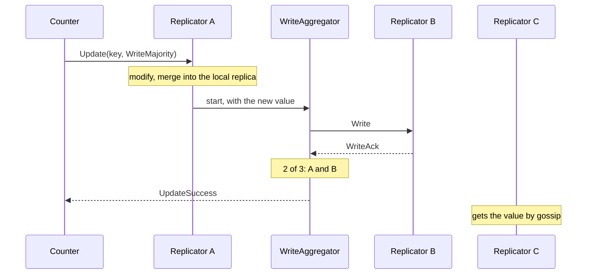
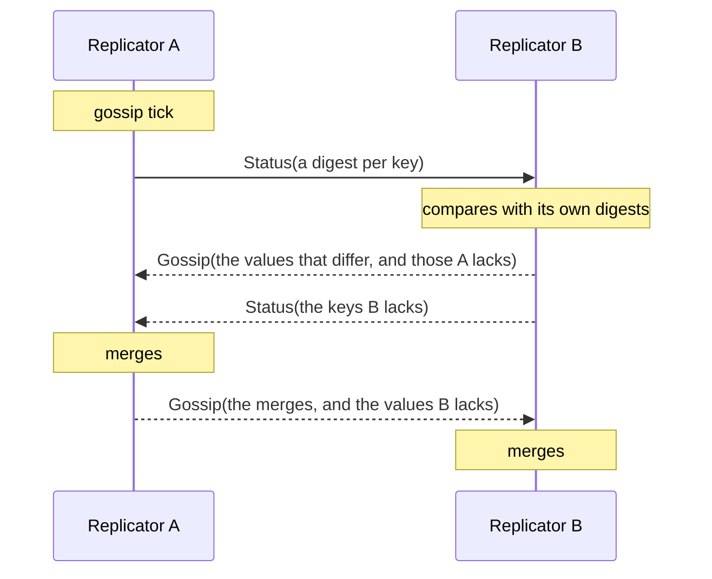
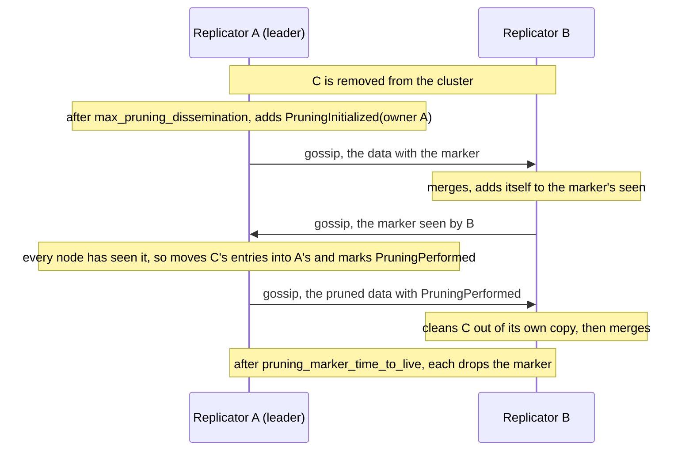

# 14. Distributed Data

## The problem

Some state belongs to the whole cluster and to no one node: how many visitors the site has had, which feature flags are on, which carts are open. Every node needs to read it quickly and update it often, and none of them should wait for the others to do so. A singleton could own it, but then every read and every write is a round trip to one node, and while that node is unreachable, nothing can be written at all.

If each node keeps its own copy and updates it on the spot, the copies drift apart, and two nodes that changed the same value at the same time have to agree on what it now holds. Last write wins loses one of the changes. Asking every node first is slow and fails when one of them is away.

## The idea

Distributed Data keeps the state in **CRDTs**, conflict-free replicated data types: values built so that any two copies can always be merged, and merging gives the same result whatever the order. A grow-only counter, for one, keeps a count per node, and the merge takes the larger count for each node; the value is their sum. Two nodes that each added one, at the same time, merge to two, and nothing is lost.

So each node holds a full copy, a **replica**, and updates it at once. A **Replicator** actor on every node holds the replicas, one per **key**, and spreads them: a write can go to some of the other nodes before it is answered, and in the background the Replicators **gossip**, comparing what they hold and sending each other what differs. Sooner or later every node holds the merge of every update. That is **eventual consistency**: a read on one node may not see a write made on another a moment ago, unless both ask enough nodes.

How many nodes a write or a read waits for is its **consistency level**, chosen per request: only the local replica, a given number of nodes, a majority, or all of them.

`ohra.cluster.ddata` is Apache Pekko's Distributed Data with its typed API, `DistributedData` and `Replicator`. The data types are in the same package.

## A first example

A counter actor that keeps a `GCounter` in the Replicator, increments it, reads it back, and keeps a copy of the latest value it was told about. It is Pekko's `ReplicatorDocSpec`, in [`examples/distributed_data/counter.py`](../../examples/distributed_data/counter.py):

```python
from dataclasses import dataclass

from ohra import ActorContext, ActorRef, Behavior, Behaviors
from ohra.cluster.ddata import (
    DistributedData,
    GCounter,
    GCounterKey,
    Replicator,
    ReplicatorMessageAdapter,
)


@dataclass(frozen=True)
class Increment:
    pass


@dataclass(frozen=True)
class GetValue:
    reply_to: ActorRef[int]


@dataclass(frozen=True)
class GetCachedValue:
    reply_to: ActorRef[int]


@dataclass(frozen=True)
class Unsubscribe:
    pass


@dataclass(frozen=True)
class InternalUpdateResponse:
    rsp: Replicator.UpdateResponse[GCounter]


@dataclass(frozen=True)
class InternalGetResponse:
    rsp: Replicator.GetResponse[GCounter]
    reply_to: ActorRef[int]


@dataclass(frozen=True)
class InternalSubscribeResponse:
    chg: Replicator.SubscribeResponse[GCounter]


type Command = (
    Increment
    | GetValue
    | GetCachedValue
    | Unsubscribe
    | InternalUpdateResponse
    | InternalGetResponse
    | InternalSubscribeResponse
)


def counter(key: GCounterKey) -> Behavior[Command]:
    def setup(ctx: ActorContext[Command]) -> Behavior[Command]:
        node = DistributedData(ctx.system).self_unique_address

        def with_adapter(
            adapter: ReplicatorMessageAdapter[Command, GCounter],
        ) -> Behavior[Command]:
            adapter.subscribe(key, InternalSubscribeResponse)

            def updated(cached_value: int) -> Behavior[Command]:
                def receive(msg: Command) -> Behavior[Command]:
                    match msg:
                        case Increment():
                            adapter.ask_update(
                                lambda reply_to: Replicator.Update(
                                    key,
                                    GCounter(),
                                    Replicator.WriteLocal(),
                                    reply_to,
                                    lambda c: c.increment(node, 1),
                                ),
                                InternalUpdateResponse,
                            )
                            return Behaviors.same
                        case GetValue(reply_to):
                            adapter.ask_get(
                                lambda ask_reply_to: Replicator.Get(
                                    key, Replicator.ReadLocal(), ask_reply_to
                                ),
                                lambda rsp: InternalGetResponse(rsp, reply_to),
                            )
                            return Behaviors.same
                        case GetCachedValue(reply_to):
                            reply_to.tell(cached_value)
                            return Behaviors.same
                        case Unsubscribe():
                            adapter.unsubscribe(key)
                            return Behaviors.same
                        case InternalUpdateResponse():
                            return Behaviors.same  # ok
                        case InternalGetResponse(Replicator.GetSuccess() as rsp, reply_to):
                            reply_to.tell(rsp.get(key).value)
                            return Behaviors.same
                        case InternalGetResponse():
                            return Behaviors.unhandled  # not dealing with failures
                        case InternalSubscribeResponse(Replicator.Changed() as chg):
                            return updated(chg.get(key).value)
                        case InternalSubscribeResponse():
                            return Behaviors.unhandled  # no deletes

                return Behaviors.receive_message(receive)

            return updated(cached_value=0)

        return DistributedData.with_replicator_message_adapter(with_adapter)

    return Behaviors.setup(setup)
```

- **`GCounterKey("counter1")`** names one replicated value, and its type says what the value is: a `GCounter`. The same key on every node is the same counter.
- **`DistributedData(ctx.system)`** is the extension. Its first use starts the node's Replicator, and its `self_unique_address` is the node's identity, which a CRDT records with each change: `c.increment(node, 1)` adds one to this node's count.
- **`with_replicator_message_adapter(with_adapter)`** hands the behavior an adapter. The Replicator answers with its own messages, such as `UpdateSuccess` and `GetSuccess`; the adapter turns them into the actor's `Command`s, as a message adapter does, so the actor needs no second protocol.
- **`Replicator.Update(key, GCounter(), WriteLocal(), reply_to, modify)`** asks the Replicator to apply `modify` to the current value, or to the empty `GCounter()` when the key has none yet. `WriteLocal()` writes this node's replica and answers at once; gossip takes the change to the other nodes.
- **`Replicator.Get(key, ReadLocal(), reply_to)`** reads this node's replica. `GetSuccess` carries the value, and `rsp.get(key)` returns it typed as the key's data.
- **`adapter.subscribe(key, InternalSubscribeResponse)`** asks for a `Changed` whenever the value changes, here or on another node. The counter keeps the last one it saw as `cached_value`, and `GetCachedValue` returns it without asking anyone. `adapter.unsubscribe(key)` stops them.

The Replicator runs only on a cluster node: `DistributedData` raises `RuntimeError` on a system that has no `cluster=ClusterSettings(...)`. So the test runs on the multi-node test kit of [chapter 12](12-testing.md#multi-node-tests), with one role, which gives it a cluster node, a probe and `spawn`. The node never joins a cluster, and does not need to: a local write and a local read work on a node alone. This is the start of [`test_counter.py`](../../examples/distributed_data/test_counter.py), which has Pekko's other two tests too:

```python
from counter import GetValue, Increment, counter
from ohra import ClusterSettings
from ohra.cluster.ddata import GCounterKey
from ohra.testkit import MultiNodeConfig, MultiNodeSpec, TestProbe, multi_node_spec

config = MultiNodeConfig()
config.role("node")
config.common_config(cluster=ClusterSettings())


@multi_node_spec(config)
async def test_have_api_for_update_and_get(spec: MultiNodeSpec):
    c = spec.spawn(counter(GCounterKey("counter1")))

    probe: TestProbe[int] = spec.create_test_probe()
    c.tell(Increment())
    c.tell(GetValue(probe.ref))
    await probe.expect_message(1)
```

`pytest examples/distributed_data` prints `5 passed`.

> **Coming from Apache Pekko**
>
> - The API is cluster-typed's `DistributedData` and `Replicator` in snake_case: `Replicator.Update`, `Get`, `Delete`, `Subscribe` and their responses are nested in `Replicator`, and the consistency levels are dataclasses, `Replicator.WriteLocal()` and `Replicator.ReadMajority(timeout=3.0)`. Timeouts are seconds.
> - `Update(key, initial, writeConsistency, replyTo)(modify)` is `Update(key, initial, write_consistency, reply_to, modify)`, with `modify` as its last field. The types' symbolic operators are named methods taking the node: `c :+ 1` is `c.increment(node, 1)`.
> - The settings are `ReplicatorSettings`, a field of `ClusterSettings` (`distributed_data=`), not HOCON under `pekko.cluster.distributed-data`.
> - Roles are not here: every member is a replica. Subscribers must be on the Replicator's own node. [Appendix B](appendix-deviations.md) has the full list.

## How it works

### The data types

Every type is an immutable value. An update returns a new value, and `merge` combines two replicas. The update methods that record who made a change take the node's `SelfUniqueAddress`, so a node can only write as itself:

| Type | Holds | Updated with | Key |
|---|---|---|---|
| `GCounter` | a count that only grows | `increment(node, n)` | `GCounterKey` |
| `PNCounter` | a count that grows and shrinks | `increment(node, n)`, `decrement(node, n)` | `PNCounterKey` |
| `GSet[A]` | a set that only grows | `add(element)` | `GSetKey[A]` |
| `ORSet[A]` | a set; an add wins over a concurrent remove | `add(node, element)`, `remove(node, element)`, `clear(node)` | `ORSetKey[A]` |
| `ORMap[K, V]` | a map of CRDTs, merged entry by entry | `put(node, key, value)`, `update(node, key, initial, modify)`, `remove(node, key)` | `ORMapKey[K, V]` |
| `LWWMap[K, V]` | a map of plain values; the latest write to an entry wins | `put(node, key, value)`, `remove(node, key)` | `LWWMapKey[K, V]` |
| `PNCounterMap[K]` | a map of counters | `increment(node, key, delta)`, `decrement(node, key, delta)` | `PNCounterMapKey[K]` |
| `ORMultiMap[K, V]` | a map of sets | `add_binding(node, key, element)`, `remove_binding(node, key, element)`, `put(node, key, values)` | `ORMultiMapKey[K, V]` |
| `Flag` | a boolean that can only be switched on | `switch_on()` | `FlagKey` |
| `LWWRegister[A]` | one value; the latest write wins | `LWWRegister.create(node, value)`, `with_value(node, value)` | `LWWRegisterKey[A]` |

`LWWMap` and `LWWRegister` keep the later of two concurrent writes and drop the other, and "later" is decided by a clock, wall time by default, so a node whose clock runs behind can lose its write. A value crosses the network as `@remotable` JSON, so the elements of a set and the keys and values of a map have to be values it can encode: plain ones such as `str` and `int`, or `@remotable` dataclasses.

### The Replicator

`DistributedData(system)` starts the Replicator the first time it is called, under `/system/ddataReplicator`, and returns the same extension after that. `DistributedData(system).replicator` is its `ActorRef[Replicator.Command]`; an actor can tell it directly, with a probe or a message adapter as `reply_to`, or go through `with_replicator_message_adapter`. Tell only the Replicator of your own node: its commands are not `@remotable`, and the Replicators reach each other with messages of their own.

The Replicator follows the cluster's membership. Every member that has been up is a replica until it is removed, while it is leaving or exiting too, and `Replicator.GetReplicaCount(reply_to)` answers `ReplicaCount(n)`, this node included. A weakly-up member is gossiped to but is not counted, and reads and writes do not wait for it. `Replicator.GetKeyIds(reply_to)` answers `GetKeyIdsResult(key_ids)`, the ids of the keys this node holds and has not deleted; it is internal, as in Pekko, and meant for tests. A Replicator that fails restarts empty, and gossip fills it again from the other nodes.

Its settings are `ClusterSettings(distributed_data=ReplicatorSettings(...))`, with Pekko's defaults:

| Setting | Default | What it does |
|---|---|---|
| `name` | `"ddataReplicator"` | the actor's name under `/system` |
| `gossip_interval` | `2.0` | seconds between two gossip rounds |
| `notify_subscribers_interval` | `0.5` | seconds between two rounds of `Changed` |
| `max_delta_elements` | `500` | the keys per gossip chunk, on average between this and twice this; also the most keys one reply sends back |
| `delta_crdt_enabled` | `True` | send [deltas](#delta-propagation) for the types that have them, instead of the full value |
| `max_delta_size` | `50` | the number of operations a merged `ORSet` or `ORMap` delta may hold before it is replaced by a placeholder and the full value is sent instead (adds in a row merge into one operation); must be above `0` |
| `log_data_size_exceeding` | `10 * 1024` | log the size of a value whose encoding is at least this large, in bytes, at INFO (a WARNING from 3/4 of the 16 MiB frame on); `None` turns it off |
| `prefer_oldest` | `False` | read from and write to the oldest nodes first |
| `expire_keys_after_inactivity` | `{}` | key id, or `"prefix*"`, to the seconds after which an untouched key is removed |
| `pruning_interval` | `120.0` | seconds between two [pruning](#pruning) rounds; `0` or less turns pruning off |
| `max_pruning_dissemination` | `300.0` | seconds a removed node's updates are given to reach every node before its data is pruned, counted only while every node is reachable |
| `pruning_marker_time_to_live` | `6 * 3600.0` | seconds the marker that a removed node's data was pruned is kept after the pruning |
| `durable_keys` | `frozenset()` | the [durable](#durable-storage) keys: key ids, or `"prefix*"` |
| `durable_pruning_marker_time_to_live` | `10 * 86400.0` | the same, for durable keys; a durable replica must not stay down longer |
| `durable_store` | `sqlite_durable_store` | a function that returns the store's behavior; `functools.partial` sets its options |

### Update

`Replicator.Update(key, initial, write_consistency, reply_to, modify)` runs `modify` inside the Replicator, on the current value or on `initial`. The result is merged into the local replica, and then written to as many nodes as the consistency level asks for. The answer is one of:

- **`UpdateSuccess(key)`**: the write reached enough nodes.
- **`UpdateTimeout(key)`**: it did not, within the level's timeout, or the level asks for more nodes than the cluster has, as `WriteTo(5, ...)` on three nodes does, which is answered at once. The local write stands, and the other nodes may still receive it, from the write in flight or by gossip. A timeout does not undo anything.
- **`ModifyFailure(key, error_message, cause)`**: `modify` raised, and nothing was written.
- **`UpdateDataDeleted(key)`**: the key has been deleted.
- **`StoreFailure(key)`**: the key is [durable](#durable-storage) and its store could not write the value. The value is merged into the local replica all the same.

`modify` must be a pure function of the value it is given. It runs in the Replicator, not in your actor, so it must not touch your actor's state, and it may run on a value that already holds updates from other nodes.

### Get

`Replicator.Get(key, consistency, reply_to)` reads the key. With a level other than `ReadLocal`, the Replicator asks other nodes for their replicas, merges what comes back with its own, and stores the merge locally before it answers:

- **`GetSuccess(key, data)`**, with `get(key)` to read `data` typed as the key's.
- **`NotFound(key)`**: no node asked had the key.
- **`GetFailure(key)`**: too few nodes answered within the level's timeout. `ReadLocal` never fails this way.
- **`GetDataDeleted(key)`**: the key has been deleted.

### Consistency levels

A write and a read each take a level. Every level but the local ones has a `timeout`, in seconds:

| Write | Read | Waits for |
|---|---|---|
| `WriteLocal()` | `ReadLocal()` | this node only |
| `WriteTo(n, timeout)` | `ReadFrom(n, timeout)` | `n` nodes, this one included |
| `WriteMajority(timeout, min_cap=0)` | `ReadMajority(timeout, min_cap=0)` | `N // 2 + 1` of the `N` replicas, or `min_cap` when that is more, at most `N` |
| `WriteMajorityPlus(timeout, additional, min_cap=0)` | `ReadMajorityPlus(timeout, additional, min_cap=0)` | a majority plus `additional`, at most `N` |
| `WriteAll(timeout)` | `ReadAll(timeout)` | every replica |

A read sees a write when the two sets of nodes overlap: when the nodes written plus the nodes read are more than `N`. `WriteMajority` with `ReadMajority` always overlap. `WriteLocal` with `ReadLocal` is fastest, and still sees the write once gossip has carried it. `WriteAll` and `ReadAll` time out when a single node does not answer, and `WriteTo(n)` or `ReadFrom(n)` with `n` larger than the cluster fails at once. `*MajorityPlus` and `*All` leave out members that are exiting, since they are about to go. On a node alone, `*Majority` and `*All` run locally, and `*MajorityPlus` starts an aggregator that has no node to wait for and succeeds at once, with the same result.

The Replicator sends the request to the nodes it needs, reachable ones first, and after a fifth of the timeout also to up to 10 of the others (`MAX_SECONDARY_NODES`), in case some of the first ones are slow or gone. A write with `WriteMajority` on three nodes:



The two-node test in [`test_replicator.py`](../../examples/distributed_data/test_replicator.py) shows it: a write with `WriteMajority` on one node is in the other's replica, read with `ReadLocal`, as soon as the write is answered. Each node subscribes a probe first, and both see the `Changed`; then a `Delete` from the second node reaches both subscribers as `Deleted`:

```python
from ohra import Address, Cluster, ClusterSettings, Join
from ohra.cluster.ddata import DistributedData, GCounter, GCounterKey, Replicator
from ohra.testkit import MultiNodeConfig, MultiNodeSpec, TestProbe, multi_node_spec

two_nodes = MultiNodeConfig()
first = two_nodes.role("first")
second = two_nodes.role("second")
two_nodes.common_config(cluster=ClusterSettings())

VISITS = GCounterKey("visits")


@multi_node_spec(two_nodes)
async def test_a_majority_write_reaches_the_other_node(spec: MultiNodeSpec):
    replicator = DistributedData(spec.system).replicator
    node = DistributedData(spec.system).self_unique_address

    Cluster(spec.system).manager.tell(Join(Address.parse(spec.node(first))))
    count: TestProbe[Replicator.ReplicaCount] = spec.create_test_probe()

    async def both_are_replicas() -> None:
        replicator.tell(Replicator.GetReplicaCount(count.ref))
        assert await count.receive_message() == Replicator.ReplicaCount(2)

    await spec.await_assert(both_are_replicas, max=10.0)
    changes: TestProbe[Replicator.SubscribeResponse[GCounter]] = spec.create_test_probe()
    replicator.tell(Replicator.Subscribe(VISITS, changes.ref))
    await spec.enter_barrier("replicas")

    if spec.is_node(first):
        updated: TestProbe[Replicator.UpdateResponse[GCounter]] = spec.create_test_probe()
        replicator.tell(
            Replicator.Update(
                VISITS,
                GCounter(),
                Replicator.WriteMajority(timeout=3.0),
                updated.ref,
                lambda c: c.increment(node, 1),
            )
        )
        await updated.expect_message(Replicator.UpdateSuccess(VISITS))
    await spec.enter_barrier("written")

    if spec.is_node(second):
        got: TestProbe[Replicator.GetResponse[GCounter]] = spec.create_test_probe()
        replicator.tell(Replicator.Get(VISITS, Replicator.ReadLocal(), got.ref))
        reply = await got.receive_message()
        assert isinstance(reply, Replicator.GetSuccess)
        assert reply.get(VISITS).value == 1
    change = await changes.receive_message()
    assert isinstance(change, Replicator.Changed)
    assert change.get(VISITS).value == 1
    await spec.enter_barrier("read")

    if spec.is_node(second):
        deleted: TestProbe[Replicator.DeleteResponse[GCounter]] = spec.create_test_probe()
        replicator.tell(Replicator.Delete(VISITS, Replicator.WriteAll(timeout=3.0), deleted.ref))
        await deleted.expect_message(Replicator.DeleteSuccess(VISITS))
    await changes.expect_message(Replicator.Deleted(VISITS))
    await spec.enter_barrier("deleted")
```

- **Both nodes join the first**, as in [chapter 5](05-cluster.md), and wait until their Replicator counts two replicas. Before that, the first node's Replicator would see no other node and write locally only.
- **Of two replicas, a majority is two,** so `UpdateSuccess` means the second node has the value, and its `ReadLocal` finds it.
- **The probes are plain subscribers.** `Replicator.Subscribe(key, ref)` is what `adapter.subscribe` sends for you.

### Subscriptions

`Replicator.Subscribe(key, subscriber)` registers a subscriber for a key, and `Unsubscribe(key, subscriber)` removes it. The Replicator collects the keys that changed, by a local update or by a write or gossip from another node, and every `notify_subscribers_interval` tells each subscriber of a changed key one `Changed(key, data)` with the latest value. Ten updates within one interval are one `Changed`. A new subscriber to a key that has a value gets a `Changed` at the next round, and `Replicator.FlushChanges()` runs a round at once.

A key id that ends with `*` subscribes to every key whose id starts with the rest, as `GCounterKey("visits-*")`. The subscriber gets a `Changed` for each matching key, with that key in it.

A subscriber also gets `Deleted(key)` when the key is deleted, and `Expired(key)` when it expires. It is watched, and removed when it stops.

**Subscribers are local.** `Changed`, `Deleted` and `Expired` are not `@remotable`, so a subscriber on another node never receives them: the Replicator logs an error and drops each one. To follow a key on every node, subscribe on every node, to that node's Replicator.

### Delete

`Replicator.Delete(key, consistency, reply_to)` deletes a key, with a write consistency level as `Update` takes. It answers `DeleteSuccess(key)`, `DeleteFailure(key)` when too few nodes acknowledged it in time, or `DataDeleted(key)` when the key was already deleted. A failed delete still deletes the local replica, and gossip carries it on.

A deleted key stays deleted, everywhere, for good: from then on `Get` answers `GetDataDeleted`, `Update` answers `UpdateDataDeleted` and `Delete` answers `DataDeleted`, and the key cannot be used again. The Replicator keeps a marker for it, which it gossips, so a stream of keys created and deleted grows without bound. For entries that come and go, use one `ORMap` or `ORSet` and remove from it.

### Expiry

`expire_keys_after_inactivity` removes keys that nobody has touched for a while. A `Get`, an `Update` or a `Delete` on any node touches the key, and the nodes share when each key was last touched as they gossip. On each gossip round, a key past its time is removed, without a marker, and its subscribers get `Expired`. After that, a `Get` answers `NotFound`, and an `Update` starts the key again from `initial`. From [`test_replicator.py`](../../examples/distributed_data/test_replicator.py):

```python
from ohra import ClusterSettings
from ohra.cluster.ddata import (
    DistributedData,
    GCounter,
    GCounterKey,
    Replicator,
    ReplicatorSettings,
)
from ohra.testkit import MultiNodeConfig, MultiNodeSpec, TestProbe, multi_node_spec

one_node = MultiNodeConfig()
one_node.role("node")
one_node.common_config(
    cluster=ClusterSettings(
        distributed_data=ReplicatorSettings(
            gossip_interval=0.2, expire_keys_after_inactivity={"session-*": 1.0}
        )
    )
)

SESSION = GCounterKey("session-42")


@multi_node_spec(one_node)
async def test_an_untouched_key_expires(spec: MultiNodeSpec):
    replicator = DistributedData(spec.system).replicator
    node = DistributedData(spec.system).self_unique_address

    updated: TestProbe[Replicator.UpdateResponse[GCounter]] = spec.create_test_probe()
    replicator.tell(
        Replicator.Update(
            SESSION, GCounter(), Replicator.WriteLocal(), updated.ref, lambda c: c.increment(node)
        )
    )
    await updated.expect_message(Replicator.UpdateSuccess(SESSION))

    changes: TestProbe[Replicator.SubscribeResponse[GCounter]] = spec.create_test_probe()
    replicator.tell(Replicator.Subscribe(SESSION, changes.ref))
    await changes.expect_message(Replicator.Changed(SESSION, GCounter().increment(node)))
    await changes.expect_message(Replicator.Expired(SESSION), 3.0)

    got: TestProbe[Replicator.GetResponse[GCounter]] = spec.create_test_probe()
    replicator.tell(Replicator.Get(SESSION, Replicator.ReadLocal(), got.ref))
    await got.expect_message(Replicator.NotFound(SESSION))
```

`"session-*"` covers every key whose id starts with `session-`, and a key id without `*` names one key. A time of `0` never expires. The key is removed on a gossip round, so it can outlive its time by up to `gossip_interval`, which is shortened here.

### The message adapter

`ReplicatorMessageAdapter[M, A]` is what `with_replicator_message_adapter` hands over: the actor's message type `M` and the data type `A`. Each method takes a function that builds the request from a `reply_to`, and a function that turns the response into an `M`:

- **`ask_update(create_request, response_adapter)`**, `ask_get` and `ask_delete`, as in the counter. They are `ctx.ask`s under the hood, so a response arrives as a message, in order with the actor's other messages.
- **`ask_replica_count(create_request, response_adapter)`**, for `GetReplicaCount`.
- **`subscribe(key, response_adapter)`** and **`unsubscribe(key)`**. The adapter subscribes a message adapter of the actor, so the subscription ends when the actor stops.

The Replicator always answers within the request's own timeout, so the ask's timeout is only a safety net: `with_replicator_message_adapter(factory, unexpected_ask_timeout=20.0)`. If it ever passes, the `response_adapter` gets `GetFailure`, `UpdateTimeout` or `DeleteFailure` for the request's key.

### Gossip

A write at any level reaches the other nodes in the end through gossip. Every `gossip_interval`, each Replicator picks one other node at random, weakly-up ones included, and sends it a `Status`: one digest per key, a hash of the key's value. The other side compares them with its own, sends back a `Gossip` with the values whose digests differ and the values the first one lacks, and a `Status` of its own for the keys it lacks itself. Each side merges what it receives, and sends back its merge of a value both held, so both end up with the same:



- **Equal values have equal digests,** whatever order their updates arrived in. A digest is the SHA-1 of the value's JSON with every set and map sorted, so two nodes holding the same merge stop sending it to each other.
- **Many keys go in chunks.** With more than `max_delta_elements` keys, the keys are split by a hash of their ids into `len(keys) // max_delta_elements` chunks, rounded down, so a chunk holds on average from `max_delta_elements` keys to nearly twice as many. A round sends up to 10 chunks, each in a `Status` of its own: the first round starts at a random chunk, and each later one goes on from there. The other side sends back at most `max_delta_elements` keys for each `Status`.
- **A gossip message is split to fit a frame.** A frame holds at most 16 MiB of JSON, measured before compression. Remoting gzips any frame over 32 KiB, so large sets and maps travel compressed, but compression does not raise that limit.
- **A restarted node is not confused with its old self.** A `Status` names the system it was meant for, and a node that restarted on the same address ignores one meant for its previous run.

### Pruning

A `GCounter` keeps a count for every node that ever incremented it, and an `ORSet` keeps, for every element, the dots of the nodes that added it, with a version vector that has an entry for each of them. Those entries are part of the value, so they stay when their node leaves the cluster for good. A cluster that replaces its nodes often, with a rolling deploy for one, would see such values grow by an entry for every node that ever wrote to them.

So the Replicator **prunes** the data of a removed node: it moves the node's entries into those of a node that is still there. The value does not change. A `GCounter` that holds 3 from a removed node C still reads 3, now counted under the node that pruned it, and it no longer names C. The counters, `ORSet`, the maps and `ORMultiMap` are pruned. `GSet`, `Flag` and `LWWRegister` keep no entry per node and are left alone.

The danger is a double count: if one node moved C's 3 into its own entry while another still held C's 3, their merge would count those 3 twice. So pruning runs as a protocol of **markers**, which travel inside the replicated value, by the same writes and gossip as the data. With C removed from a cluster of A, the leader, and B:



The leader starts and the owner prunes on a pruning round, every `pruning_interval`; in between, the markers move with the data:

- **C's updates spread first.** Every node notes when C was removed, and the leader waits `max_pruning_dissemination` from then, five minutes by default, so that C's last updates have reached every node. The leader also finds removed nodes in the data itself: a node that a value names, that is not a member the Replicator gossips to, and that is not already known as removed, such as a node removed before this one joined. Its wait starts when the leader finds it.
- **The leader starts it.** The leader is the first of the up and leaving members in address order, while it is up itself. Once the wait is over, it adds a `PruningInitialized` marker for C to every value that names C, with itself as the owner.
- **The marker spreads.** Each node that receives the value merges it and adds itself to the marker's `seen`. Markers merge too, so the owner learns who has seen its marker as the gossip comes back.
- **The owner prunes once every node has seen it.** On a round where every other node it gossips to is in `seen`, or at once when it has no other node, the owner moves C's entries into its own and replaces the marker with `PruningPerformed`, which nobody undoes: when two markers for C merge, the performed one wins, so no node prunes C a second time. Every member counts, so a member that has not started `DistributedData` holds pruning up for the whole cluster. If the owner itself leaves before it prunes, its marker still wins every merge over a later leader's, as in Pekko, and C is never pruned.
- **Stale copies are cleaned on merge.** While a value carries `PruningPerformed` for C, every merge first takes C's entries out of both sides, and only then merges the data. A node that still holds C's old entries, or a write that carries them, cannot bring C's count back.
- **The markers go.** `PruningPerformed` carries a wall-clock time, `pruning_marker_time_to_live` after the pruning, six hours by default. Once that time has passed, each node drops the marker and forgets C. A copy of C's old entries that turned up after that, from a partition that outlasted it, would be merged in as if C were new, and the value would no longer be right. That is why the time is in hours.

**A split pauses pruning.** While any node is unreachable, the pruning rounds are skipped: nothing is collected, started or pruned, and no expired marker is dropped. The clock that times `max_pruning_dissemination` stops as well, so a removed node's updates get their full time with every node reachable. None of this changes what a `Get` reads, before, during or after the pruning.

The three settings are in the [table above](#the-replicator). A cluster whose partitions can outlast six hours can give the updates more time and keep the markers longer:

```python
from ohra import ClusterSettings
from ohra.cluster.ddata import ReplicatorSettings

settings = ClusterSettings(
    distributed_data=ReplicatorSettings(
        max_pruning_dissemination=600.0, pruning_marker_time_to_live=24 * 3600.0
    )
)
```

`pruning_interval=0` turns pruning off, as Pekko's `pruning-interval = off` does, and every value then keeps the entries of every node that ever wrote to it.

### Durable storage

By default every replica lives in memory, so a cluster that stops as a whole loses its data. A **durable key** is kept on disk as well. The Replicator writes every change to a durable key to its store before it answers, and a node that restarts loads its durable keys back before it serves anything. Keys that are not durable never reach the store.

`durable_keys` lists them, as exact key ids or as `prefix*`:

```python
from functools import partial

from ohra import ClusterSettings
from ohra.cluster.ddata import ReplicatorSettings, sqlite_durable_store

settings = ClusterSettings(
    distributed_data=ReplicatorSettings(
        durable_keys=frozenset({"cart-total", "session-*"}),
        durable_store=partial(
            sqlite_durable_store, "/var/lib/app/ddata-store", write_behind_interval=0.2
        ),
    )
)
```

- **What a store does.** A local `Update` or `Delete` of a durable key is answered after the store has answered: `UpdateSuccess` or `DeleteSuccess` when it wrote the value, `StoreFailure(key)` when it could not. At a level above `WriteLocal`, the write also waits for the local store, next to the other nodes. A `Write` that changes a durable key is acknowledged once the store has stored it. A `ReadRepair` or a gossip that changes one is sent to the store and answered at once; a gossip is not answered.
- **While it loads.** A Replicator with durable keys starts by asking its store for everything. Until the load is done it stashes your commands and answers them, in order, afterwards. It drops the traffic of other Replicators, so a node that is still loading does not take part in reads, writes or gossip, and `GetReplicaCount` answers `0`. If the load fails, or the store stops later, the Replicator logs an error and stops.
- **Where the files go.** `sqlite_durable_store(dir="ddata", write_behind_interval=0.0)` keeps a SQLite database, `<dir>/ddata.db`, created on first use. A `dir` that ends in `ddata` becomes `<dir>-<system name>-<replicator name>-<port>`, so that several nodes on one host do not share a directory. Any other path is used as given. A node on a dynamic port (`0`) gets a new directory on every start and never finds its old data, so production sets a fixed path of its own, as in the example, one for each node.
- **Write-behind.** With `write_behind_interval=0.0` each change is committed before it is answered. A positive interval collects the changes and commits them together once it has passed, writing only the last value of each key, which pays when a few keys change often. The answer then comes as soon as the store has accepted the change, not when it is on disk, so a process that is killed loses up to one interval of changes. Stopping the store writes what is waiting first.
- **A durable replica must not stay down too long.** Pruning (above) leaves a marker that a removed node's data was pruned, and drops it after a time. A durable replica that was down while the others pruned still holds that node's old entries. If it comes back while the markers exist, the markers clean the entries out. If it comes back after they are gone, nothing recognizes the entries as old, and they are merged in as if the removed node were new, which leaves the value wrong. So for durable keys the marker is kept for `durable_pruning_marker_time_to_live`, ten days by default, and a durable replica must not be stopped for longer than that. One that has to be stopped longer joins again only after its directory is deleted.
- **Another store.** `durable_store` is a function that returns the store's behavior, and the Replicator spawns it as a child. The behavior handles `DurableStore.LoadAll(reply_to)`, to which it answers with zero or more `LoadData(data)`, a mapping of key to `DurableDataEnvelope`, and then `LoadAllCompleted()` (the SQLite store sends at most one `LoadData`); `DurableStore.Store(key, data, reply)`, to which it answers `reply.success` or `reply.failure` to `reply.reply_to` when `reply` is not `None`; and `DurableStore.Expire(keys)`, which removes keys. A store that cannot load raises `DurableStore.LoadFailed`. The stored value is the JSON of `DurableDataEnvelope`, which holds the data and the `PruningPerformed` markers and nothing else.

> **Coming from Apache Pekko**
>
> - `sqlite_durable_store` takes the place of `LmdbDurableStore`: SQLite is in the standard library, and the core has no dependencies. `durable.store-actor-class` is `durable_store`, a behavior factory.
> - `durable.lmdb.dir` and `durable.lmdb.write-behind-interval` are the parameters of `sqlite_durable_store`, and there is no `map-size`. [Appendix B](appendix-deviations.md) has the rest.

### Delta propagation

A **delta** is the change an `Update` made, without the rest of the value: adding one element to an `ORSet` of ten thousand sends that one `add`, not the set. The types that can describe their changes this way are the delta-CRDTs, and each reports its change through `delta`. The Replicator takes it right after `modify` runs, files it under the key with a version number, and then sends it in two ways. A write that reaches other nodes sends the delta first: a causal delta as a `DeltaPropagation`, which the other nodes merge into their copy, and any other delta inside the `Write` itself. And a tick sends a few nodes at a time the deltas they have not been sent yet.

Deltas come in two kinds. Some may be applied in any order and any number of times: `GCounter`, `PNCounter` and `GSet`. The others must be applied in the order they were made, each exactly once, because a delta such as "remove this element" means nothing to a node that has not seen the add before it. Their deltas are `RequiresCausalDeliveryOfDeltas`: those of `ORSet`, `ORMap` and the types built on it, `LWWMap`, `PNCounterMap` and `ORMultiMap`. A value that has no delta, such as `Flag` or `LWWRegister`, is always sent whole.

For the causal kind, the sender numbers its deltas of a key 1, 2, 3, and the receiver remembers the last number it applied from each node. A delta whose numbers are already applied is skipped. A delta that starts after the next expected number has a gap in front of it, so the receiver skips it and answers `DeltaNack`; the write aggregator then sends that node the full `Write` instead. A gap found on the tick has no one waiting for a reply: the node catches up by gossip. A change that has no delta, or a merged `ORSet` or `ORMap` delta of `max_delta_size` operations or more, is replaced by a placeholder that counts as a version but is never sent, so the receiver sees a gap there too and waits for the full value.

- **The tick.** Every `max(gossip_interval / 5, 0.2)` seconds, so 0.4 seconds with the default gossip interval, the Replicator sends each node in a slice the deltas it has not been sent. The slice is `min(max(n // 5 + 1, 2), min(n, 10))` of the `n` other nodes, taken round-robin: from 2 to 10 nodes per tick, all of them when there are no more than that, and a different slice on the next tick. Every fifth tick, the Replicator also drops the deltas that have gone to every node.
- **Gossip is the safety net.** Deltas are an optimization on top of gossip, not a replacement. Gossip still compares digests and sends the full value of any key on which two nodes differ, so a delta that was lost, skipped or cut off is repaired by the next round. Every full envelope carries the sender's delta version, so a node that receives the value by gossip or by a `Write` carries on from that version with the next delta.
- **Large propagations are not split.** A `DeltaPropagation` over the frame size is dropped with an error log, and gossip delivers the value later.
- **Mixed clusters.** A node with `delta_crdt_enabled=False` ignores deltas that arrive, answering `DeltaNack` to a write, and sends none of its own; the cluster still converges by full values.

To turn deltas off, so that every write and every round of gossip carries the full value:

```python
from ohra import ClusterSettings
from ohra.cluster.ddata import ReplicatorSettings

settings = ClusterSettings(distributed_data=ReplicatorSettings(delta_crdt_enabled=False))
```

> **Coming from Apache Pekko**
>
> - `delta-crdt.enabled` and `delta-crdt.max-delta-size` are `delta_crdt_enabled` and `max_delta_size`. The control flow is Pekko's, function for function, including that a propagation is not split. [Appendix B](appendix-deviations.md) lists the differences in the messages.

### Limits

All the data is in memory, on every node, and gossip sends the whole value of a key, and so does a write for a type without deltas; for a type with deltas, a write and the [propagation tick](#delta-propagation) send only the change. That suits many small keys, or a few of moderate size; Pekko's guidance of at most 100,000 top-level keys holds here too. A value whose encoding is at least `log_data_size_exceeding` bytes has its size logged at INFO, and at WARNING once it reaches 3/4 of the frame, as Pekko does. One whose JSON is larger than 16 MiB cannot be sent at all, compressed or not.

CRDTs hold state, not commands. A value that has to be decided once, such as which node owns a cart, needs one owner, a [singleton](06-singleton.md) or [sharding](07-sharding.md), rather than a merge.

### Not here yet

Later parts are planned to move the receptionist ([chapter 2](02-actor-system.md)) onto an `ORMultiMap`, and the sharding coordinator's state ([chapter 7](07-sharding.md)) onto Distributed Data, as Pekko keeps them.

---

[← Streams](13-streams.md) · [Contents](README.md) · [Appendix A: Apache Pekko names →](appendix-pekko-names.md)
