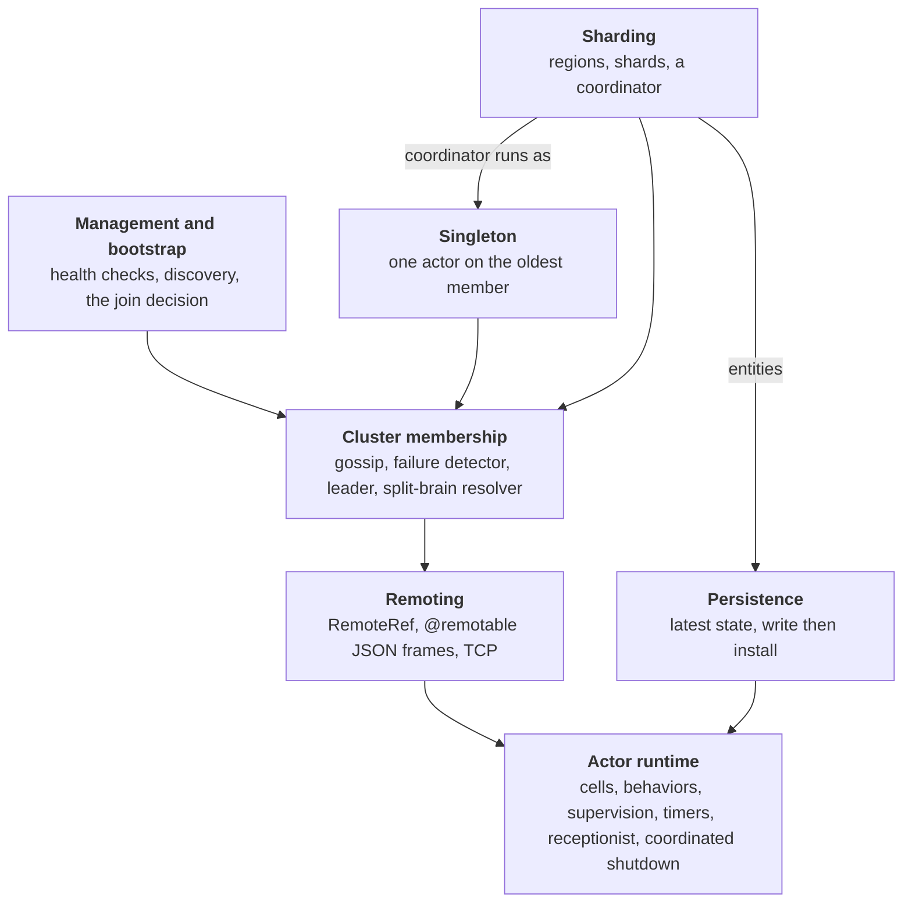

# How ohra works

ohra runs Apache Pekko Typed on one asyncio event loop per process, in pure Python with no dependencies. Every feature is built from one primitive: an actor that handles one message at a time and returns its next behavior. Remoting, the cluster, sharding and persistence are all actors on top of it.

## Reading paths

Every chapter opens the same way: **the problem** it solves, **the idea** in plain words, **a first example** you can run, and a box for readers **coming from Apache Pekko**. **How it works** follows, as the reference.

- **New to actors.** Read the chapters in order, each one up to "How it works", and come back for the rest when you need it. The examples build on chapter 1's `cart.py`, and all but the web app and the Kubernetes cluster run with one command. The [glossary](glossary.md) has every term in plain words.
- **Coming from Apache Pekko or Akka.** Skim the box near the top of each chapter for the names and the differences that matter, then read "How it works" for the layers you use. [Appendix A](appendix-pekko-names.md) maps every name, and [appendix B](appendix-deviations.md) lists every deviation.
- **Contributing.** "How it works" describes the actors behind each feature, ported from the Apache Pekko source. Read it with [CONTRIBUTING.md](../../CONTRIBUTING.md), which has the runtime invariants and the checks.

## At a glance

Each layer is a set of actors and uses only the layers under it. The core runtime knows nothing about the network. Remoting makes a ref point at another process. The cluster, the singleton and sharding are actors that talk to their peers through remoting. Persistence and management sit beside them, used by whoever needs them. An arrow reads "uses".

| Layer | Package | Apache Pekko module |
| --- | --- | --- |
| Actor runtime | `cell.py`, `behavior.py`, `system.py` | actor-typed |
| Remoting | `remote/` | remote (Artery) |
| Cluster membership, split-brain resolver | `cluster/core.py`, `cluster/sbr.py` | cluster-typed |
| Singleton | `cluster/singleton.py` | cluster-tools |
| Sharding | `cluster/sharding/` | cluster-sharding-typed |
| Persistence | `persistence.py` | persistence-typed (durable state) |
| Management, bootstrap, discovery | `management/`, `discovery.py` | pekko-management |

## Contents

1. [Actors](01-actors.md)
2. [The actor system](02-actor-system.md)
3. [Persistence](03-persistence.md)
4. [Remoting](04-remoting.md)
5. [Cluster membership](05-cluster.md)
6. [Cluster singleton](06-singleton.md)
7. [Sharding](07-sharding.md)
8. [Management and Kubernetes](08-management-and-kubernetes.md)
9. [FastAPI](09-fastapi.md)
10. [numpy and shared memory](10-numpy-and-shared-memory.md)
11. [Putting it together: one cart request](11-putting-it-together.md)

Appendices

- [Appendix A: Apache Pekko names](appendix-pekko-names.md)
- [Appendix B: Known deviations from Apache Pekko](appendix-deviations.md)
- [Appendix C: Performance](appendix-performance.md)
- [Glossary](glossary.md)
